# Awesome Gemini 4 Hydrogen

English · [简体中文](README.zh-CN.md)

[](https://awesome.re) [](#contents) [](docs/prompts.md) [](https://github.com/sandbase-lab/awesome-gemini-4-hydrogen/actions/workflows/sync.yml) [](https://www.sandbase.ai/model/google/gemini-4-hydrogen?utm_source=github&utm_medium=readme&utm_campaign=awesome-gemini-4-hydrogen)

[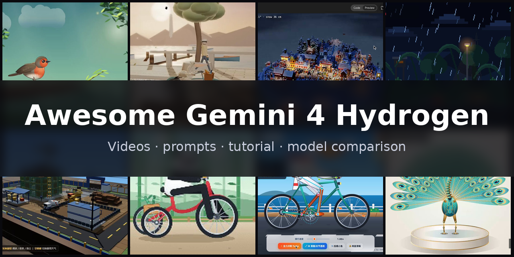](https://www.sandbase.ai/lab/ai-videos/gemini-4-hydrogen?utm_source=github&utm_medium=readme&utm_campaign=awesome-gemini-4-hydrogen&utm_content=banner)

A curated list of **Gemini 4 Hydrogen examples**: videos, prompts and demos made with Google's Gemini 4 Hydrogen, announced on November 12, 2026. Three.js 3D scenes, SVG and canvas animation, motion graphics, product UI and playable browser games, most of them written as one self-contained HTML or SVG file from a prompt, each one credited to its creator and linked to the original post.

**219 videos** from **143 creators** · **50** with the creator's prompt · synced daily from [SandBase Lab](https://www.sandbase.ai/lab/ai-videos/gemini-4-hydrogen?utm_source=github&utm_medium=readme&utm_campaign=awesome-gemini-4-hydrogen&utm_content=stats)

## Start here

| I want to… | Go to |
|---|---|
| Watch the videos | [Browse by category](#contents) below, or [play them full-size on SandBase Lab](https://www.sandbase.ai/lab/ai-videos/gemini-4-hydrogen?utm_source=github&utm_medium=readme&utm_campaign=awesome-gemini-4-hydrogen&utm_content=quickstart) |
| Copy a prompt | [Prompt index](docs/prompts.md): every video that comes with its prompt |
| Write your own prompt | [Prompt guide](docs/prompt-guide.md): 7 patterns and a fill-in template |
| Make a video | [Tutorial](docs/tutorial.md): prompt → HTML → MP4, with the API and a recording script |
| Pick a model | [Gemini 4 Hydrogen against the creator reports and the Lab measurements](docs/model-comparison.md) |
| Try it now | [Run Gemini 4 Hydrogen in the Lab arena](https://www.sandbase.ai/arena/text?models=google%2Fgemini-4-hydrogen&utm_source=github&utm_medium=readme&utm_campaign=awesome-gemini-4-hydrogen&utm_content=quickstart), next to other models |

<a id="contents"></a>

## Contents

- [Featured](#featured) (8)
- [3D scenes](#3d-scene) (67)
- [Motion graphics](#motion-graphics) (36)
- [Games](#game) (19)
- [Product UI](#ui-demo) (8)
- [Particles & shapes](#particles) (2)
- [Charts & diagrams](#data-viz) (1)
- [Explainers](#explainer) (4)
- [Tests & comparisons](#comparison) (82)
- [Recreate a video with Gemini 4 Hydrogen](#recreate)
- [FAQ](#faq)
- [Suggest a video](#contribute)

Click a preview to play the video. Click a title for the post, the prompt and **Recreate** on SandBase Lab. **@handle** links to the creator's post on X.

<a id="featured"></a>

## Featured

<table>
<tr><td width="33%" valign="top"><a href="https://www.sandbase.ai/lab/media/x/gemini-4-hydrogen/2121745863827697687/video.mp4">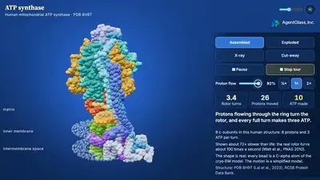</a><br><a href="https://www.sandbase.ai/lab/ai-videos/gemini-4-hydrogen/2121745863827697687?utm_source=github&utm_medium=readme&utm_campaign=awesome-gemini-4-hydrogen&utm_content=card"><b>Mitochondrial motor simulation created with Gemini 4</b></a><br><sub><a href="https://x.com/SidraMiconi/status/2121745863827697687">@SidraMiconi</a> · 0:26 · <a href="https://www.sandbase.ai/lab/ai-videos/gemini-4-hydrogen/2121745863827697687?utm_source=github&utm_medium=readme&utm_campaign=awesome-gemini-4-hydrogen&utm_content=card">prompt</a></sub></td><td width="33%" valign="top"><a href="https://www.sandbase.ai/lab/media/x/gemini-4-hydrogen/2121622062317895753/video.mp4">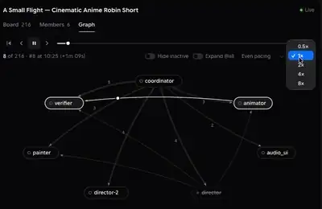</a><br><a href="https://www.sandbase.ai/lab/ai-videos/gemini-4-hydrogen/2121622062317895753?utm_source=github&utm_medium=readme&utm_campaign=awesome-gemini-4-hydrogen&utm_content=card"><b>Swarm graph page from Antigravity</b></a><br><sub><a href="https://x.com/LuminaBench/status/2121622062317895753">@LuminaBench</a> · 0:20</sub></td><td width="33%" valign="top"><a href="https://www.sandbase.ai/lab/media/x/gemini-4-hydrogen/2121465962863919238/video.mp4">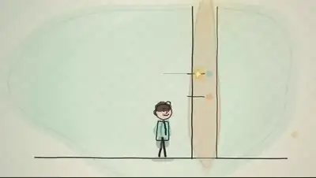</a><br><a href="https://www.sandbase.ai/lab/ai-videos/gemini-4-hydrogen/2121465962863919238?utm_source=github&utm_medium=readme&utm_campaign=awesome-gemini-4-hydrogen&utm_content=card"><b>Hand-drawn animation with Gemini 4 Hydrogen</b></a><br><sub><a href="https://x.com/hakmgpt/status/2121465962863919238">@hakmgpt</a> · 0:45</sub></td></tr>
<tr><td width="33%" valign="top"><a href="https://www.sandbase.ai/lab/media/x/gemini-4-hydrogen/2124730278992367846/video.mp4">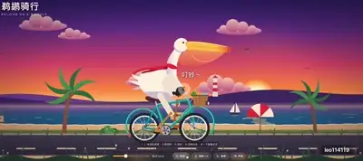</a><br><a href="https://www.sandbase.ai/lab/ai-videos/gemini-4-hydrogen/2124730278992367846?utm_source=github&utm_medium=readme&utm_campaign=awesome-gemini-4-hydrogen&utm_content=card"><b>An SVG animation of a pelican riding a bicycle</b></a><br><sub><a href="https://x.com/leo114119/status/2124730278992367846">@leo114119</a></sub></td><td width="33%" valign="top"><a href="https://www.sandbase.ai/lab/media/x/gemini-4-hydrogen/2121877676042682538/video.mp4">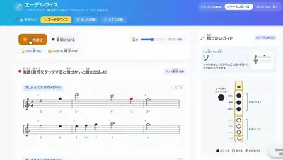</a><br><a href="https://www.sandbase.ai/lab/ai-videos/gemini-4-hydrogen/2121877676042682538?utm_source=github&utm_medium=readme&utm_campaign=awesome-gemini-4-hydrogen&utm_content=card"><b>Recorder music guide app built with Gemini 4</b></a><br><sub><a href="https://x.com/nin222/status/2121877676042682538">@nin222</a> · 0:42</sub></td><td width="33%" valign="top"><a href="https://www.sandbase.ai/lab/media/x/gemini-4-hydrogen/2124421508563149279/video.mp4">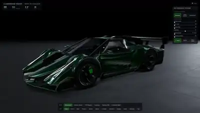</a><br><a href="https://www.sandbase.ai/lab/ai-videos/gemini-4-hydrogen/2124421508563149279?utm_source=github&utm_medium=readme&utm_campaign=awesome-gemini-4-hydrogen&utm_content=card"><b>A 3D Lamborghini Veneno in Three.js</b></a><br><sub><a href="https://x.com/Leviwoyun/status/2124421508563149279">@Leviwoyun</a></sub></td></tr>
<tr><td width="33%" valign="top"><a href="https://www.sandbase.ai/lab/media/x/gemini-4-carbon/2121612131615621212/video.mp4">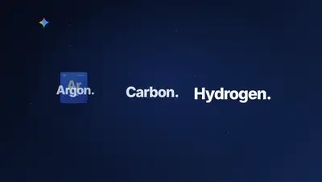</a><br><a href="https://www.sandbase.ai/lab/ai-videos/gemini-4-hydrogen/2121612131615621212?utm_source=github&utm_medium=readme&utm_campaign=awesome-gemini-4-hydrogen&utm_content=card"><b>Explainer on Gemini 4 model naming tiers</b></a><br><sub><a href="https://x.com/HarshithLucky3/status/2121612131615621212">@HarshithLucky3</a> · 0:15</sub></td><td width="33%" valign="top"><a href="https://www.sandbase.ai/lab/media/x/gemini-4-carbon/2122645874249699423/video.mp4"></a><br><a href="https://www.sandbase.ai/lab/ai-videos/gemini-4-hydrogen/2122645874249699423?utm_source=github&utm_medium=readme&utm_campaign=awesome-gemini-4-hydrogen&utm_content=card"><b>Calling Gemini 4 Hydrogen from AI assistants</b></a><br><sub><a href="https://x.com/HimazinProducer/status/2122645874249699423">@HimazinProducer</a> · 0:10</sub></td></tr>
</table>

<a id="3d-scene"></a>

## 3D scenes

<table>
<tr><td width="33%" valign="top"><a href="https://www.sandbase.ai/lab/media/x/gemini-4-hydrogen/2120776850431717567/video.mp4">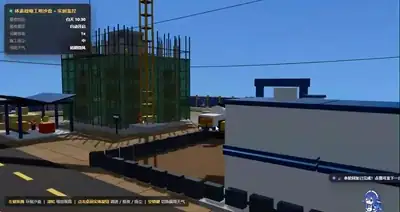</a><br><a href="https://www.sandbase.ai/lab/ai-videos/gemini-4-hydrogen/2120776850431717567?utm_source=github&utm_medium=readme&utm_campaign=awesome-gemini-4-hydrogen&utm_content=card"><b>Single HTML 3D scene built via Python</b></a><br><sub><a href="https://x.com/huang18825/status/2120776850431717567">@huang18825</a> · 0:26</sub></td><td width="33%" valign="top"><a href="https://www.sandbase.ai/lab/media/x/gemini-4-hydrogen/2120935535422374055/video.mp4">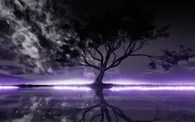</a><br><a href="https://www.sandbase.ai/lab/ai-videos/gemini-4-hydrogen/2120935535422374055?utm_source=github&utm_medium=readme&utm_campaign=awesome-gemini-4-hydrogen&utm_content=card"><b>A procedural 3D scene with sky and water</b></a><br><sub><a href="https://x.com/HarshithLucky3/status/2120935535422374055">@HarshithLucky3</a> · 0:43</sub></td><td width="33%" valign="top"><a href="https://www.sandbase.ai/lab/media/x/gemini-4-hydrogen/2120937159473660224/video.mp4">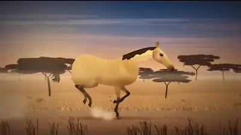</a><br><a href="https://www.sandbase.ai/lab/ai-videos/gemini-4-hydrogen/2120937159473660224?utm_source=github&utm_medium=readme&utm_campaign=awesome-gemini-4-hydrogen&utm_content=card"><b>An animated galloping horse in Three.js</b></a><br><sub><a href="https://x.com/AI_Screening/status/2120937159473660224">@AI_Screening</a> · 0:21</sub></td></tr>
<tr><td width="33%" valign="top"><a href="https://www.sandbase.ai/lab/media/x/gemini-4-hydrogen/2120938275594756296/video.mp4"></a><br><a href="https://www.sandbase.ai/lab/ai-videos/gemini-4-hydrogen/2120938275594756296?utm_source=github&utm_medium=readme&utm_campaign=awesome-gemini-4-hydrogen&utm_content=card"><b>Voxel Chinese mountain temple at sunrise</b></a><br><sub><a href="https://x.com/camperaigg/status/2120938275594756296">@camperaigg</a> · 0:24 · <a href="https://www.sandbase.ai/lab/ai-videos/gemini-4-hydrogen/2120938275594756296?utm_source=github&utm_medium=readme&utm_campaign=awesome-gemini-4-hydrogen&utm_content=card">prompt</a></sub></td><td width="33%" valign="top"><a href="https://www.sandbase.ai/lab/media/x/gemini-4-hydrogen/2120940617169826037/video.mp4">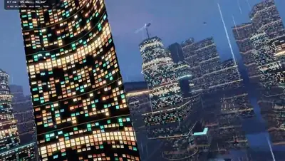</a><br><a href="https://www.sandbase.ai/lab/ai-videos/gemini-4-hydrogen/2120940617169826037?utm_source=github&utm_medium=readme&utm_campaign=awesome-gemini-4-hydrogen&utm_content=card"><b>Futuristic city flythrough built in Three.js</b></a><br><sub><a href="https://x.com/kimmonismus/status/2120940617169826037">@kimmonismus</a> · 0:20</sub></td><td width="33%" valign="top"><a href="https://www.sandbase.ai/lab/media/x/gemini-4-hydrogen/2120951069874532806/video.mp4">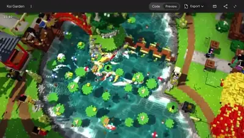</a><br><a href="https://www.sandbase.ai/lab/ai-videos/gemini-4-hydrogen/2120951069874532806?utm_source=github&utm_medium=readme&utm_campaign=awesome-gemini-4-hydrogen&utm_content=card"><b>Modular Koi Garden project built with Gemini</b></a><br><sub><a href="https://x.com/IamEmily2050/status/2120951069874532806">@IamEmily2050</a> · 1:00</sub></td></tr>
</table>

<details>
<summary><b>Show all 67</b></summary>

<table>
<tr><td width="33%" valign="top"><a href="https://www.sandbase.ai/lab/media/x/gemini-4-hydrogen/2120953932692537722/video.mp4">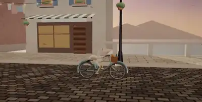</a><br><a href="https://www.sandbase.ai/lab/ai-videos/gemini-4-hydrogen/2120953932692537722?utm_source=github&utm_medium=readme&utm_campaign=awesome-gemini-4-hydrogen&utm_content=card"><b>A pelican riding a bicycle in 3D</b></a><br><sub><a href="https://x.com/nehstrr3/status/2120953932692537722">@nehstrr3</a> · 0:35</sub></td><td width="33%" valign="top"><a href="https://www.sandbase.ai/lab/media/x/gemini-4-hydrogen/2120957446202253803/video.mp4">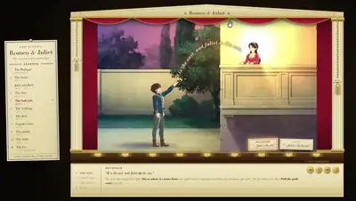</a><br><a href="https://www.sandbase.ai/lab/ai-videos/gemini-4-hydrogen/2120957446202253803?utm_source=github&utm_medium=readme&utm_campaign=awesome-gemini-4-hydrogen&utm_content=card"><b>Romeo and Juliet balcony scene 3D paper theatre</b></a><br><sub><a href="https://x.com/techartist_/status/2120957446202253803">@techartist_</a> · 0:23</sub></td><td width="33%" valign="top"><a href="https://www.sandbase.ai/lab/media/x/gemini-4-hydrogen/2120970648168042967/video.mp4">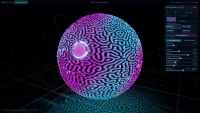</a><br><a href="https://www.sandbase.ai/lab/ai-videos/gemini-4-hydrogen/2120970648168042967?utm_source=github&utm_medium=readme&utm_campaign=awesome-gemini-4-hydrogen&utm_content=card"><b>3D reaction diffusion organism in Three.js</b></a><br><sub><a href="https://x.com/sunset_evm/status/2120970648168042967">@sunset_evm</a> · 0:15</sub></td></tr>
<tr><td width="33%" valign="top"><a href="https://www.sandbase.ai/lab/media/x/gemini-4-hydrogen/2120972707965931603/video.mp4">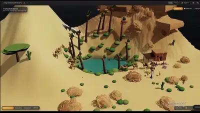</a><br><a href="https://www.sandbase.ai/lab/ai-videos/gemini-4-hydrogen/2120972707965931603?utm_source=github&utm_medium=readme&utm_campaign=awesome-gemini-4-hydrogen&utm_content=card"><b>Isometric Sahara desert Three.js scene</b></a><br><sub><a href="https://x.com/ItsmeAjayKV/status/2120972707965931603">@ItsmeAjayKV</a> · 0:57</sub></td><td width="33%" valign="top"><a href="https://www.sandbase.ai/lab/media/x/gemini-4-hydrogen/2120972954146140409/video.mp4">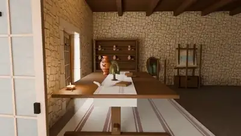</a><br><a href="https://www.sandbase.ai/lab/ai-videos/gemini-4-hydrogen/2120972954146140409?utm_source=github&utm_medium=readme&utm_campaign=awesome-gemini-4-hydrogen&utm_content=card"><b>A Three.js project built with Gemini 4 Hydrogen</b></a><br><sub><a href="https://x.com/SPAC89/status/2120972954146140409">@SPAC89</a> · 0:28</sub></td><td width="33%" valign="top"><a href="https://www.sandbase.ai/lab/media/x/gemini-4-hydrogen/2120979135975809516/video.mp4"></a><br><a href="https://www.sandbase.ai/lab/ai-videos/gemini-4-hydrogen/2120979135975809516?utm_source=github&utm_medium=readme&utm_campaign=awesome-gemini-4-hydrogen&utm_content=card"><b>Falling ice crystal simulation in Three.js</b></a><br><sub><a href="https://x.com/camperaigg/status/2120979135975809516">@camperaigg</a> · 0:18 · <a href="https://www.sandbase.ai/lab/ai-videos/gemini-4-hydrogen/2120979135975809516?utm_source=github&utm_medium=readme&utm_campaign=awesome-gemini-4-hydrogen&utm_content=card">prompt</a></sub></td></tr>
<tr><td width="33%" valign="top"><a href="https://www.sandbase.ai/lab/media/x/gemini-4-hydrogen/2120981734040674518/video.mp4">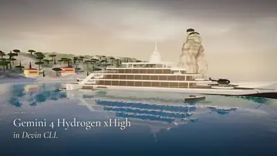</a><br><a href="https://www.sandbase.ai/lab/ai-videos/gemini-4-hydrogen/2120981734040674518?utm_source=github&utm_medium=readme&utm_campaign=awesome-gemini-4-hydrogen&utm_content=card"><b>Mega yacht cruising off Capri coastline in Three.js</b></a><br><sub><a href="https://x.com/Chris_Wozniczek/status/2120981734040674518">@Chris_Wozniczek</a> · 1:10</sub></td><td width="33%" valign="top"><a href="https://www.sandbase.ai/lab/media/x/gemini-4-hydrogen/2120999326038044771/video.mp4">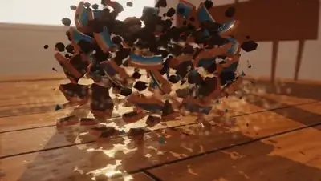</a><br><a href="https://www.sandbase.ai/lab/ai-videos/gemini-4-hydrogen/2120999326038044771?utm_source=github&utm_medium=readme&utm_campaign=awesome-gemini-4-hydrogen&utm_content=card"><b>Shattering pot simulation in Three.js</b></a><br><sub><a href="https://x.com/camperaigg/status/2120999326038044771">@camperaigg</a> · 0:16</sub></td><td width="33%" valign="top"><a href="https://www.sandbase.ai/lab/media/x/gemini-4-hydrogen/2121006210082324528/video.mp4">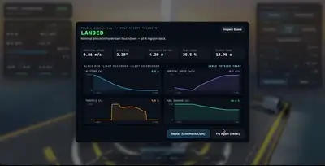</a><br><a href="https://www.sandbase.ai/lab/ai-videos/gemini-4-hydrogen/2121006210082324528?utm_source=github&utm_medium=readme&utm_campaign=awesome-gemini-4-hydrogen&utm_content=card"><b>Falcon 9 booster landing simulation in Three.js</b></a><br><sub><a href="https://x.com/tinkerlog/status/2121006210082324528">@tinkerlog</a> · 1:51</sub></td></tr>
<tr><td width="33%" valign="top"><a href="https://www.sandbase.ai/lab/media/x/gemini-4-hydrogen/2121079696557535597/video.mp4">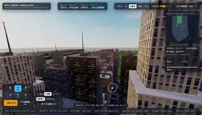</a><br><a href="https://www.sandbase.ai/lab/ai-videos/gemini-4-hydrogen/2121079696557535597?utm_source=github&utm_medium=readme&utm_campaign=awesome-gemini-4-hydrogen&utm_content=card"><b>New York City flight simulation in Three.js</b></a><br><sub><a href="https://x.com/yharuto0917/status/2121079696557535597">@yharuto0917</a> · 1:11</sub></td><td width="33%" valign="top"><a href="https://www.sandbase.ai/lab/media/x/gemini-4-hydrogen/2121089280583901375/video.mp4">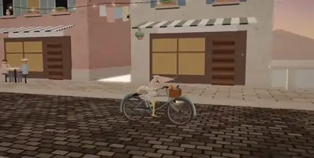</a><br><a href="https://www.sandbase.ai/lab/ai-videos/gemini-4-hydrogen/2121089280583901375?utm_source=github&utm_medium=readme&utm_campaign=awesome-gemini-4-hydrogen&utm_content=card"><b>A pelican riding a bicycle in 3D</b></a><br><sub><a href="https://x.com/Shohank9n1/status/2121089280583901375">@Shohank9n1</a> · 0:29 · <a href="https://www.sandbase.ai/lab/ai-videos/gemini-4-hydrogen/2121089280583901375?utm_source=github&utm_medium=readme&utm_campaign=awesome-gemini-4-hydrogen&utm_content=card">prompt</a></sub></td><td width="33%" valign="top"><a href="https://www.sandbase.ai/lab/media/x/gemini-4-hydrogen/2121108557735289029/video.mp4">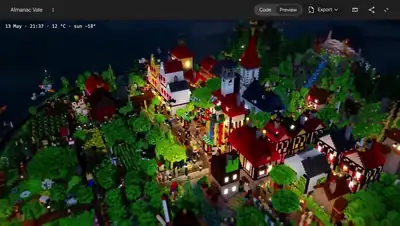</a><br><a href="https://www.sandbase.ai/lab/ai-videos/gemini-4-hydrogen/2121108557735289029?utm_source=github&utm_medium=readme&utm_campaign=awesome-gemini-4-hydrogen&utm_content=card"><b>Almance Vale created with modular prompts</b></a><br><sub><a href="https://x.com/IamEmily2050/status/2121108557735289029">@IamEmily2050</a> · 1:00</sub></td></tr>
<tr><td width="33%" valign="top"><a href="https://www.sandbase.ai/lab/media/x/gemini-4-hydrogen/2121115630459920809/video.mp4">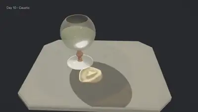</a><br><a href="https://www.sandbase.ai/lab/ai-videos/gemini-4-hydrogen/2121115630459920809?utm_source=github&utm_medium=readme&utm_campaign=awesome-gemini-4-hydrogen&utm_content=card"><b>Water caustic reflections and orbiting key light in WebGPU</b></a><br><sub><a href="https://x.com/AI_Andrew/status/2121115630459920809">@AI_Andrew</a> · 0:40</sub></td><td width="33%" valign="top"><a href="https://www.sandbase.ai/lab/media/x/gemini-4-hydrogen/2121128385690693821/video.mp4">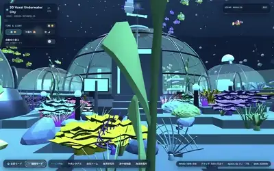</a><br><a href="https://www.sandbase.ai/lab/ai-videos/gemini-4-hydrogen/2121128385690693821?utm_source=github&utm_medium=readme&utm_campaign=awesome-gemini-4-hydrogen&utm_content=card"><b>Explorable 3D underwater city</b></a><br><sub><a href="https://x.com/ayyh_18/status/2121128385690693821">@ayyh_18</a> · 0:50</sub></td><td width="33%" valign="top"><a href="https://www.sandbase.ai/lab/media/x/gemini-4-hydrogen/2121163760081440784/video.mp4">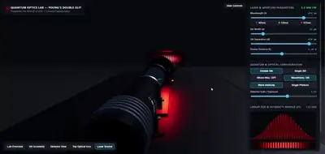</a><br><a href="https://www.sandbase.ai/lab/ai-videos/gemini-4-hydrogen/2121163760081440784?utm_source=github&utm_medium=readme&utm_campaign=awesome-gemini-4-hydrogen&utm_content=card"><b>A 3D double slit quantum physics lab</b></a><br><sub><a href="https://x.com/analogalok/status/2121163760081440784">@analogalok</a> · 0:30 · <a href="https://www.sandbase.ai/lab/ai-videos/gemini-4-hydrogen/2121163760081440784?utm_source=github&utm_medium=readme&utm_campaign=awesome-gemini-4-hydrogen&utm_content=card">prompt</a></sub></td></tr>
<tr><td width="33%" valign="top"><a href="https://www.sandbase.ai/lab/media/x/gemini-4-hydrogen/2121165467821936651/video.mp4">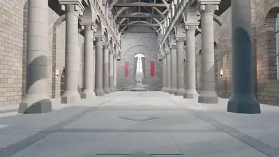</a><br><a href="https://www.sandbase.ai/lab/ai-videos/gemini-4-hydrogen/2121165467821936651?utm_source=github&utm_medium=readme&utm_campaign=awesome-gemini-4-hydrogen&utm_content=card"><b>Recreating the iron throne hall in Blender</b></a><br><sub><a href="https://x.com/ashen_one/status/2121165467821936651">@ashen_one</a> · 0:15</sub></td><td width="33%" valign="top"><a href="https://www.sandbase.ai/lab/media/x/gemini-4-hydrogen/2121169304649638116/video.mp4">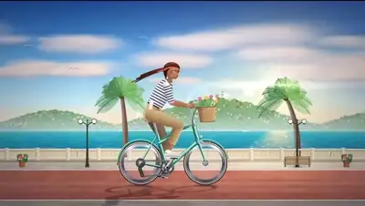</a><br><a href="https://www.sandbase.ai/lab/ai-videos/gemini-4-hydrogen/2121169304649638116?utm_source=github&utm_medium=readme&utm_campaign=awesome-gemini-4-hydrogen&utm_content=card"><b>A scene built with Three.js in Antigravity</b></a><br><sub><a href="https://x.com/AI_Screening/status/2121169304649638116">@AI_Screening</a> · 0:14</sub></td><td width="33%" valign="top"><a href="https://www.sandbase.ai/lab/media/x/gemini-4-hydrogen/2121172856889618528/video.mp4">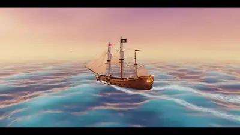</a><br><a href="https://www.sandbase.ai/lab/ai-videos/gemini-4-hydrogen/2121172856889618528?utm_source=github&utm_medium=readme&utm_campaign=awesome-gemini-4-hydrogen&utm_content=card"><b>A grayscale pirate ship in Three.js</b></a><br><sub><a href="https://x.com/parves075/status/2121172856889618528">@parves075</a> · 0:37</sub></td></tr>
<tr><td width="33%" valign="top"><a href="https://www.sandbase.ai/lab/media/x/gemini-4-hydrogen/2121200010574598655/video.mp4">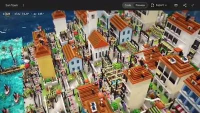</a><br><a href="https://www.sandbase.ai/lab/ai-videos/gemini-4-hydrogen/2121200010574598655?utm_source=github&utm_medium=readme&utm_campaign=awesome-gemini-4-hydrogen&utm_content=card"><b>Sun Twon multi-module scene generation</b></a><br><sub><a href="https://x.com/IamEmily2050/status/2121200010574598655">@IamEmily2050</a> · 1:00</sub></td><td width="33%" valign="top"><a href="https://www.sandbase.ai/lab/media/x/gemini-4-hydrogen/2121209712465297565/video.mp4">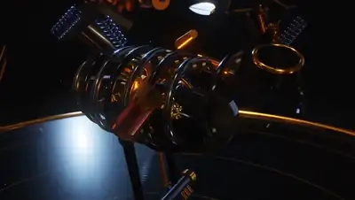</a><br><a href="https://www.sandbase.ai/lab/ai-videos/gemini-4-hydrogen/2121209712465297565?utm_source=github&utm_medium=readme&utm_campaign=awesome-gemini-4-hydrogen&utm_content=card"><b>Procedural mechanical bird in Three.js</b></a><br><sub><a href="https://x.com/camperaigg/status/2121209712465297565">@camperaigg</a> · 0:18</sub></td><td width="33%" valign="top"><a href="https://www.sandbase.ai/lab/media/x/gemini-4-hydrogen/2121254256288137484/video.mp4">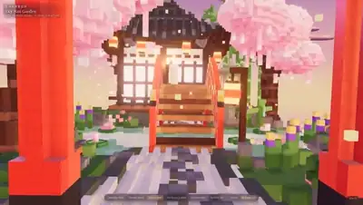</a><br><a href="https://www.sandbase.ai/lab/ai-videos/gemini-4-hydrogen/2121254256288137484?utm_source=github&utm_medium=readme&utm_campaign=awesome-gemini-4-hydrogen&utm_content=card"><b>A pure Three.js scene in single HTML</b></a><br><sub><a href="https://x.com/SahilPanhotra/status/2121254256288137484">@SahilPanhotra</a> · 0:28</sub></td></tr>
<tr><td width="33%" valign="top"><a href="https://www.sandbase.ai/lab/media/x/gemini-4-hydrogen/2121259604076036239/video.mp4">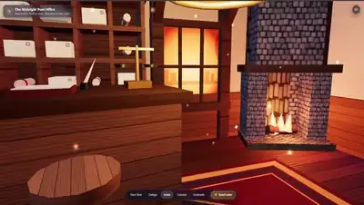</a><br><a href="https://www.sandbase.ai/lab/ai-videos/gemini-4-hydrogen/2121259604076036239?utm_source=github&utm_medium=readme&utm_campaign=awesome-gemini-4-hydrogen&utm_content=card"><b>Interactive miniature scene of a floating post office</b></a><br><sub><a href="https://x.com/jony_palino/status/2121259604076036239">@jony_palino</a> · 0:37</sub></td><td width="33%" valign="top"><a href="https://www.sandbase.ai/lab/media/x/gemini-4-hydrogen/2121279837512106168/video.mp4">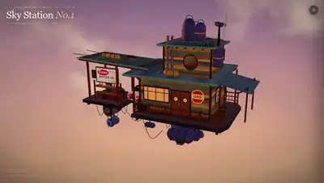</a><br><a href="https://www.sandbase.ai/lab/ai-videos/gemini-4-hydrogen/2121279837512106168?utm_source=github&utm_medium=readme&utm_campaign=awesome-gemini-4-hydrogen&utm_content=card"><b>Sky refueling station with retro flying car</b></a><br><sub><a href="https://x.com/doe_naps/status/2121279837512106168">@doe_naps</a> · 0:35</sub></td><td width="33%" valign="top"><a href="https://www.sandbase.ai/lab/media/x/gemini-4-hydrogen/2121298325412745396/video.mp4">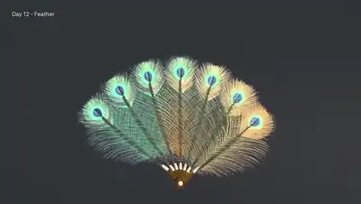</a><br><a href="https://www.sandbase.ai/lab/ai-videos/gemini-4-hydrogen/2121298325412745396?utm_source=github&utm_medium=readme&utm_campaign=awesome-gemini-4-hydrogen&utm_content=card"><b>Shimmering peacock feather in WebGPU</b></a><br><sub><a href="https://x.com/AI_Andrew/status/2121298325412745396">@AI_Andrew</a> · 0:20</sub></td></tr>
<tr><td width="33%" valign="top"><a href="https://www.sandbase.ai/lab/media/x/gemini-4-hydrogen/2121330663106474327/video.mp4"></a><br><a href="https://www.sandbase.ai/lab/ai-videos/gemini-4-hydrogen/2121330663106474327?utm_source=github&utm_medium=readme&utm_campaign=awesome-gemini-4-hydrogen&utm_content=card"><b>Three.js animation test with swarm mode</b></a><br><sub><a href="https://x.com/DanjiTosaka/status/2121330663106474327">@DanjiTosaka</a> · 0:31 · <a href="https://www.sandbase.ai/lab/ai-videos/gemini-4-hydrogen/2121330663106474327?utm_source=github&utm_medium=readme&utm_campaign=awesome-gemini-4-hydrogen&utm_content=card">prompt</a></sub></td><td width="33%" valign="top"><a href="https://www.sandbase.ai/lab/media/x/gemini-4-hydrogen/2121354542344466565/video.mp4">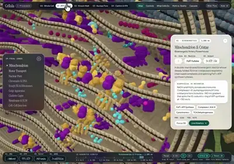</a><br><a href="https://www.sandbase.ai/lab/ai-videos/gemini-4-hydrogen/2121354542344466565?utm_source=github&utm_medium=readme&utm_campaign=awesome-gemini-4-hydrogen&utm_content=card"><b>Interactive 3D encyclopedia of a human cell</b></a><br><sub><a href="https://x.com/soumyadesign/status/2121354542344466565">@soumyadesign</a> · 0:47</sub></td><td width="33%" valign="top"><a href="https://www.sandbase.ai/lab/media/x/gemini-4-hydrogen/2121393266318823550/video.mp4">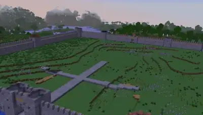</a><br><a href="https://www.sandbase.ai/lab/ai-videos/gemini-4-hydrogen/2121393266318823550?utm_source=github&utm_medium=readme&utm_campaign=awesome-gemini-4-hydrogen&utm_content=card"><b>Minecraft medieval village built and filmed by AI</b></a><br><sub><a href="https://x.com/jan_volad/status/2121393266318823550">@jan_volad</a> · 0:52</sub></td></tr>
<tr><td width="33%" valign="top"><a href="https://www.sandbase.ai/lab/media/x/gemini-4-hydrogen/2121554731034362171/video.mp4">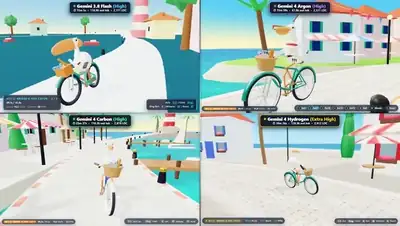</a><br><a href="https://www.sandbase.ai/lab/ai-videos/gemini-4-hydrogen/2121554731034362171?utm_source=github&utm_medium=readme&utm_campaign=awesome-gemini-4-hydrogen&utm_content=card"><b>A pelican riding a bicycle in Three.js</b></a><br><sub><a href="https://x.com/StatsWire/status/2121554731034362171">@StatsWire</a> · 0:45</sub></td><td width="33%" valign="top"><a href="https://www.sandbase.ai/lab/media/x/gemini-4-hydrogen/2121590376544997507/video.mp4">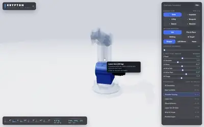</a><br><a href="https://www.sandbase.ai/lab/ai-videos/gemini-4-hydrogen/2121590376544997507?utm_source=github&utm_medium=readme&utm_campaign=awesome-gemini-4-hydrogen&utm_content=card"><b>Interactive 3D industrial robot arm in Three.js</b></a><br><sub><a href="https://x.com/HarshithLucky3/status/2121590376544997507">@HarshithLucky3</a> · 0:55 · <a href="https://www.sandbase.ai/lab/ai-videos/gemini-4-hydrogen/2121590376544997507?utm_source=github&utm_medium=readme&utm_campaign=awesome-gemini-4-hydrogen&utm_content=card">prompt</a></sub></td><td width="33%" valign="top"><a href="https://www.sandbase.ai/lab/media/x/gemini-4-hydrogen/2121745863827697687/video.mp4"></a><br><a href="https://www.sandbase.ai/lab/ai-videos/gemini-4-hydrogen/2121745863827697687?utm_source=github&utm_medium=readme&utm_campaign=awesome-gemini-4-hydrogen&utm_content=card"><b>Mitochondrial motor simulation created with Gemini 4</b></a><br><sub><a href="https://x.com/SidraMiconi/status/2121745863827697687">@SidraMiconi</a> · 0:26 · <a href="https://www.sandbase.ai/lab/ai-videos/gemini-4-hydrogen/2121745863827697687?utm_source=github&utm_medium=readme&utm_campaign=awesome-gemini-4-hydrogen&utm_content=card">prompt</a></sub></td></tr>
<tr><td width="33%" valign="top"><a href="https://www.sandbase.ai/lab/media/x/gemini-4-hydrogen/2121778642665816215/video.mp4">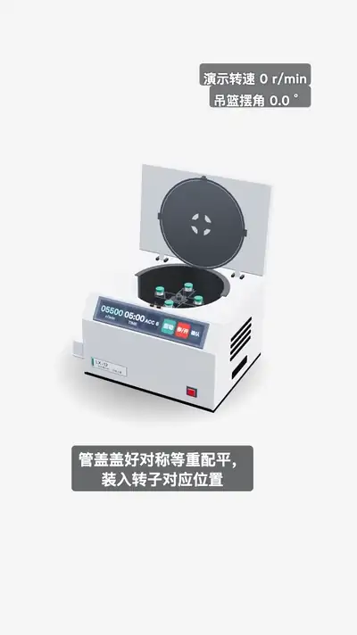</a><br><a href="https://www.sandbase.ai/lab/ai-videos/gemini-4-hydrogen/2121778642665816215?utm_source=github&utm_medium=readme&utm_campaign=awesome-gemini-4-hydrogen&utm_content=card"><b>Interactive 3D centrifuge model generated by Gemini</b></a><br><sub><a href="https://x.com/CopperForgeAI/status/2121778642665816215">@CopperForgeAI</a> · 0:21</sub></td><td width="33%" valign="top"><a href="https://www.sandbase.ai/lab/media/x/gemini-4-hydrogen/2121896295220785467/video.mp4">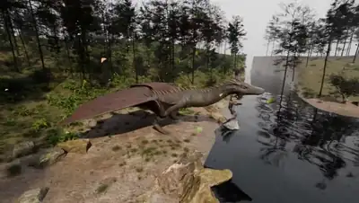</a><br><a href="https://www.sandbase.ai/lab/ai-videos/gemini-4-hydrogen/2121896295220785467?utm_source=github&utm_medium=readme&utm_campaign=awesome-gemini-4-hydrogen&utm_content=card"><b>Wyvern flight and roar animation in Blender</b></a><br><sub><a href="https://x.com/kesarisandeep4u/status/2121896295220785467">@kesarisandeep4u</a> · 0:35</sub></td><td width="33%" valign="top"><a href="https://www.sandbase.ai/lab/media/x/gemini-4-hydrogen/2121902216261013532/video.mp4">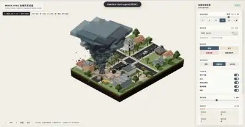</a><br><a href="https://www.sandbase.ai/lab/ai-videos/gemini-4-hydrogen/2121902216261013532?utm_source=github&utm_medium=readme&utm_campaign=awesome-gemini-4-hydrogen&utm_content=card"><b>A tornado simulator hitting a miniature town</b></a><br><sub><a href="https://x.com/cfenghub/status/2121902216261013532">@cfenghub</a> · 0:25</sub></td></tr>
<tr><td width="33%" valign="top"><a href="https://www.sandbase.ai/lab/media/x/gemini-4-hydrogen/2121960943361896596/video.mp4">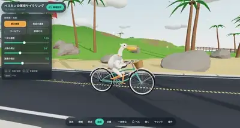</a><br><a href="https://www.sandbase.ai/lab/ai-videos/gemini-4-hydrogen/2121960943361896596?utm_source=github&utm_medium=readme&utm_campaign=awesome-gemini-4-hydrogen&utm_content=card"><b>A pelican riding a bicycle along the coast</b></a><br><sub><a href="https://x.com/Aki_LIG/status/2121960943361896596">@Aki_LIG</a> · 2:48 · <a href="https://www.sandbase.ai/lab/ai-videos/gemini-4-hydrogen/2121960943361896596?utm_source=github&utm_medium=readme&utm_campaign=awesome-gemini-4-hydrogen&utm_content=card">prompt</a></sub></td><td width="33%" valign="top"><a href="https://www.sandbase.ai/lab/media/x/gemini-4-hydrogen/2121991166136590744/video.mp4">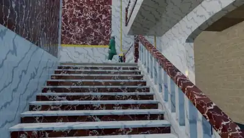</a><br><a href="https://www.sandbase.ai/lab/ai-videos/gemini-4-hydrogen/2121991166136590744?utm_source=github&utm_medium=readme&utm_campaign=awesome-gemini-4-hydrogen&utm_content=card"><b>A navigable 1780s Versailles built in 3D</b></a><br><sub><a href="https://x.com/c_nemri/status/2121991166136590744">@c_nemri</a> · 1:13</sub></td><td width="33%" valign="top"><a href="https://www.sandbase.ai/lab/media/x/gemini-4-hydrogen/2121994622511845677/video.mp4">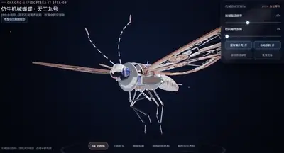</a><br><a href="https://www.sandbase.ai/lab/ai-videos/gemini-4-hydrogen/2121994622511845677?utm_source=github&utm_medium=readme&utm_campaign=awesome-gemini-4-hydrogen&utm_content=card"><b>A mechanical butterfly created in Three.js</b></a><br><sub><a href="https://x.com/dragono64v/status/2121994622511845677">@dragono64v</a> · 0:37</sub></td></tr>
<tr><td width="33%" valign="top"><a href="https://www.sandbase.ai/lab/media/x/gemini-4-hydrogen/2122000359602196495/video.mp4">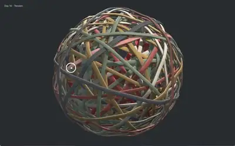</a><br><a href="https://www.sandbase.ai/lab/ai-videos/gemini-4-hydrogen/2122000359602196495?utm_source=github&utm_medium=readme&utm_campaign=awesome-gemini-4-hydrogen&utm_content=card"><b>Interactive rubber band ball in WebGPU</b></a><br><sub><a href="https://x.com/AI_Andrew/status/2122000359602196495">@AI_Andrew</a> · 0:05</sub></td><td width="33%" valign="top"><a href="https://www.sandbase.ai/lab/media/x/gemini-4-hydrogen/2122019069411172393/video.mp4">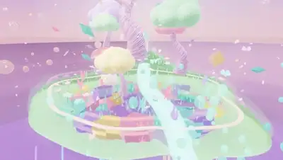</a><br><a href="https://www.sandbase.ai/lab/ai-videos/gemini-4-hydrogen/2122019069411172393?utm_source=github&utm_medium=readme&utm_campaign=awesome-gemini-4-hydrogen&utm_content=card"><b>A 3D miniature candy planet island</b></a><br><sub><a href="https://x.com/dragono64v/status/2122019069411172393">@dragono64v</a> · 0:20</sub></td><td width="33%" valign="top"><a href="https://www.sandbase.ai/lab/media/x/gemini-4-hydrogen/2122177107216503211/video.mp4">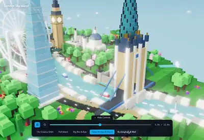</a><br><a href="https://www.sandbase.ai/lab/ai-videos/gemini-4-hydrogen/2122177107216503211?utm_source=github&utm_medium=readme&utm_campaign=awesome-gemini-4-hydrogen&utm_content=card"><b>Three.js island generated by Gemini 4 Hydrogen</b></a><br><sub><a href="https://x.com/Dav338876/status/2122177107216503211">@Dav338876</a> · 0:27</sub></td></tr>
<tr><td width="33%" valign="top"><a href="https://www.sandbase.ai/lab/media/x/gemini-4-argon/2122253350808744004/video.mp4"></a><br><a href="https://www.sandbase.ai/lab/ai-videos/gemini-4-hydrogen/2122253350808744004?utm_source=github&utm_medium=readme&utm_campaign=awesome-gemini-4-hydrogen&utm_content=card"><b>Cute character animation using video minimax model</b></a><br><sub><a href="https://x.com/nyapan_mohy/status/2122253350808744004">@nyapan_mohy</a> · 0:15 · <a href="https://www.sandbase.ai/lab/ai-videos/gemini-4-hydrogen/2122253350808744004?utm_source=github&utm_medium=readme&utm_campaign=awesome-gemini-4-hydrogen&utm_content=card">prompt</a></sub></td><td width="33%" valign="top"><a href="https://www.sandbase.ai/lab/media/x/gemini-4-hydrogen/2122255731411849691/video.mp4">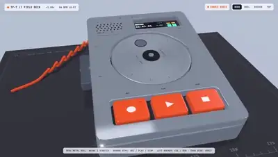</a><br><a href="https://www.sandbase.ai/lab/ai-videos/gemini-4-hydrogen/2122255731411849691?utm_source=github&utm_medium=readme&utm_campaign=awesome-gemini-4-hydrogen&utm_content=card"><b>Interactive TP-7 recorder built with code</b></a><br><sub><a href="https://x.com/FiniYang/status/2122255731411849691">@FiniYang</a> · 0:14 · <a href="https://www.sandbase.ai/lab/ai-videos/gemini-4-hydrogen/2122255731411849691?utm_source=github&utm_medium=readme&utm_campaign=awesome-gemini-4-hydrogen&utm_content=card">prompt</a></sub></td><td width="33%" valign="top"><a href="https://www.sandbase.ai/lab/media/x/gemini-4-hydrogen/2122303514907214287/video.mp4"></a><br><a href="https://www.sandbase.ai/lab/ai-videos/gemini-4-hydrogen/2122303514907214287?utm_source=github&utm_medium=readme&utm_campaign=awesome-gemini-4-hydrogen&utm_content=card"><b>Procedural steam locomotive assembly in Three.js</b></a><br><sub><a href="https://x.com/FiniYang/status/2122303514907214287">@FiniYang</a> · 0:16</sub></td></tr>
<tr><td width="33%" valign="top"><a href="https://www.sandbase.ai/lab/media/x/gemini-4-hydrogen/2122355544811794832/video.mp4"></a><br><a href="https://www.sandbase.ai/lab/ai-videos/gemini-4-hydrogen/2122355544811794832?utm_source=github&utm_medium=readme&utm_campaign=awesome-gemini-4-hydrogen&utm_content=card"><b>Cartoon style 3D world with shader effects</b></a><br><sub><a href="https://x.com/parazar/status/2122355544811794832">@parazar</a> · 1:14</sub></td><td width="33%" valign="top"><a href="https://www.sandbase.ai/lab/media/x/gemini-4-hydrogen/2122367785749934533/video.mp4"></a><br><a href="https://www.sandbase.ai/lab/ai-videos/gemini-4-hydrogen/2122367785749934533?utm_source=github&utm_medium=readme&utm_campaign=awesome-gemini-4-hydrogen&utm_content=card"><b>Recreation of Titanic scene using Gemini-4-hydrogen</b></a><br><sub><a href="https://x.com/Dav338876/status/2122367785749934533">@Dav338876</a> · 1:13</sub></td><td width="33%" valign="top"><a href="https://www.sandbase.ai/lab/media/x/gemini-4-hydrogen/2122424240641376674/video.mp4"></a><br><a href="https://www.sandbase.ai/lab/ai-videos/gemini-4-hydrogen/2122424240641376674?utm_source=github&utm_medium=readme&utm_campaign=awesome-gemini-4-hydrogen&utm_content=card"><b>Blender scene created with Gemini-4-hydrogen</b></a><br><sub><a href="https://x.com/SPAC89/status/2122424240641376674">@SPAC89</a> · 0:50</sub></td></tr>
<tr><td width="33%" valign="top"><a href="https://www.sandbase.ai/lab/media/x/gemini-4-hydrogen/2122471069659656310/video.mp4"></a><br><a href="https://www.sandbase.ai/lab/ai-videos/gemini-4-hydrogen/2122471069659656310?utm_source=github&utm_medium=readme&utm_campaign=awesome-gemini-4-hydrogen&utm_content=card"><b>StageFlow Three.js scene staging with GLB</b></a><br><sub><a href="https://x.com/tarumainfo/status/2122471069659656310">@tarumainfo</a></sub></td><td width="33%" valign="top"><a href="https://www.sandbase.ai/lab/media/x/gemini-4-hydrogen/2122608311912780243/video.mp4"></a><br><a href="https://www.sandbase.ai/lab/ai-videos/gemini-4-hydrogen/2122608311912780243?utm_source=github&utm_medium=readme&utm_campaign=awesome-gemini-4-hydrogen&utm_content=card"><b>Interactive 3D DC motor in Three.js</b></a><br><sub><a href="https://x.com/analogalok/status/2122608311912780243">@analogalok</a> · <a href="https://www.sandbase.ai/lab/ai-videos/gemini-4-hydrogen/2122608311912780243?utm_source=github&utm_medium=readme&utm_campaign=awesome-gemini-4-hydrogen&utm_content=card">prompt</a></sub></td><td width="33%" valign="top"><a href="https://www.sandbase.ai/lab/media/x/gemini-4-hydrogen/2122609183837049037/video.mp4"></a><br><a href="https://www.sandbase.ai/lab/ai-videos/gemini-4-hydrogen/2122609183837049037?utm_source=github&utm_medium=readme&utm_campaign=awesome-gemini-4-hydrogen&utm_content=card"><b>Sci-Fi Mech Assembling and Launching in Three.js</b></a><br><sub><a href="https://x.com/alohaproxy/status/2122609183837049037">@alohaproxy</a> · <a href="https://www.sandbase.ai/lab/ai-videos/gemini-4-hydrogen/2122609183837049037?utm_source=github&utm_medium=readme&utm_campaign=awesome-gemini-4-hydrogen&utm_content=card">prompt</a></sub></td></tr>
<tr><td width="33%" valign="top"><a href="https://www.sandbase.ai/lab/media/x/gemini-4-hydrogen/2122614055747678695/video.mp4"></a><br><a href="https://www.sandbase.ai/lab/ai-videos/gemini-4-hydrogen/2122614055747678695?utm_source=github&utm_medium=readme&utm_campaign=awesome-gemini-4-hydrogen&utm_content=card"><b>Gemini 4 Hydrogen Game and 3D Capabilities</b></a><br><sub><a href="https://x.com/Skybornfx/status/2122614055747678695">@Skybornfx</a></sub></td><td width="33%" valign="top"><a href="https://www.sandbase.ai/lab/media/x/gemini-4-hydrogen/2122725218561200410/video.mp4"></a><br><a href="https://www.sandbase.ai/lab/ai-videos/gemini-4-hydrogen/2122725218561200410?utm_source=github&utm_medium=readme&utm_campaign=awesome-gemini-4-hydrogen&utm_content=card"><b>Spirited Away-style sea train scene in Blender</b></a><br><sub><a href="https://x.com/paojiaofty/status/2122725218561200410">@paojiaofty</a> · 0:15</sub></td><td width="33%" valign="top"><a href="https://www.sandbase.ai/lab/media/x/gemini-4-hydrogen/2122743416916521437/video.mp4"></a><br><a href="https://www.sandbase.ai/lab/ai-videos/gemini-4-hydrogen/2122743416916521437?utm_source=github&utm_medium=readme&utm_campaign=awesome-gemini-4-hydrogen&utm_content=card"><b>East Asian pagoda bridge gate in Three.js</b></a><br><sub><a href="https://x.com/srikanthvaluri/status/2122743416916521437">@srikanthvaluri</a></sub></td></tr>
<tr><td width="33%" valign="top"><a href="https://www.sandbase.ai/lab/media/x/gemini-4-hydrogen/2122823093299380475/video.mp4"></a><br><a href="https://www.sandbase.ai/lab/ai-videos/gemini-4-hydrogen/2122823093299380475?utm_source=github&utm_medium=readme&utm_campaign=awesome-gemini-4-hydrogen&utm_content=card"><b>A time loop 3D scene test</b></a><br><sub><a href="https://x.com/ItsmeAjayKV/status/2122823093299380475">@ItsmeAjayKV</a> · 1:06</sub></td><td width="33%" valign="top"><a href="https://www.sandbase.ai/lab/media/x/gemini-4-hydrogen/2123034440763146262/video.mp4"></a><br><a href="https://www.sandbase.ai/lab/ai-videos/gemini-4-hydrogen/2123034440763146262?utm_source=github&utm_medium=readme&utm_campaign=awesome-gemini-4-hydrogen&utm_content=card"><b>Real-time path tracing with Three.js and WebGPU</b></a><br><sub><a href="https://x.com/meby_central/status/2123034440763146262">@meby_central</a></sub></td><td width="33%" valign="top"><a href="https://www.sandbase.ai/lab/media/x/gemini-4-hydrogen/2123710061633782184/video.mp4"></a><br><a href="https://www.sandbase.ai/lab/ai-videos/gemini-4-hydrogen/2123710061633782184?utm_source=github&utm_medium=readme&utm_campaign=awesome-gemini-4-hydrogen&utm_content=card"><b>A 3D model attempt of a Xiaomi SU7 Ultra</b></a><br><sub><a href="https://x.com/YxzRainy/status/2123710061633782184">@YxzRainy</a></sub></td></tr>
<tr><td width="33%" valign="top"><a href="https://www.sandbase.ai/lab/media/x/gemini-4-argon/2123843882937155607/video.mp4"></a><br><a href="https://www.sandbase.ai/lab/ai-videos/gemini-4-hydrogen/2123843882937155607?utm_source=github&utm_medium=readme&utm_campaign=awesome-gemini-4-hydrogen&utm_content=card"><b>A 3D V12 engine built in Three.js</b></a><br><sub><a href="https://x.com/thtbee_/status/2123843882937155607">@thtbee_</a></sub></td><td width="33%" valign="top"><a href="https://www.sandbase.ai/lab/media/x/gemini-4-hydrogen/2124034158423089211/video.mp4"></a><br><a href="https://www.sandbase.ai/lab/ai-videos/gemini-4-hydrogen/2124034158423089211?utm_source=github&utm_medium=readme&utm_campaign=awesome-gemini-4-hydrogen&utm_content=card"><b>A cute smiling ghost in Three.js</b></a><br><sub><a href="https://x.com/srikanthvaluri/status/2124034158423089211">@srikanthvaluri</a></sub></td><td width="33%" valign="top"><a href="https://www.sandbase.ai/lab/media/x/gemini-4-hydrogen/2124421508563149279/video.mp4"></a><br><a href="https://www.sandbase.ai/lab/ai-videos/gemini-4-hydrogen/2124421508563149279?utm_source=github&utm_medium=readme&utm_campaign=awesome-gemini-4-hydrogen&utm_content=card"><b>A 3D Lamborghini Veneno in Three.js</b></a><br><sub><a href="https://x.com/Leviwoyun/status/2124421508563149279">@Leviwoyun</a></sub></td></tr>
<tr><td width="33%" valign="top"><a href="https://www.sandbase.ai/lab/media/x/gemini-4-hydrogen/2124761669192798306/video.mp4"></a><br><a href="https://www.sandbase.ai/lab/ai-videos/gemini-4-hydrogen/2124761669192798306?utm_source=github&utm_medium=readme&utm_campaign=awesome-gemini-4-hydrogen&utm_content=card"><b>Rainy night convenience store street corner in WebGL2</b></a><br><sub><a href="https://x.com/xiax0603/status/2124761669192798306">@xiax0603</a></sub></td><td width="33%" valign="top"><a href="https://www.sandbase.ai/lab/media/x/gemini-4-hydrogen/2125594945830469779/video.mp4"></a><br><a href="https://www.sandbase.ai/lab/ai-videos/gemini-4-hydrogen/2125594945830469779?utm_source=github&utm_medium=readme&utm_campaign=awesome-gemini-4-hydrogen&utm_content=card"><b>Testing Three.js 3D documentary generation with agents</b></a><br><sub><a href="https://x.com/guiitib/status/2125594945830469779">@guiitib</a></sub></td><td width="33%" valign="top"><a href="https://www.sandbase.ai/lab/media/x/gemini-4-hydrogen/2125742982548554053/video.mp4"></a><br><a href="https://www.sandbase.ai/lab/ai-videos/gemini-4-hydrogen/2125742982548554053?utm_source=github&utm_medium=readme&utm_campaign=awesome-gemini-4-hydrogen&utm_content=card"><b>Social media content created with Three.js</b></a><br><sub><a href="https://x.com/GuiKrypto/status/2125742982548554053">@GuiKrypto</a></sub></td></tr>
<tr><td width="33%" valign="top"><a href="https://www.sandbase.ai/lab/media/x/gemini-4-carbon/2126291966312984815/video.mp4"></a><br><a href="https://www.sandbase.ai/lab/ai-videos/gemini-4-hydrogen/2126291966312984815?utm_source=github&utm_medium=readme&utm_campaign=awesome-gemini-4-hydrogen&utm_content=card"><b>Interactive 3D teardown car showroom in Three.js</b></a><br><sub><a href="https://x.com/adityawaslost/status/2126291966312984815">@adityawaslost</a></sub></td></tr>
</table>

</details>

<a id="motion-graphics"></a>

## Motion graphics

<table>
<tr><td width="33%" valign="top"><a href="https://www.sandbase.ai/lab/media/x/gemini-4-hydrogen/2120793403176988866/video.mp4"></a><br><a href="https://www.sandbase.ai/lab/ai-videos/gemini-4-hydrogen/2120793403176988866?utm_source=github&utm_medium=readme&utm_campaign=awesome-gemini-4-hydrogen&utm_content=card"><b>Interactive pelican riding a bicycle animation</b></a><br><sub><a href="https://x.com/Delroy715/status/2120793403176988866">@Delroy715</a> · 0:33</sub></td><td width="33%" valign="top"><a href="https://www.sandbase.ai/lab/media/x/gemini-4-hydrogen/2120879536607023386/video.mp4"></a><br><a href="https://www.sandbase.ai/lab/ai-videos/gemini-4-hydrogen/2120879536607023386?utm_source=github&utm_medium=readme&utm_campaign=awesome-gemini-4-hydrogen&utm_content=card"><b>Grayscale 2D animation scene test</b></a><br><sub><a href="https://x.com/nehstrr3/status/2120879536607023386">@nehstrr3</a> · 0:48</sub></td><td width="33%" valign="top"><a href="https://www.sandbase.ai/lab/media/x/gemini-4-hydrogen/2120921538421735676/video.mp4"></a><br><a href="https://www.sandbase.ai/lab/ai-videos/gemini-4-hydrogen/2120921538421735676?utm_source=github&utm_medium=readme&utm_campaign=awesome-gemini-4-hydrogen&utm_content=card"><b>Glazed mechanical peacock spreading feathers SVG animation</b></a><br><sub><a href="https://x.com/leo114119/status/2120921538421735676">@leo114119</a> · 0:22</sub></td></tr>
<tr><td width="33%" valign="top"><a href="https://www.sandbase.ai/lab/media/x/gemini-4-hydrogen/2120937028015833193/video.mp4"></a><br><a href="https://www.sandbase.ai/lab/ai-videos/gemini-4-hydrogen/2120937028015833193?utm_source=github&utm_medium=readme&utm_campaign=awesome-gemini-4-hydrogen&utm_content=card"><b>Pelican riding bicycle SVG animation</b></a><br><sub><a href="https://x.com/DrstaOne/status/2120937028015833193">@DrstaOne</a> · 0:31 · <a href="https://www.sandbase.ai/lab/ai-videos/gemini-4-hydrogen/2120937028015833193?utm_source=github&utm_medium=readme&utm_campaign=awesome-gemini-4-hydrogen&utm_content=card">prompt</a></sub></td><td width="33%" valign="top"><a href="https://www.sandbase.ai/lab/media/x/gemini-4-hydrogen/2120940274847453609/video.mp4"></a><br><a href="https://www.sandbase.ai/lab/ai-videos/gemini-4-hydrogen/2120940274847453609?utm_source=github&utm_medium=readme&utm_campaign=awesome-gemini-4-hydrogen&utm_content=card"><b>Single prompt testing with Gemini 4 Hydrogen</b></a><br><sub><a href="https://x.com/Avenoxai/status/2120940274847453609">@Avenoxai</a> · 0:31</sub></td><td width="33%" valign="top"><a href="https://www.sandbase.ai/lab/media/x/gemini-4-hydrogen/2120970144885456948/video.mp4"></a><br><a href="https://www.sandbase.ai/lab/ai-videos/gemini-4-hydrogen/2120970144885456948?utm_source=github&utm_medium=readme&utm_campaign=awesome-gemini-4-hydrogen&utm_content=card"><b>Earth zoom in to Statue of Liberty animation</b></a><br><sub><a href="https://x.com/analogalok/status/2120970144885456948">@analogalok</a> · 0:29 · <a href="https://www.sandbase.ai/lab/ai-videos/gemini-4-hydrogen/2120970144885456948?utm_source=github&utm_medium=readme&utm_campaign=awesome-gemini-4-hydrogen&utm_content=card">prompt</a></sub></td></tr>
</table>

<details>
<summary><b>Show all 36</b></summary>

<table>
<tr><td width="33%" valign="top"><a href="https://www.sandbase.ai/lab/media/x/gemini-4-hydrogen/2120980010936717728/video.mp4"></a><br><a href="https://www.sandbase.ai/lab/ai-videos/gemini-4-hydrogen/2120980010936717728?utm_source=github&utm_medium=readme&utm_campaign=awesome-gemini-4-hydrogen&utm_content=card"><b>Pure code spider animation</b></a><br><sub><a href="https://x.com/hakmgpt/status/2120980010936717728">@hakmgpt</a> · 1:00</sub></td><td width="33%" valign="top"><a href="https://www.sandbase.ai/lab/media/x/gemini-4-hydrogen/2121030290369827023/video.mp4"></a><br><a href="https://www.sandbase.ai/lab/ai-videos/gemini-4-hydrogen/2121030290369827023?utm_source=github&utm_medium=readme&utm_campaign=awesome-gemini-4-hydrogen&utm_content=card"><b>SVG animation of a border collie brewing coffee</b></a><br><sub><a href="https://x.com/Sin_Yiyao/status/2121030290369827023">@Sin_Yiyao</a> · 0:24 · <a href="https://www.sandbase.ai/lab/ai-videos/gemini-4-hydrogen/2121030290369827023?utm_source=github&utm_medium=readme&utm_campaign=awesome-gemini-4-hydrogen&utm_content=card">prompt</a></sub></td><td width="33%" valign="top"><a href="https://www.sandbase.ai/lab/media/x/gemini-4-hydrogen/2121046922974962086/video.mp4"></a><br><a href="https://www.sandbase.ai/lab/ai-videos/gemini-4-hydrogen/2121046922974962086?utm_source=github&utm_medium=readme&utm_campaign=awesome-gemini-4-hydrogen&utm_content=card"><b>Project created with Gemini 4 Hydrogen</b></a><br><sub><a href="https://x.com/JamesC_Alpha/status/2121046922974962086">@JamesC_Alpha</a> · 0:16</sub></td></tr>
<tr><td width="33%" valign="top"><a href="https://www.sandbase.ai/lab/media/x/gemini-4-hydrogen/2121057739204169981/video.mp4"></a><br><a href="https://www.sandbase.ai/lab/ai-videos/gemini-4-hydrogen/2121057739204169981?utm_source=github&utm_medium=readme&utm_campaign=awesome-gemini-4-hydrogen&utm_content=card"><b>Testing a lava lamp video generation</b></a><br><sub><a href="https://x.com/loading_X__/status/2121057739204169981">@loading_X__</a> · 0:17</sub></td><td width="33%" valign="top"><a href="https://www.sandbase.ai/lab/media/x/gemini-4-hydrogen/2121068143502397863/video.mp4"></a><br><a href="https://www.sandbase.ai/lab/ai-videos/gemini-4-hydrogen/2121068143502397863?utm_source=github&utm_medium=readme&utm_campaign=awesome-gemini-4-hydrogen&utm_content=card"><b>SVG animation of a pelican riding a bicycle</b></a><br><sub><a href="https://x.com/qingzhoucloud/status/2121068143502397863">@qingzhoucloud</a> · 0:14 · <a href="https://www.sandbase.ai/lab/ai-videos/gemini-4-hydrogen/2121068143502397863?utm_source=github&utm_medium=readme&utm_campaign=awesome-gemini-4-hydrogen&utm_content=card">prompt</a></sub></td><td width="33%" valign="top"><a href="https://www.sandbase.ai/lab/media/x/gemini-4-hydrogen/2121171341026193639/video.mp4"></a><br><a href="https://www.sandbase.ai/lab/ai-videos/gemini-4-hydrogen/2121171341026193639?utm_source=github&utm_medium=readme&utm_campaign=awesome-gemini-4-hydrogen&utm_content=card"><b>2D animation scene created with Gemini 4 Hydrogen</b></a><br><sub><a href="https://x.com/nehstrr3/status/2121171341026193639">@nehstrr3</a> · 1:00</sub></td></tr>
<tr><td width="33%" valign="top"><a href="https://www.sandbase.ai/lab/media/x/gemini-4-hydrogen/2121400396002492781/video.mp4"></a><br><a href="https://www.sandbase.ai/lab/ai-videos/gemini-4-hydrogen/2121400396002492781?utm_source=github&utm_medium=readme&utm_campaign=awesome-gemini-4-hydrogen&utm_content=card"><b>Modular project generation with Gemini 4 Hydrogen</b></a><br><sub><a href="https://x.com/IamEmily2050/status/2121400396002492781">@IamEmily2050</a> · 1:00</sub></td><td width="33%" valign="top"><a href="https://www.sandbase.ai/lab/media/x/gemini-4-hydrogen/2121465962863919238/video.mp4"></a><br><a href="https://www.sandbase.ai/lab/ai-videos/gemini-4-hydrogen/2121465962863919238?utm_source=github&utm_medium=readme&utm_campaign=awesome-gemini-4-hydrogen&utm_content=card"><b>Hand-drawn animation with Gemini 4 Hydrogen</b></a><br><sub><a href="https://x.com/hakmgpt/status/2121465962863919238">@hakmgpt</a> · 0:45</sub></td><td width="33%" valign="top"><a href="https://www.sandbase.ai/lab/media/x/gemini-4-hydrogen/2121468074931224684/video.mp4"></a><br><a href="https://www.sandbase.ai/lab/ai-videos/gemini-4-hydrogen/2121468074931224684?utm_source=github&utm_medium=readme&utm_campaign=awesome-gemini-4-hydrogen&utm_content=card"><b>An animation generated using Gemini-4-hydrogen</b></a><br><sub><a href="https://x.com/hakmgpt/status/2121468074931224684">@hakmgpt</a> · 0:30</sub></td></tr>
<tr><td width="33%" valign="top"><a href="https://www.sandbase.ai/lab/media/x/gemini-4-hydrogen/2121620820791562291/video.mp4"></a><br><a href="https://www.sandbase.ai/lab/ai-videos/gemini-4-hydrogen/2121620820791562291?utm_source=github&utm_medium=readme&utm_campaign=awesome-gemini-4-hydrogen&utm_content=card"><b>Animation of a robin flying in code</b></a><br><sub><a href="https://x.com/LuminaBench/status/2121620820791562291">@LuminaBench</a> · 0:20</sub></td><td width="33%" valign="top"><a href="https://www.sandbase.ai/lab/media/x/gemini-4-hydrogen/2121668035643875526/video.mp4"></a><br><a href="https://www.sandbase.ai/lab/ai-videos/gemini-4-hydrogen/2121668035643875526?utm_source=github&utm_medium=readme&utm_campaign=awesome-gemini-4-hydrogen&utm_content=card"><b>AI generated music and motion graphics from code</b></a><br><sub><a href="https://x.com/TimJayas/status/2121668035643875526">@TimJayas</a> · 0:30</sub></td><td width="33%" valign="top"><a href="https://www.sandbase.ai/lab/media/x/gemini-4-hydrogen/2121920801222119634/video.mp4"></a><br><a href="https://www.sandbase.ai/lab/ai-videos/gemini-4-hydrogen/2121920801222119634?utm_source=github&utm_medium=readme&utm_campaign=awesome-gemini-4-hydrogen&utm_content=card"><b>Rapid prototyping test with Gemini 4 Hydrogen</b></a><br><sub><a href="https://x.com/ItsmeAjayKV/status/2121920801222119634">@ItsmeAjayKV</a> · 0:56</sub></td></tr>
<tr><td width="33%" valign="top"><a href="https://www.sandbase.ai/lab/media/x/gemini-4-hydrogen/2121952483132289270/video.mp4"></a><br><a href="https://www.sandbase.ai/lab/ai-videos/gemini-4-hydrogen/2121952483132289270?utm_source=github&utm_medium=readme&utm_campaign=awesome-gemini-4-hydrogen&utm_content=card"><b>Single Prompt Generation by Gemini Hydrogen</b></a><br><sub><a href="https://x.com/CodeByPoonam/status/2121952483132289270">@CodeByPoonam</a> · 0:47</sub></td><td width="33%" valign="top"><a href="https://www.sandbase.ai/lab/media/x/gemini-4-hydrogen/2121972204665770012/video.mp4"></a><br><a href="https://www.sandbase.ai/lab/ai-videos/gemini-4-hydrogen/2121972204665770012?utm_source=github&utm_medium=readme&utm_campaign=awesome-gemini-4-hydrogen&utm_content=card"><b>Music video titled Bloom in Color</b></a><br><sub><a href="https://x.com/DavidLi36143625/status/2121972204665770012">@DavidLi36143625</a> · 0:57 · <a href="https://www.sandbase.ai/lab/ai-videos/gemini-4-hydrogen/2121972204665770012?utm_source=github&utm_medium=readme&utm_campaign=awesome-gemini-4-hydrogen&utm_content=card">prompt</a></sub></td><td width="33%" valign="top"><a href="https://www.sandbase.ai/lab/media/x/gemini-4-hydrogen/2121995389255778491/video.mp4"></a><br><a href="https://www.sandbase.ai/lab/ai-videos/gemini-4-hydrogen/2121995389255778491?utm_source=github&utm_medium=readme&utm_campaign=awesome-gemini-4-hydrogen&utm_content=card"><b>A puffin stealing a hat in HTML animation</b></a><br><sub><a href="https://x.com/learnwithcheer/status/2121995389255778491">@learnwithcheer</a> · 0:05</sub></td></tr>
<tr><td width="33%" valign="top"><a href="https://www.sandbase.ai/lab/media/x/gemini-4-hydrogen/2122117109736263722/video.mp4"></a><br><a href="https://www.sandbase.ai/lab/ai-videos/gemini-4-hydrogen/2122117109736263722?utm_source=github&utm_medium=readme&utm_campaign=awesome-gemini-4-hydrogen&utm_content=card"><b>SVG test with Gemini 4 Hydrogen</b></a><br><sub><a href="https://x.com/gin1910410/status/2122117109736263722">@gin1910410</a> · 0:09</sub></td><td width="33%" valign="top"><a href="https://www.sandbase.ai/lab/media/x/gemini-4-hydrogen/2122510161369841742/video.mp4"></a><br><a href="https://www.sandbase.ai/lab/ai-videos/gemini-4-hydrogen/2122510161369841742?utm_source=github&utm_medium=readme&utm_campaign=awesome-gemini-4-hydrogen&utm_content=card"><b>Short animation generated by Gemini 4 Hydrogen plugin</b></a><br><sub><a href="https://x.com/Ali_F_Dev/status/2122510161369841742">@Ali_F_Dev</a></sub></td><td width="33%" valign="top"><a href="https://www.sandbase.ai/lab/media/x/gemini-4-argon/2122547991894737058/video.mp4"></a><br><a href="https://www.sandbase.ai/lab/ai-videos/gemini-4-hydrogen/2122547991894737058?utm_source=github&utm_medium=readme&utm_campaign=awesome-gemini-4-hydrogen&utm_content=card"><b>Local 4K Martial Arts Film Generated with MiniMax</b></a><br><sub><a href="https://x.com/hiwise_aigc/status/2122547991894737058">@hiwise_aigc</a> · 0:20</sub></td></tr>
<tr><td width="33%" valign="top"><a href="https://www.sandbase.ai/lab/media/x/gemini-4-hydrogen/2122623429644054768/video.mp4"></a><br><a href="https://www.sandbase.ai/lab/ai-videos/gemini-4-hydrogen/2122623429644054768?utm_source=github&utm_medium=readme&utm_campaign=awesome-gemini-4-hydrogen&utm_content=card"><b>Construction animation of the Eiffel Tower</b></a><br><sub><a href="https://x.com/qingzhoucloud/status/2122623429644054768">@qingzhoucloud</a></sub></td><td width="33%" valign="top"><a href="https://www.sandbase.ai/lab/media/x/gemini-4-hydrogen/2123065479384203366/video.mp4"></a><br><a href="https://www.sandbase.ai/lab/ai-videos/gemini-4-hydrogen/2123065479384203366?utm_source=github&utm_medium=readme&utm_campaign=awesome-gemini-4-hydrogen&utm_content=card"><b>Moving video generated from six portrait photos</b></a><br><sub><a href="https://x.com/joseph_mugen/status/2123065479384203366">@joseph_mugen</a> · 0:10</sub></td><td width="33%" valign="top"><a href="https://www.sandbase.ai/lab/media/x/gemini-4-hydrogen/2124730278992367846/video.mp4"></a><br><a href="https://www.sandbase.ai/lab/ai-videos/gemini-4-hydrogen/2124730278992367846?utm_source=github&utm_medium=readme&utm_campaign=awesome-gemini-4-hydrogen&utm_content=card"><b>An SVG animation of a pelican riding a bicycle</b></a><br><sub><a href="https://x.com/leo114119/status/2124730278992367846">@leo114119</a></sub></td></tr>
<tr><td width="33%" valign="top"><a href="https://www.sandbase.ai/lab/media/x/gemini-4-hydrogen/2124745667696619877/video.mp4"></a><br><a href="https://www.sandbase.ai/lab/ai-videos/gemini-4-hydrogen/2124745667696619877?utm_source=github&utm_medium=readme&utm_campaign=awesome-gemini-4-hydrogen&utm_content=card"><b>An SVG animation of a glass mechanical peacock</b></a><br><sub><a href="https://x.com/leo114119/status/2124745667696619877">@leo114119</a></sub></td><td width="33%" valign="top"><a href="https://www.sandbase.ai/lab/media/x/gemini-4-hydrogen/2124755200758157353/video.mp4"></a><br><a href="https://www.sandbase.ai/lab/ai-videos/gemini-4-hydrogen/2124755200758157353?utm_source=github&utm_medium=readme&utm_campaign=awesome-gemini-4-hydrogen&utm_content=card"><b>Glazed mechanical peacock opening feathers SVG animation</b></a><br><sub><a href="https://x.com/xiax0603/status/2124755200758157353">@xiax0603</a></sub></td><td width="33%" valign="top"><a href="https://www.sandbase.ai/lab/media/x/gemini-4-hydrogen/2125261778997133526/video.mp4"></a><br><a href="https://www.sandbase.ai/lab/ai-videos/gemini-4-hydrogen/2125261778997133526?utm_source=github&utm_medium=readme&utm_campaign=awesome-gemini-4-hydrogen&utm_content=card"><b>A test video based on Alpha Mom prompt</b></a><br><sub><a href="https://x.com/GuiKrypto/status/2125261778997133526">@GuiKrypto</a></sub></td></tr>
<tr><td width="33%" valign="top"><a href="https://www.sandbase.ai/lab/media/x/gemini-4-hydrogen/2125618568511557979/video.mp4"></a><br><a href="https://www.sandbase.ai/lab/ai-videos/gemini-4-hydrogen/2125618568511557979?utm_source=github&utm_medium=readme&utm_campaign=awesome-gemini-4-hydrogen&utm_content=card"><b>Paper animation created with Gemini Hydrogen</b></a><br><sub><a href="https://x.com/prayag_sonar/status/2125618568511557979">@prayag_sonar</a></sub></td><td width="33%" valign="top"><a href="https://www.sandbase.ai/lab/media/x/gemini-4-hydrogen/2125691480731750654/video.mp4"></a><br><a href="https://www.sandbase.ai/lab/ai-videos/gemini-4-hydrogen/2125691480731750654?utm_source=github&utm_medium=readme&utm_campaign=awesome-gemini-4-hydrogen&utm_content=card"><b>A video reel created with Gemini Hydrogen</b></a><br><sub><a href="https://x.com/garciarsdiego/status/2125691480731750654">@garciarsdiego</a></sub></td><td width="33%" valign="top"><a href="https://www.sandbase.ai/lab/media/x/gemini-4-hydrogen/2125918679196107086/video.mp4"></a><br><a href="https://www.sandbase.ai/lab/ai-videos/gemini-4-hydrogen/2125918679196107086?utm_source=github&utm_medium=readme&utm_campaign=awesome-gemini-4-hydrogen&utm_content=card"><b>Little Ember Wings AI music video</b></a><br><sub><a href="https://x.com/DavidLi36143625/status/2125918679196107086">@DavidLi36143625</a> · <a href="https://www.sandbase.ai/lab/ai-videos/gemini-4-hydrogen/2125918679196107086?utm_source=github&utm_medium=readme&utm_campaign=awesome-gemini-4-hydrogen&utm_content=card">prompt</a></sub></td></tr>
<tr><td width="33%" valign="top"><a href="https://www.sandbase.ai/lab/media/x/gemini-4-hydrogen/2125988647014912029/video.mp4"></a><br><a href="https://www.sandbase.ai/lab/ai-videos/gemini-4-hydrogen/2125988647014912029?utm_source=github&utm_medium=readme&utm_campaign=awesome-gemini-4-hydrogen&utm_content=card"><b>Live animated pixel-art canvas in Google Sheets</b></a><br><sub><a href="https://x.com/sarahmarti82917/status/2125988647014912029">@sarahmarti82917</a></sub></td><td width="33%" valign="top"><a href="https://www.sandbase.ai/lab/media/x/gemini-4-hydrogen/2126269810082206037/video.mp4"></a><br><a href="https://www.sandbase.ai/lab/ai-videos/gemini-4-hydrogen/2126269810082206037?utm_source=github&utm_medium=readme&utm_campaign=awesome-gemini-4-hydrogen&utm_content=card"><b>Automatic robot arm calibration and exploration</b></a><br><sub><a href="https://x.com/seeedstudio/status/2126269810082206037">@seeedstudio</a></sub></td><td width="33%" valign="top"><a href="https://www.sandbase.ai/lab/media/x/gemini-4-hydrogen/2126391358642606302/video.mp4"></a><br><a href="https://www.sandbase.ai/lab/ai-videos/gemini-4-hydrogen/2126391358642606302?utm_source=github&utm_medium=readme&utm_campaign=awesome-gemini-4-hydrogen&utm_content=card"><b>Motion video recreated from reference assets</b></a><br><sub><a href="https://x.com/JuzerSaifyMando/status/2126391358642606302">@JuzerSaifyMando</a></sub></td></tr>
</table>

</details>

<a id="game"></a>

## Games

<table>
<tr><td width="33%" valign="top"><a href="https://www.sandbase.ai/lab/media/x/gemini-4-hydrogen/2120948703095820743/video.mp4"></a><br><a href="https://www.sandbase.ai/lab/ai-videos/gemini-4-hydrogen/2120948703095820743?utm_source=github&utm_medium=readme&utm_campaign=awesome-gemini-4-hydrogen&utm_content=card"><b>Interactive hydrogen fusion simulation game in a star</b></a><br><sub><a href="https://x.com/SidraMiconi/status/2120948703095820743">@SidraMiconi</a> · 0:24</sub></td><td width="33%" valign="top"><a href="https://www.sandbase.ai/lab/media/x/gemini-4-hydrogen/2120957526724276710/video.mp4"></a><br><a href="https://www.sandbase.ai/lab/ai-videos/gemini-4-hydrogen/2120957526724276710?utm_source=github&utm_medium=readme&utm_campaign=awesome-gemini-4-hydrogen&utm_content=card"><b>Mini-game similar to GTA VI</b></a><br><sub><a href="https://x.com/0xNaneless/status/2120957526724276710">@0xNaneless</a> · 0:17</sub></td><td width="33%" valign="top"><a href="https://www.sandbase.ai/lab/media/x/gemini-4-hydrogen/2120988437188669844/video.mp4"></a><br><a href="https://www.sandbase.ai/lab/ai-videos/gemini-4-hydrogen/2120988437188669844?utm_source=github&utm_medium=readme&utm_campaign=awesome-gemini-4-hydrogen&utm_content=card"><b>Minecraft clone built in Gemini Hydrogen</b></a><br><sub><a href="https://x.com/RezAIT00/status/2120988437188669844">@RezAIT00</a> · 0:23</sub></td></tr>
<tr><td width="33%" valign="top"><a href="https://www.sandbase.ai/lab/media/x/gemini-4-hydrogen/2121146464466604147/video.mp4"></a><br><a href="https://www.sandbase.ai/lab/ai-videos/gemini-4-hydrogen/2121146464466604147?utm_source=github&utm_medium=readme&utm_campaign=awesome-gemini-4-hydrogen&utm_content=card"><b>Cities Skylines clone built with Gemini 4 Hydrogen</b></a><br><sub><a href="https://x.com/yohakujpn/status/2121146464466604147">@yohakujpn</a> · 3:33</sub></td><td width="33%" valign="top"><a href="https://www.sandbase.ai/lab/media/x/gemini-4-hydrogen/2121218443336876183/video.mp4"></a><br><a href="https://www.sandbase.ai/lab/ai-videos/gemini-4-hydrogen/2121218443336876183?utm_source=github&utm_medium=readme&utm_campaign=awesome-gemini-4-hydrogen&utm_content=card"><b>A pelican game powered by Three.js</b></a><br><sub><a href="https://x.com/aiislove666/status/2121218443336876183">@aiislove666</a> · 0:42</sub></td><td width="33%" valign="top"><a href="https://www.sandbase.ai/lab/media/x/gemini-4-hydrogen/2121288800764858638/video.mp4"></a><br><a href="https://www.sandbase.ai/lab/ai-videos/gemini-4-hydrogen/2121288800764858638?utm_source=github&utm_medium=readme&utm_campaign=awesome-gemini-4-hydrogen&utm_content=card"><b>Rust game recreation in Three.js</b></a><br><sub><a href="https://x.com/RezAIT00/status/2121288800764858638">@RezAIT00</a> · 0:18</sub></td></tr>
</table>

<details>
<summary><b>Show all 19</b></summary>

<table>
<tr><td width="33%" valign="top"><a href="https://www.sandbase.ai/lab/media/x/gemini-4-hydrogen/2121291623346962495/video.mp4"></a><br><a href="https://www.sandbase.ai/lab/ai-videos/gemini-4-hydrogen/2121291623346962495?utm_source=github&utm_medium=readme&utm_campaign=awesome-gemini-4-hydrogen&utm_content=card"><b>Browser-based multiplayer MOBA game</b></a><br><sub><a href="https://x.com/shreyanzjain/status/2121291623346962495">@shreyanzjain</a> · 0:39</sub></td><td width="33%" valign="top"><a href="https://www.sandbase.ai/lab/media/x/gemini-4-hydrogen/2121293853139620111/video.mp4"></a><br><a href="https://www.sandbase.ai/lab/ai-videos/gemini-4-hydrogen/2121293853139620111?utm_source=github&utm_medium=readme&utm_campaign=awesome-gemini-4-hydrogen&utm_content=card"><b>Pelican cycling web game generated in SVG</b></a><br><sub><a href="https://x.com/laopai1990/status/2121293853139620111">@laopai1990</a> · 0:21</sub></td><td width="33%" valign="top"><a href="https://www.sandbase.ai/lab/media/x/gemini-4-hydrogen/2121325715341897769/video.mp4"></a><br><a href="https://www.sandbase.ai/lab/ai-videos/gemini-4-hydrogen/2121325715341897769?utm_source=github&utm_medium=readme&utm_campaign=awesome-gemini-4-hydrogen&utm_content=card"><b>A 3D snake game built with Defold</b></a><br><sub><a href="https://x.com/FatalExit/status/2121325715341897769">@FatalExit</a> · 0:20</sub></td></tr>
<tr><td width="33%" valign="top"><a href="https://www.sandbase.ai/lab/media/x/gemini-4-hydrogen/2121561371951399133/video.mp4"></a><br><a href="https://www.sandbase.ai/lab/ai-videos/gemini-4-hydrogen/2121561371951399133?utm_source=github&utm_medium=readme&utm_campaign=awesome-gemini-4-hydrogen&utm_content=card"><b>Playable shooter game built in single HTML file</b></a><br><sub><a href="https://x.com/SahilPanhotra/status/2121561371951399133">@SahilPanhotra</a> · 0:10</sub></td><td width="33%" valign="top"><a href="https://www.sandbase.ai/lab/media/x/gemini-4-hydrogen/2121605706205769828/video.mp4"></a><br><a href="https://www.sandbase.ai/lab/ai-videos/gemini-4-hydrogen/2121605706205769828?utm_source=github&utm_medium=readme&utm_campaign=awesome-gemini-4-hydrogen&utm_content=card"><b>A 3D racing game built with AI code</b></a><br><sub><a href="https://x.com/a_kucherenko/status/2121605706205769828">@a_kucherenko</a> · 0:24</sub></td><td width="33%" valign="top"><a href="https://www.sandbase.ai/lab/media/x/gemini-4-hydrogen/2121648872036409544/video.mp4"></a><br><a href="https://www.sandbase.ai/lab/ai-videos/gemini-4-hydrogen/2121648872036409544?utm_source=github&utm_medium=readme&utm_campaign=awesome-gemini-4-hydrogen&utm_content=card"><b>Neon space shooter game from a single prompt</b></a><br><sub><a href="https://x.com/joseph_mugen/status/2121648872036409544">@joseph_mugen</a> · 0:12</sub></td></tr>
<tr><td width="33%" valign="top"><a href="https://www.sandbase.ai/lab/media/x/gemini-4-hydrogen/2121909681514074328/video.mp4"></a><br><a href="https://www.sandbase.ai/lab/ai-videos/gemini-4-hydrogen/2121909681514074328?utm_source=github&utm_medium=readme&utm_campaign=awesome-gemini-4-hydrogen&utm_content=card"><b>Open world GTA style game built in Gemini 4</b></a><br><sub><a href="https://x.com/SahilPanhotra/status/2121909681514074328">@SahilPanhotra</a> · 0:53</sub></td><td width="33%" valign="top"><a href="https://www.sandbase.ai/lab/media/x/gemini-4-hydrogen/2122071075156856926/video.mp4"></a><br><a href="https://www.sandbase.ai/lab/ai-videos/gemini-4-hydrogen/2122071075156856926?utm_source=github&utm_medium=readme&utm_campaign=awesome-gemini-4-hydrogen&utm_content=card"><b>Generating a playable game from two images</b></a><br><sub><a href="https://x.com/0xLakshyaGaming/status/2122071075156856926">@0xLakshyaGaming</a> · 1:04</sub></td><td width="33%" valign="top"><a href="https://www.sandbase.ai/lab/media/x/gemini-4-hydrogen/2122087748337299571/video.mp4"></a><br><a href="https://www.sandbase.ai/lab/ai-videos/gemini-4-hydrogen/2122087748337299571?utm_source=github&utm_medium=readme&utm_campaign=awesome-gemini-4-hydrogen&utm_content=card"><b>Medieval city built in Minecraft</b></a><br><sub><a href="https://x.com/jan_volad/status/2122087748337299571">@jan_volad</a> · 1:53</sub></td></tr>
<tr><td width="33%" valign="top"><a href="https://www.sandbase.ai/lab/media/x/gemini-4-hydrogen/2122438252317843561/video.mp4"></a><br><a href="https://www.sandbase.ai/lab/ai-videos/gemini-4-hydrogen/2122438252317843561?utm_source=github&utm_medium=readme&utm_campaign=awesome-gemini-4-hydrogen&utm_content=card"><b>Playable 3D sci-fi flight shooter in WebGL</b></a><br><sub><a href="https://x.com/kanta13jp1/status/2122438252317843561">@kanta13jp1</a> · 0:24</sub></td><td width="33%" valign="top"><a href="https://www.sandbase.ai/lab/media/x/gemini-4-hydrogen/2122794998265782445/video.mp4"></a><br><a href="https://www.sandbase.ai/lab/ai-videos/gemini-4-hydrogen/2122794998265782445?utm_source=github&utm_medium=readme&utm_campaign=awesome-gemini-4-hydrogen&utm_content=card"><b>Neon air hockey game created in Godot</b></a><br><sub><a href="https://x.com/IliaGrigorevDev/status/2122794998265782445">@IliaGrigorevDev</a> · 0:29</sub></td><td width="33%" valign="top"><a href="https://www.sandbase.ai/lab/media/x/gemini-4-hydrogen/2122966212804051383/video.mp4"></a><br><a href="https://www.sandbase.ai/lab/ai-videos/gemini-4-hydrogen/2122966212804051383?utm_source=github&utm_medium=readme&utm_campaign=awesome-gemini-4-hydrogen&utm_content=card"><b>Playable runner game from fake mobile ads</b></a><br><sub><a href="https://x.com/c_nemri/status/2122966212804051383">@c_nemri</a></sub></td></tr>
<tr><td width="33%" valign="top"><a href="https://www.sandbase.ai/lab/media/x/gemini-4-hydrogen/2123053572372009253/video.mp4"></a><br><a href="https://www.sandbase.ai/lab/ai-videos/gemini-4-hydrogen/2123053572372009253?utm_source=github&utm_medium=readme&utm_campaign=awesome-gemini-4-hydrogen&utm_content=card"><b>A Pani Puri game built with AI</b></a><br><sub><a href="https://x.com/Goura_vk/status/2123053572372009253">@Goura_vk</a></sub></td></tr>
</table>

</details>

<a id="ui-demo"></a>

## Product UI

<table>
<tr><td width="33%" valign="top"><a href="https://www.sandbase.ai/lab/media/x/gemini-4-hydrogen/2120944141559550409/video.mp4"></a><br><a href="https://www.sandbase.ai/lab/ai-videos/gemini-4-hydrogen/2120944141559550409?utm_source=github&utm_medium=readme&utm_campaign=awesome-gemini-4-hydrogen&utm_content=card"><b>Swarm multi-agent canvas mini-apps generator demo</b></a><br><sub><a href="https://x.com/shengzheyao/status/2120944141559550409">@shengzheyao</a> · 0:26</sub></td><td width="33%" valign="top"><a href="https://www.sandbase.ai/lab/media/x/gemini-4-hydrogen/2121297504780345463/video.mp4"></a><br><a href="https://www.sandbase.ai/lab/ai-videos/gemini-4-hydrogen/2121297504780345463?utm_source=github&utm_medium=readme&utm_campaign=awesome-gemini-4-hydrogen&utm_content=card"><b>Game Boy chiptune techno track demo</b></a><br><sub><a href="https://x.com/bartaro/status/2121297504780345463">@bartaro</a> · 1:46</sub></td><td width="33%" valign="top"><a href="https://www.sandbase.ai/lab/media/x/gemini-4-hydrogen/2121877676042682538/video.mp4"></a><br><a href="https://www.sandbase.ai/lab/ai-videos/gemini-4-hydrogen/2121877676042682538?utm_source=github&utm_medium=readme&utm_campaign=awesome-gemini-4-hydrogen&utm_content=card"><b>Recorder music guide app built with Gemini 4</b></a><br><sub><a href="https://x.com/nin222/status/2121877676042682538">@nin222</a> · 0:42</sub></td></tr>
<tr><td width="33%" valign="top"><a href="https://www.sandbase.ai/lab/media/x/gemini-4-hydrogen/2122019549117911473/video.mp4"></a><br><a href="https://www.sandbase.ai/lab/ai-videos/gemini-4-hydrogen/2122019549117911473?utm_source=github&utm_medium=readme&utm_campaign=awesome-gemini-4-hydrogen&utm_content=card"><b>Recreating a website from an image</b></a><br><sub><a href="https://x.com/thebuggeddev/status/2122019549117911473">@thebuggeddev</a> · 0:12</sub></td><td width="33%" valign="top"><a href="https://www.sandbase.ai/lab/media/x/gemini-4-hydrogen/2122629568125157709/video.mp4"></a><br><a href="https://www.sandbase.ai/lab/ai-videos/gemini-4-hydrogen/2122629568125157709?utm_source=github&utm_medium=readme&utm_campaign=awesome-gemini-4-hydrogen&utm_content=card"><b>Interactive typography tool created from a sketch</b></a><br><sub><a href="https://x.com/mspd4100/status/2122629568125157709">@mspd4100</a></sub></td><td width="33%" valign="top"><a href="https://www.sandbase.ai/lab/media/x/gemini-4-carbon/2122645874249699423/video.mp4"></a><br><a href="https://www.sandbase.ai/lab/ai-videos/gemini-4-hydrogen/2122645874249699423?utm_source=github&utm_medium=readme&utm_campaign=awesome-gemini-4-hydrogen&utm_content=card"><b>Calling Gemini 4 Hydrogen from AI assistants</b></a><br><sub><a href="https://x.com/HimazinProducer/status/2122645874249699423">@HimazinProducer</a> · 0:10</sub></td></tr>
</table>

<details>
<summary><b>Show all 8</b></summary>

<table>
<tr><td width="33%" valign="top"><a href="https://www.sandbase.ai/lab/media/x/gemini-4-hydrogen/2122761655964910070/video.mp4"></a><br><a href="https://www.sandbase.ai/lab/ai-videos/gemini-4-hydrogen/2122761655964910070?utm_source=github&utm_medium=readme&utm_campaign=awesome-gemini-4-hydrogen&utm_content=card"><b>Robot arm onboarding and task calibration</b></a><br><sub><a href="https://x.com/carolina_parada/status/2122761655964910070">@carolina_parada</a> · 0:31</sub></td><td width="33%" valign="top"><a href="https://www.sandbase.ai/lab/media/x/gemini-4-hydrogen/2125547117490102599/video.mp4"></a><br><a href="https://www.sandbase.ai/lab/ai-videos/gemini-4-hydrogen/2125547117490102599?utm_source=github&utm_medium=readme&utm_campaign=awesome-gemini-4-hydrogen&utm_content=card"><b>A gym app landing page in React</b></a><br><sub><a href="https://x.com/J70427237/status/2125547117490102599">@J70427237</a> · <a href="https://www.sandbase.ai/lab/ai-videos/gemini-4-hydrogen/2125547117490102599?utm_source=github&utm_medium=readme&utm_campaign=awesome-gemini-4-hydrogen&utm_content=card">prompt</a></sub></td></tr>
</table>

</details>

<a id="particles"></a>

## Particles & shapes

<table>
<tr><td width="33%" valign="top"><a href="https://www.sandbase.ai/lab/media/x/gemini-4-hydrogen/2120998990594310650/video.mp4"></a><br><a href="https://www.sandbase.ai/lab/ai-videos/gemini-4-hydrogen/2120998990594310650?utm_source=github&utm_medium=readme&utm_campaign=awesome-gemini-4-hydrogen&utm_content=card"><b>Visualization of quantum orbitals merging into hydrogen molecules</b></a><br><sub><a href="https://x.com/Moleh1ll/status/2120998990594310650">@Moleh1ll</a> · 0:22</sub></td><td width="33%" valign="top"><a href="https://www.sandbase.ai/lab/media/x/gemini-4-hydrogen/2125593639770562684/video.mp4"></a><br><a href="https://www.sandbase.ai/lab/ai-videos/gemini-4-hydrogen/2125593639770562684?utm_source=github&utm_medium=readme&utm_campaign=awesome-gemini-4-hydrogen&utm_content=card"><b>Generative art with adjusted color hue</b></a><br><sub><a href="https://x.com/surajdobar/status/2125593639770562684">@surajdobar</a></sub></td></tr>
</table>

<a id="data-viz"></a>

## Charts & diagrams

<table>
<tr><td width="33%" valign="top"><a href="https://www.sandbase.ai/lab/media/x/gemini-4-hydrogen/2121622062317895753/video.mp4"></a><br><a href="https://www.sandbase.ai/lab/ai-videos/gemini-4-hydrogen/2121622062317895753?utm_source=github&utm_medium=readme&utm_campaign=awesome-gemini-4-hydrogen&utm_content=card"><b>Swarm graph page from Antigravity</b></a><br><sub><a href="https://x.com/LuminaBench/status/2121622062317895753">@LuminaBench</a> · 0:20</sub></td></tr>
</table>

<a id="explainer"></a>

## Explainers

<table>
<tr><td width="33%" valign="top"><a href="https://www.sandbase.ai/lab/media/x/gemini-4-carbon/2121612131615621212/video.mp4"></a><br><a href="https://www.sandbase.ai/lab/ai-videos/gemini-4-hydrogen/2121612131615621212?utm_source=github&utm_medium=readme&utm_campaign=awesome-gemini-4-hydrogen&utm_content=card"><b>Explainer on Gemini 4 model naming tiers</b></a><br><sub><a href="https://x.com/HarshithLucky3/status/2121612131615621212">@HarshithLucky3</a> · 0:15</sub></td><td width="33%" valign="top"><a href="https://www.sandbase.ai/lab/media/x/gemini-4-hydrogen/2121844887033458954/video.mp4"></a><br><a href="https://www.sandbase.ai/lab/ai-videos/gemini-4-hydrogen/2121844887033458954?utm_source=github&utm_medium=readme&utm_campaign=awesome-gemini-4-hydrogen&utm_content=card"><b>Educational lesson transformed into an engaging video</b></a><br><sub><a href="https://x.com/smalkalbani/status/2121844887033458954">@smalkalbani</a> · 0:20 · <a href="https://www.sandbase.ai/lab/ai-videos/gemini-4-hydrogen/2121844887033458954?utm_source=github&utm_medium=readme&utm_campaign=awesome-gemini-4-hydrogen&utm_content=card">prompt</a></sub></td><td width="33%" valign="top"><a href="https://www.sandbase.ai/lab/media/x/gemini-4-hydrogen/2125798153748426836/video.mp4"></a><br><a href="https://www.sandbase.ai/lab/ai-videos/gemini-4-hydrogen/2125798153748426836?utm_source=github&utm_medium=readme&utm_campaign=awesome-gemini-4-hydrogen&utm_content=card"><b>Documentary about the OpenAI leadership crisis</b></a><br><sub><a href="https://x.com/XiaoKooeye/status/2125798153748426836">@XiaoKooeye</a></sub></td></tr>
<tr><td width="33%" valign="top"><a href="https://www.sandbase.ai/lab/media/x/gemini-4-hydrogen/2126348879616700859/video.mp4"></a><br><a href="https://www.sandbase.ai/lab/ai-videos/gemini-4-hydrogen/2126348879616700859?utm_source=github&utm_medium=readme&utm_campaign=awesome-gemini-4-hydrogen&utm_content=card"><b>Animated explanations of twelve physics concepts</b></a><br><sub><a href="https://x.com/prayag_sonar/status/2126348879616700859">@prayag_sonar</a></sub></td></tr>
</table>

<a id="comparison"></a>

## Tests & comparisons

<table>
<tr><td width="33%" valign="top"><a href="https://www.sandbase.ai/lab/media/x/gemini-4-hydrogen/2120897880487596186/video.mp4"></a><br><a href="https://www.sandbase.ai/lab/ai-videos/gemini-4-hydrogen/2120897880487596186?utm_source=github&utm_medium=readme&utm_campaign=awesome-gemini-4-hydrogen&utm_content=card"><b>Comparison between Fable 5.2 and Gemini 4 Carbon</b></a><br><sub><a href="https://x.com/vikktorrrre/status/2120897880487596186">@vikktorrrre</a> · 1:00</sub></td><td width="33%" valign="top"><a href="https://www.sandbase.ai/lab/media/x/gemini-4-hydrogen/2120947103559999742/video.mp4"></a><br><a href="https://www.sandbase.ai/lab/ai-videos/gemini-4-hydrogen/2120947103559999742?utm_source=github&utm_medium=readme&utm_campaign=awesome-gemini-4-hydrogen&utm_content=card"><b>NYC 3D scene model comparison</b></a><br><sub><a href="https://x.com/aipulseda1ly/status/2120947103559999742">@aipulseda1ly</a> · 0:08</sub></td><td width="33%" valign="top"><a href="https://www.sandbase.ai/lab/media/x/gemini-4-hydrogen/2120956699951628637/video.mp4"></a><br><a href="https://www.sandbase.ai/lab/ai-videos/gemini-4-hydrogen/2120956699951628637?utm_source=github&utm_medium=readme&utm_campaign=awesome-gemini-4-hydrogen&utm_content=card"><b>Ghibli style tandem ride SVG generation comparison</b></a><br><sub><a href="https://x.com/marcthecreatorr/status/2120956699951628637">@marcthecreatorr</a> · 0:28 · <a href="https://www.sandbase.ai/lab/ai-videos/gemini-4-hydrogen/2120956699951628637?utm_source=github&utm_medium=readme&utm_campaign=awesome-gemini-4-hydrogen&utm_content=card">prompt</a></sub></td></tr>
<tr><td width="33%" valign="top"><a href="https://www.sandbase.ai/lab/media/x/gemini-4-hydrogen/2120959112934834412/video.mp4"></a><br><a href="https://www.sandbase.ai/lab/ai-videos/gemini-4-hydrogen/2120959112934834412?utm_source=github&utm_medium=readme&utm_campaign=awesome-gemini-4-hydrogen&utm_content=card"><b>Speed comparison between Gemini 4 Hydrogen and Flash</b></a><br><sub><a href="https://x.com/Bhavani_00007/status/2120959112934834412">@Bhavani_00007</a> · 0:20</sub></td><td width="33%" valign="top"><a href="https://www.sandbase.ai/lab/media/x/gemini-4-hydrogen/2120960537639182703/video.mp4"></a><br><a href="https://www.sandbase.ai/lab/ai-videos/gemini-4-hydrogen/2120960537639182703?utm_source=github&utm_medium=readme&utm_campaign=awesome-gemini-4-hydrogen&utm_content=card"><b>Comparison of single-page website designs</b></a><br><sub><a href="https://x.com/SaiNemani1/status/2120960537639182703">@SaiNemani1</a> · 1:04 · <a href="https://www.sandbase.ai/lab/ai-videos/gemini-4-hydrogen/2120960537639182703?utm_source=github&utm_medium=readme&utm_campaign=awesome-gemini-4-hydrogen&utm_content=card">prompt</a></sub></td><td width="33%" valign="top"><a href="https://www.sandbase.ai/lab/media/x/gemini-4-hydrogen/2120978349967458704/video.mp4"></a><br><a href="https://www.sandbase.ai/lab/ai-videos/gemini-4-hydrogen/2120978349967458704?utm_source=github&utm_medium=readme&utm_campaign=awesome-gemini-4-hydrogen&utm_content=card"><b>Lion biking and juggling interactive SVG comparison</b></a><br><sub><a href="https://x.com/SahilPanhotra/status/2120978349967458704">@SahilPanhotra</a> · 0:48 · <a href="https://www.sandbase.ai/lab/ai-videos/gemini-4-hydrogen/2120978349967458704?utm_source=github&utm_medium=readme&utm_campaign=awesome-gemini-4-hydrogen&utm_content=card">prompt</a></sub></td></tr>
</table>

<details>
<summary><b>Show all 82</b></summary>

<table>
<tr><td width="33%" valign="top"><a href="https://www.sandbase.ai/lab/media/x/gemini-4-hydrogen/2120985358317875222/video.mp4"></a><br><a href="https://www.sandbase.ai/lab/ai-videos/gemini-4-hydrogen/2120985358317875222?utm_source=github&utm_medium=readme&utm_campaign=awesome-gemini-4-hydrogen&utm_content=card"><b>Prompt comparison across Gemini 4 models</b></a><br><sub><a href="https://x.com/kickingkeys/status/2120985358317875222">@kickingkeys</a> · 0:20</sub></td><td width="33%" valign="top"><a href="https://www.sandbase.ai/lab/media/x/gemini-4-hydrogen/2121030005899825504/video.mp4"></a><br><a href="https://www.sandbase.ai/lab/ai-videos/gemini-4-hydrogen/2121030005899825504?utm_source=github&utm_medium=readme&utm_campaign=awesome-gemini-4-hydrogen&utm_content=card"><b>Cost and token comparison across three models</b></a><br><sub><a href="https://x.com/luckeyfaraday/status/2121030005899825504">@luckeyfaraday</a> · 0:21</sub></td><td width="33%" valign="top"><a href="https://www.sandbase.ai/lab/media/x/gemini-4-hydrogen/2121030532247261251/video.mp4"></a><br><a href="https://www.sandbase.ai/lab/ai-videos/gemini-4-hydrogen/2121030532247261251?utm_source=github&utm_medium=readme&utm_campaign=awesome-gemini-4-hydrogen&utm_content=card"><b>Qwen 4 Max Preview vs Gemini 4 Hydrogen</b></a><br><sub><a href="https://x.com/Chris_Wozniczek/status/2121030532247261251">@Chris_Wozniczek</a> · 1:10</sub></td></tr>
<tr><td width="33%" valign="top"><a href="https://www.sandbase.ai/lab/media/x/gemini-4-hydrogen/2121095287632441723/video.mp4"></a><br><a href="https://www.sandbase.ai/lab/ai-videos/gemini-4-hydrogen/2121095287632441723?utm_source=github&utm_medium=readme&utm_campaign=awesome-gemini-4-hydrogen&utm_content=card"><b>HTML oil painting animation generation comparison</b></a><br><sub><a href="https://x.com/ALwith_ai/status/2121095287632441723">@ALwith_ai</a> · 0:16</sub></td><td width="33%" valign="top"><a href="https://www.sandbase.ai/lab/media/x/gemini-4-hydrogen/2121108468484460948/video.mp4"></a><br><a href="https://www.sandbase.ai/lab/ai-videos/gemini-4-hydrogen/2121108468484460948?utm_source=github&utm_medium=readme&utm_campaign=awesome-gemini-4-hydrogen&utm_content=card"><b>Shakeable interactive snow globe generated by AI models</b></a><br><sub><a href="https://x.com/PokeBenchTV/status/2121108468484460948">@PokeBenchTV</a> · 0:58 · <a href="https://www.sandbase.ai/lab/ai-videos/gemini-4-hydrogen/2121108468484460948?utm_source=github&utm_medium=readme&utm_campaign=awesome-gemini-4-hydrogen&utm_content=card">prompt</a></sub></td><td width="33%" valign="top"><a href="https://www.sandbase.ai/lab/media/x/gemini-4-hydrogen/2121118111613305174/video.mp4"></a><br><a href="https://www.sandbase.ai/lab/ai-videos/gemini-4-hydrogen/2121118111613305174?utm_source=github&utm_medium=readme&utm_campaign=awesome-gemini-4-hydrogen&utm_content=card"><b>Comparison of AI models generating splashing whales</b></a><br><sub><a href="https://x.com/Offloop/status/2121118111613305174">@Offloop</a> · 0:12</sub></td></tr>
<tr><td width="33%" valign="top"><a href="https://www.sandbase.ai/lab/media/x/gemini-4-hydrogen/2121121271538991281/video.mp4"></a><br><a href="https://www.sandbase.ai/lab/ai-videos/gemini-4-hydrogen/2121121271538991281?utm_source=github&utm_medium=readme&utm_campaign=awesome-gemini-4-hydrogen&utm_content=card"><b>Comparison of Three.js 3D desk scenes</b></a><br><sub><a href="https://x.com/sugarcanebkk/status/2121121271538991281">@sugarcanebkk</a> · 0:18</sub></td><td width="33%" valign="top"><a href="https://www.sandbase.ai/lab/media/x/gemini-4-hydrogen/2121128996779982870/video.mp4"></a><br><a href="https://www.sandbase.ai/lab/ai-videos/gemini-4-hydrogen/2121128996779982870?utm_source=github&utm_medium=readme&utm_campaign=awesome-gemini-4-hydrogen&utm_content=card"><b>Homing Javelin game comparison between Gemini and Sonnet</b></a><br><sub><a href="https://x.com/VulKan42069/status/2121128996779982870">@VulKan42069</a> · 1:05</sub></td><td width="33%" valign="top"><a href="https://www.sandbase.ai/lab/media/x/gemini-4-hydrogen/2121163593114919253/video.mp4"></a><br><a href="https://www.sandbase.ai/lab/ai-videos/gemini-4-hydrogen/2121163593114919253?utm_source=github&utm_medium=readme&utm_campaign=awesome-gemini-4-hydrogen&utm_content=card"><b>Gemini 4 Hydrogen vs Claude Sonnet 5.5</b></a><br><sub><a href="https://x.com/theGOATmeeh/status/2121163593114919253">@theGOATmeeh</a> · 0:09</sub></td></tr>
<tr><td width="33%" valign="top"><a href="https://www.sandbase.ai/lab/media/x/gemini-4-hydrogen/2121172215182065807/video.mp4"></a><br><a href="https://www.sandbase.ai/lab/ai-videos/gemini-4-hydrogen/2121172215182065807?utm_source=github&utm_medium=readme&utm_campaign=awesome-gemini-4-hydrogen&utm_content=card"><b>Playable 3D web-swinging game comparison across models</b></a><br><sub><a href="https://x.com/StatsWire/status/2121172215182065807">@StatsWire</a> · 0:45</sub></td><td width="33%" valign="top"><a href="https://www.sandbase.ai/lab/media/x/gemini-4-hydrogen/2121212636507595077/video.mp4"></a><br><a href="https://www.sandbase.ai/lab/ai-videos/gemini-4-hydrogen/2121212636507595077?utm_source=github&utm_medium=readme&utm_campaign=awesome-gemini-4-hydrogen&utm_content=card"><b>HTML generation comparison between Gemini models</b></a><br><sub><a href="https://x.com/StatsWire/status/2121212636507595077">@StatsWire</a> · 0:45</sub></td><td width="33%" valign="top"><a href="https://www.sandbase.ai/lab/media/x/gemini-4-hydrogen/2121218239451574582/video.mp4"></a><br><a href="https://www.sandbase.ai/lab/ai-videos/gemini-4-hydrogen/2121218239451574582?utm_source=github&utm_medium=readme&utm_campaign=awesome-gemini-4-hydrogen&utm_content=card"><b>Comparing agent execution speed between Gemini and Sonnet</b></a><br><sub><a href="https://x.com/lostinazeroy/status/2121218239451574582">@lostinazeroy</a> · 0:12</sub></td></tr>
<tr><td width="33%" valign="top"><a href="https://www.sandbase.ai/lab/media/x/gemini-4-hydrogen/2121219775170761044/video.mp4"></a><br><a href="https://www.sandbase.ai/lab/ai-videos/gemini-4-hydrogen/2121219775170761044?utm_source=github&utm_medium=readme&utm_campaign=awesome-gemini-4-hydrogen&utm_content=card"><b>Benchmarking Chrome Dino game generation across models</b></a><br><sub><a href="https://x.com/noclipepe/status/2121219775170761044">@noclipepe</a> · 0:28</sub></td><td width="33%" valign="top"><a href="https://www.sandbase.ai/lab/media/x/gemini-4-hydrogen/2121221667619852660/video.mp4"></a><br><a href="https://www.sandbase.ai/lab/ai-videos/gemini-4-hydrogen/2121221667619852660?utm_source=github&utm_medium=readme&utm_campaign=awesome-gemini-4-hydrogen&utm_content=card"><b>Comparing 3D ship models by Sonnet and Gemini</b></a><br><sub><a href="https://x.com/marcthecreatorr/status/2121221667619852660">@marcthecreatorr</a> · 0:54</sub></td><td width="33%" valign="top"><a href="https://www.sandbase.ai/lab/media/x/gemini-4-hydrogen/2121226579141386285/video.mp4"></a><br><a href="https://www.sandbase.ai/lab/ai-videos/gemini-4-hydrogen/2121226579141386285?utm_source=github&utm_medium=readme&utm_campaign=awesome-gemini-4-hydrogen&utm_content=card"><b>Four Gemini models building a 3D trebuchet game</b></a><br><sub><a href="https://x.com/StatsWire/status/2121226579141386285">@StatsWire</a> · 0:45 · <a href="https://www.sandbase.ai/lab/ai-videos/gemini-4-hydrogen/2121226579141386285?utm_source=github&utm_medium=readme&utm_campaign=awesome-gemini-4-hydrogen&utm_content=card">prompt</a></sub></td></tr>
<tr><td width="33%" valign="top"><a href="https://www.sandbase.ai/lab/media/x/gemini-4-argon/2121228272495419480/video.mp4"></a><br><a href="https://www.sandbase.ai/lab/ai-videos/gemini-4-hydrogen/2121228272495419480?utm_source=github&utm_medium=readme&utm_campaign=awesome-gemini-4-hydrogen&utm_content=card"><b>Multi-style running cat stop motion comparison</b></a><br><sub><a href="https://x.com/TypingMindApp/status/2121228272495419480">@TypingMindApp</a> · 0:15 · <a href="https://www.sandbase.ai/lab/ai-videos/gemini-4-hydrogen/2121228272495419480?utm_source=github&utm_medium=readme&utm_campaign=awesome-gemini-4-hydrogen&utm_content=card">prompt</a></sub></td><td width="33%" valign="top"><a href="https://www.sandbase.ai/lab/media/x/gemini-4-carbon/2121240209358561686/video.mp4"></a><br><a href="https://www.sandbase.ai/lab/ai-videos/gemini-4-hydrogen/2121240209358561686?utm_source=github&utm_medium=readme&utm_campaign=awesome-gemini-4-hydrogen&utm_content=card"><b>Cost and time comparison for arcade game generation</b></a><br><sub><a href="https://x.com/0xTeddet/status/2121240209358561686">@0xTeddet</a> · 0:21</sub></td><td width="33%" valign="top"><a href="https://www.sandbase.ai/lab/media/x/gemini-4-hydrogen/2121289822677483740/video.mp4"></a><br><a href="https://www.sandbase.ai/lab/ai-videos/gemini-4-hydrogen/2121289822677483740?utm_source=github&utm_medium=readme&utm_campaign=awesome-gemini-4-hydrogen&utm_content=card"><b>Stickman versus cursor animation model comparison</b></a><br><sub><a href="https://x.com/DanielZambrini/status/2121289822677483740">@DanielZambrini</a> · 0:15 · <a href="https://www.sandbase.ai/lab/ai-videos/gemini-4-hydrogen/2121289822677483740?utm_source=github&utm_medium=readme&utm_campaign=awesome-gemini-4-hydrogen&utm_content=card">prompt</a></sub></td></tr>
<tr><td width="33%" valign="top"><a href="https://www.sandbase.ai/lab/media/x/gemini-4-hydrogen/2121305690585383385/video.mp4"></a><br><a href="https://www.sandbase.ai/lab/ai-videos/gemini-4-hydrogen/2121305690585383385?utm_source=github&utm_medium=readme&utm_campaign=awesome-gemini-4-hydrogen&utm_content=card"><b>Generation speed comparison across models</b></a><br><sub><a href="https://x.com/AnikaCodes/status/2121305690585383385">@AnikaCodes</a> · 0:20</sub></td><td width="33%" valign="top"><a href="https://www.sandbase.ai/lab/media/x/gemini-4-hydrogen/2121307569335730331/video.mp4"></a><br><a href="https://www.sandbase.ai/lab/ai-videos/gemini-4-hydrogen/2121307569335730331?utm_source=github&utm_medium=readme&utm_campaign=awesome-gemini-4-hydrogen&utm_content=card"><b>Depression narrative animation model comparison</b></a><br><sub><a href="https://x.com/VulKan42069/status/2121307569335730331">@VulKan42069</a> · 0:45</sub></td><td width="33%" valign="top"><a href="https://www.sandbase.ai/lab/media/x/fable-5-2/2121326233044537688/video.mp4"></a><br><a href="https://www.sandbase.ai/lab/ai-videos/gemini-4-hydrogen/2121326233044537688?utm_source=github&utm_medium=readme&utm_campaign=awesome-gemini-4-hydrogen&utm_content=card"><b>Model comparison on Up house test</b></a><br><sub><a href="https://x.com/noclipepe/status/2121326233044537688">@noclipepe</a> · 0:36</sub></td></tr>
<tr><td width="33%" valign="top"><a href="https://www.sandbase.ai/lab/media/x/gemini-4-hydrogen/2121378834687610966/video.mp4"></a><br><a href="https://www.sandbase.ai/lab/ai-videos/gemini-4-hydrogen/2121378834687610966?utm_source=github&utm_medium=readme&utm_campaign=awesome-gemini-4-hydrogen&utm_content=card"><b>Comparison of night Tokyo scene generation models</b></a><br><sub><a href="https://x.com/sprinntt/status/2121378834687610966">@sprinntt</a> · 0:19 · <a href="https://www.sandbase.ai/lab/ai-videos/gemini-4-hydrogen/2121378834687610966?utm_source=github&utm_medium=readme&utm_campaign=awesome-gemini-4-hydrogen&utm_content=card">prompt</a></sub></td><td width="33%" valign="top"><a href="https://www.sandbase.ai/lab/media/x/gpt-6-2-sol/2121502334866096160/video.mp4"></a><br><a href="https://www.sandbase.ai/lab/ai-videos/gemini-4-hydrogen/2121502334866096160?utm_source=github&utm_medium=readme&utm_campaign=awesome-gemini-4-hydrogen&utm_content=card"><b>Three.js 3D island generation model comparison</b></a><br><sub><a href="https://x.com/laopai1990/status/2121502334866096160">@laopai1990</a> · 1:06</sub></td><td width="33%" valign="top"><a href="https://www.sandbase.ai/lab/media/x/gpt-6-2-sol/2121532503022514662/video.mp4"></a><br><a href="https://www.sandbase.ai/lab/ai-videos/gemini-4-hydrogen/2121532503022514662?utm_source=github&utm_medium=readme&utm_campaign=awesome-gemini-4-hydrogen&utm_content=card"><b>Three AI models performing the same task</b></a><br><sub><a href="https://x.com/jayakavuru/status/2121532503022514662">@jayakavuru</a> · 0:43</sub></td></tr>
<tr><td width="33%" valign="top"><a href="https://www.sandbase.ai/lab/media/x/gpt-6-2-sol/2121555574869360796/video.mp4"></a><br><a href="https://www.sandbase.ai/lab/ai-videos/gemini-4-hydrogen/2121555574869360796?utm_source=github&utm_medium=readme&utm_campaign=awesome-gemini-4-hydrogen&utm_content=card"><b>Comparing three AI models using same prompt</b></a><br><sub><a href="https://x.com/realdrovex/status/2121555574869360796">@realdrovex</a> · 0:43</sub></td><td width="33%" valign="top"><a href="https://www.sandbase.ai/lab/media/x/gemini-4-argon/2121596515474964556/video.mp4"></a><br><a href="https://www.sandbase.ai/lab/ai-videos/gemini-4-hydrogen/2121596515474964556?utm_source=github&utm_medium=readme&utm_campaign=awesome-gemini-4-hydrogen&utm_content=card"><b>Temple escape game generated by two models</b></a><br><sub><a href="https://x.com/runable_hq/status/2121596515474964556">@runable_hq</a> · 0:13</sub></td><td width="33%" valign="top"><a href="https://www.sandbase.ai/lab/media/x/gemini-4-carbon/2121604816380010719/video.mp4"></a><br><a href="https://www.sandbase.ai/lab/ai-videos/gemini-4-hydrogen/2121604816380010719?utm_source=github&utm_medium=readme&utm_campaign=awesome-gemini-4-hydrogen&utm_content=card"><b>Buggy drifting in a quarry comparison</b></a><br><sub><a href="https://x.com/teddyaisi/status/2121604816380010719">@teddyaisi</a> · 0:20</sub></td></tr>
<tr><td width="33%" valign="top"><a href="https://www.sandbase.ai/lab/media/x/gemini-4-carbon/2121664345818235177/video.mp4"></a><br><a href="https://www.sandbase.ai/lab/ai-videos/gemini-4-hydrogen/2121664345818235177?utm_source=github&utm_medium=readme&utm_campaign=awesome-gemini-4-hydrogen&utm_content=card"><b>Four-model horse animation benchmark in desert environment</b></a><br><sub><a href="https://x.com/Marlenuii/status/2121664345818235177">@Marlenuii</a> · 0:19</sub></td><td width="33%" valign="top"><a href="https://www.sandbase.ai/lab/media/x/gemini-4-hydrogen/2121683480199196852/video.mp4"></a><br><a href="https://www.sandbase.ai/lab/ai-videos/gemini-4-hydrogen/2121683480199196852?utm_source=github&utm_medium=readme&utm_campaign=awesome-gemini-4-hydrogen&utm_content=card"><b>Claude Sonnet 5.5 vs Gemini 4 Hydrogen comparison</b></a><br><sub><a href="https://x.com/AIMind_Ai/status/2121683480199196852">@AIMind_Ai</a> · 0:32</sub></td><td width="33%" valign="top"><a href="https://www.sandbase.ai/lab/media/x/gemini-4-hydrogen/2121701704139956250/video.mp4"></a><br><a href="https://www.sandbase.ai/lab/ai-videos/gemini-4-hydrogen/2121701704139956250?utm_source=github&utm_medium=readme&utm_campaign=awesome-gemini-4-hydrogen&utm_content=card"><b>Comparing four AI models on cloud video generation</b></a><br><sub><a href="https://x.com/EnvolDev/status/2121701704139956250">@EnvolDev</a> · 0:25 · <a href="https://www.sandbase.ai/lab/ai-videos/gemini-4-hydrogen/2121701704139956250?utm_source=github&utm_medium=readme&utm_campaign=awesome-gemini-4-hydrogen&utm_content=card">prompt</a></sub></td></tr>
<tr><td width="33%" valign="top"><a href="https://www.sandbase.ai/lab/media/x/gemini-4-hydrogen/2121723072541782394/video.mp4"></a><br><a href="https://www.sandbase.ai/lab/ai-videos/gemini-4-hydrogen/2121723072541782394?utm_source=github&utm_medium=readme&utm_campaign=awesome-gemini-4-hydrogen&utm_content=card"><b>Cube rendering comparison between Gemini and Claude</b></a><br><sub><a href="https://x.com/DavGrew/status/2121723072541782394">@DavGrew</a> · 0:14</sub></td><td width="33%" valign="top"><a href="https://www.sandbase.ai/lab/media/x/gemini-4-carbon/2121800606406885880/video.mp4"></a><br><a href="https://www.sandbase.ai/lab/ai-videos/gemini-4-hydrogen/2121800606406885880?utm_source=github&utm_medium=readme&utm_campaign=awesome-gemini-4-hydrogen&utm_content=card"><b>Three models generating an octopus in Three.js</b></a><br><sub><a href="https://x.com/teddyaisi/status/2121800606406885880">@teddyaisi</a> · 0:20</sub></td><td width="33%" valign="top"><a href="https://www.sandbase.ai/lab/media/x/gemini-4-hydrogen/2121913603624419568/video.mp4"></a><br><a href="https://www.sandbase.ai/lab/ai-videos/gemini-4-hydrogen/2121913603624419568?utm_source=github&utm_medium=readme&utm_campaign=awesome-gemini-4-hydrogen&utm_content=card"><b>Comparison across three AI models using same prompt</b></a><br><sub><a href="https://x.com/VamsiBuilds/status/2121913603624419568">@VamsiBuilds</a> · 0:43</sub></td></tr>
<tr><td width="33%" valign="top"><a href="https://www.sandbase.ai/lab/media/x/gemini-4-carbon/2121977175612219870/video.mp4"></a><br><a href="https://www.sandbase.ai/lab/ai-videos/gemini-4-hydrogen/2121977175612219870?utm_source=github&utm_medium=readme&utm_campaign=awesome-gemini-4-hydrogen&utm_content=card"><b>Comparing Three.js lava flow across Gemini models</b></a><br><sub><a href="https://x.com/teddyaisi/status/2121977175612219870">@teddyaisi</a> · 0:20 · <a href="https://www.sandbase.ai/lab/ai-videos/gemini-4-hydrogen/2121977175612219870?utm_source=github&utm_medium=readme&utm_campaign=awesome-gemini-4-hydrogen&utm_content=card">prompt</a></sub></td><td width="33%" valign="top"><a href="https://www.sandbase.ai/lab/media/x/gemini-4-hydrogen/2122035198728814753/video.mp4"></a><br><a href="https://www.sandbase.ai/lab/ai-videos/gemini-4-hydrogen/2122035198728814753?utm_source=github&utm_medium=readme&utm_campaign=awesome-gemini-4-hydrogen&utm_content=card"><b>Animation movement quality comparison between models</b></a><br><sub><a href="https://x.com/rubenssoto_ai/status/2122035198728814753">@rubenssoto_ai</a> · 0:30</sub></td><td width="33%" valign="top"><a href="https://www.sandbase.ai/lab/media/x/gemini-4-argon/2122075114883690862/video.mp4"></a><br><a href="https://www.sandbase.ai/lab/ai-videos/gemini-4-hydrogen/2122075114883690862?utm_source=github&utm_medium=readme&utm_campaign=awesome-gemini-4-hydrogen&utm_content=card"><b>Comparing three AI models on an Earth visualization</b></a><br><sub><a href="https://x.com/Dain0x/status/2122075114883690862">@Dain0x</a> · 0:43 · <a href="https://www.sandbase.ai/lab/ai-videos/gemini-4-hydrogen/2122075114883690862?utm_source=github&utm_medium=readme&utm_campaign=awesome-gemini-4-hydrogen&utm_content=card">prompt</a></sub></td></tr>
<tr><td width="33%" valign="top"><a href="https://www.sandbase.ai/lab/media/x/gemini-4-hydrogen/2122094888007139351/video.mp4"></a><br><a href="https://www.sandbase.ai/lab/ai-videos/gemini-4-hydrogen/2122094888007139351?utm_source=github&utm_medium=readme&utm_campaign=awesome-gemini-4-hydrogen&utm_content=card"><b>Four AI workflows generating Rio at night</b></a><br><sub><a href="https://x.com/SamgreyAi/status/2122094888007139351">@SamgreyAi</a> · 0:12</sub></td><td width="33%" valign="top"><a href="https://www.sandbase.ai/lab/media/x/gemini-4-carbon/2122105333887934810/video.mp4"></a><br><a href="https://www.sandbase.ai/lab/ai-videos/gemini-4-hydrogen/2122105333887934810?utm_source=github&utm_medium=readme&utm_campaign=awesome-gemini-4-hydrogen&utm_content=card"><b>Comparing four AI models on cathedral prompt</b></a><br><sub><a href="https://x.com/EnvolDev/status/2122105333887934810">@EnvolDev</a> · 0:25 · <a href="https://www.sandbase.ai/lab/ai-videos/gemini-4-hydrogen/2122105333887934810?utm_source=github&utm_medium=readme&utm_campaign=awesome-gemini-4-hydrogen&utm_content=card">prompt</a></sub></td><td width="33%" valign="top"><a href="https://www.sandbase.ai/lab/media/x/qwen4-max/2122221106304352257/video.mp4"></a><br><a href="https://www.sandbase.ai/lab/ai-videos/gemini-4-hydrogen/2122221106304352257?utm_source=github&utm_medium=readme&utm_campaign=awesome-gemini-4-hydrogen&utm_content=card"><b>Comparing AI models for an electric motor simulation</b></a><br><sub><a href="https://x.com/analogalok/status/2122221106304352257">@analogalok</a> · 0:13 · <a href="https://www.sandbase.ai/lab/ai-videos/gemini-4-hydrogen/2122221106304352257?utm_source=github&utm_medium=readme&utm_campaign=awesome-gemini-4-hydrogen&utm_content=card">prompt</a></sub></td></tr>
<tr><td width="33%" valign="top"><a href="https://www.sandbase.ai/lab/media/x/gemini-4-hydrogen/2122345434567905500/video.mp4"></a><br><a href="https://www.sandbase.ai/lab/ai-videos/gemini-4-hydrogen/2122345434567905500?utm_source=github&utm_medium=readme&utm_campaign=awesome-gemini-4-hydrogen&utm_content=card"><b>Comparison of models building Minecraft from code</b></a><br><sub><a href="https://x.com/x_Kuro_/status/2122345434567905500">@x_Kuro_</a> · 0:16 · <a href="https://www.sandbase.ai/lab/ai-videos/gemini-4-hydrogen/2122345434567905500?utm_source=github&utm_medium=readme&utm_campaign=awesome-gemini-4-hydrogen&utm_content=card">prompt</a></sub></td><td width="33%" valign="top"><a href="https://www.sandbase.ai/lab/media/x/gemini-4-hydrogen/2122349082723176738/video.mp4"></a><br><a href="https://www.sandbase.ai/lab/ai-videos/gemini-4-hydrogen/2122349082723176738?utm_source=github&utm_medium=readme&utm_campaign=awesome-gemini-4-hydrogen&utm_content=card"><b>Testing three AI models on a walking simulation</b></a><br><sub><a href="https://x.com/noclipepe/status/2122349082723176738">@noclipepe</a> · 0:58 · <a href="https://www.sandbase.ai/lab/ai-videos/gemini-4-hydrogen/2122349082723176738?utm_source=github&utm_medium=readme&utm_campaign=awesome-gemini-4-hydrogen&utm_content=card">prompt</a></sub></td><td width="33%" valign="top"><a href="https://www.sandbase.ai/lab/media/x/gemini-4-hydrogen/2122353119749361808/video.mp4"></a><br><a href="https://www.sandbase.ai/lab/ai-videos/gemini-4-hydrogen/2122353119749361808?utm_source=github&utm_medium=readme&utm_campaign=awesome-gemini-4-hydrogen&utm_content=card"><b>Comparing four AI models creating an animated SVG</b></a><br><sub><a href="https://x.com/RezAIT00/status/2122353119749361808">@RezAIT00</a> · 0:18 · <a href="https://www.sandbase.ai/lab/ai-videos/gemini-4-hydrogen/2122353119749361808?utm_source=github&utm_medium=readme&utm_campaign=awesome-gemini-4-hydrogen&utm_content=card">prompt</a></sub></td></tr>
<tr><td width="33%" valign="top"><a href="https://www.sandbase.ai/lab/media/x/gemini-4-hydrogen/2122374143878304055/video.mp4"></a><br><a href="https://www.sandbase.ai/lab/ai-videos/gemini-4-hydrogen/2122374143878304055?utm_source=github&utm_medium=readme&utm_campaign=awesome-gemini-4-hydrogen&utm_content=card"><b>Guessing which AI model generated the bunny</b></a><br><sub><a href="https://x.com/jony_palino/status/2122374143878304055">@jony_palino</a> · 0:20</sub></td><td width="33%" valign="top"><a href="https://www.sandbase.ai/lab/media/x/gemini-4-carbon/2122424452885717358/video.mp4"></a><br><a href="https://www.sandbase.ai/lab/ai-videos/gemini-4-hydrogen/2122424452885717358?utm_source=github&utm_medium=readme&utm_campaign=awesome-gemini-4-hydrogen&utm_content=card"><b>Comparison of cathedral of ice generation models</b></a><br><sub><a href="https://x.com/realdrovex/status/2122424452885717358">@realdrovex</a> · 0:25 · <a href="https://www.sandbase.ai/lab/ai-videos/gemini-4-hydrogen/2122424452885717358?utm_source=github&utm_medium=readme&utm_campaign=awesome-gemini-4-hydrogen&utm_content=card">prompt</a></sub></td><td width="33%" valign="top"><a href="https://www.sandbase.ai/lab/media/x/gemini-4-carbon/2122440859891409372/video.mp4"></a><br><a href="https://www.sandbase.ai/lab/ai-videos/gemini-4-hydrogen/2122440859891409372?utm_source=github&utm_medium=readme&utm_campaign=awesome-gemini-4-hydrogen&utm_content=card"><b>Four AI Models Compare a Horse Galloping Through Water</b></a><br><sub><a href="https://x.com/SamgreyAi/status/2122440859891409372">@SamgreyAi</a> · 0:12 · <a href="https://www.sandbase.ai/lab/ai-videos/gemini-4-hydrogen/2122440859891409372?utm_source=github&utm_medium=readme&utm_campaign=awesome-gemini-4-hydrogen&utm_content=card">prompt</a></sub></td></tr>
<tr><td width="33%" valign="top"><a href="https://www.sandbase.ai/lab/media/x/gemini-4-carbon/2122544449968373997/video.mp4"></a><br><a href="https://www.sandbase.ai/lab/ai-videos/gemini-4-hydrogen/2122544449968373997?utm_source=github&utm_medium=readme&utm_campaign=awesome-gemini-4-hydrogen&utm_content=card"><b>Four models generating humpback whale breach in Three.js</b></a><br><sub><a href="https://x.com/teddyaisi/status/2122544449968373997">@teddyaisi</a> · <a href="https://www.sandbase.ai/lab/ai-videos/gemini-4-hydrogen/2122544449968373997?utm_source=github&utm_medium=readme&utm_campaign=awesome-gemini-4-hydrogen&utm_content=card">prompt</a></sub></td><td width="33%" valign="top"><a href="https://www.sandbase.ai/lab/media/x/gemini-4-hydrogen/2122545954251555294/video.mp4"></a><br><a href="https://www.sandbase.ai/lab/ai-videos/gemini-4-hydrogen/2122545954251555294?utm_source=github&utm_medium=readme&utm_campaign=awesome-gemini-4-hydrogen&utm_content=card"><b>Three AI models generating video from same prompt</b></a><br><sub><a href="https://x.com/GeroXBT/status/2122545954251555294">@GeroXBT</a> · 0:10</sub></td><td width="33%" valign="top"><a href="https://www.sandbase.ai/lab/media/x/gemini-4-hydrogen/2122649824411455933/video.mp4"></a><br><a href="https://www.sandbase.ai/lab/ai-videos/gemini-4-hydrogen/2122649824411455933?utm_source=github&utm_medium=readme&utm_campaign=awesome-gemini-4-hydrogen&utm_content=card"><b>Sun and Earth generation comparison across models</b></a><br><sub><a href="https://x.com/GeroXBT/status/2122649824411455933">@GeroXBT</a> · 0:10</sub></td></tr>
<tr><td width="33%" valign="top"><a href="https://www.sandbase.ai/lab/media/x/gemini-4-hydrogen/2122651038029086720/video.mp4"></a><br><a href="https://www.sandbase.ai/lab/ai-videos/gemini-4-hydrogen/2122651038029086720?utm_source=github&utm_medium=readme&utm_campaign=awesome-gemini-4-hydrogen&utm_content=card"><b>Single-Cylinder Engine Cross-Section Compared Across Four Models</b></a><br><sub><a href="https://x.com/kinderlayer/status/2122651038029086720">@kinderlayer</a> · 0:12 · <a href="https://www.sandbase.ai/lab/ai-videos/gemini-4-hydrogen/2122651038029086720?utm_source=github&utm_medium=readme&utm_campaign=awesome-gemini-4-hydrogen&utm_content=card">prompt</a></sub></td><td width="33%" valign="top"><a href="https://www.sandbase.ai/lab/media/x/gemini-4-hydrogen/2122694324332765681/video.mp4"></a><br><a href="https://www.sandbase.ai/lab/ai-videos/gemini-4-hydrogen/2122694324332765681?utm_source=github&utm_medium=readme&utm_campaign=awesome-gemini-4-hydrogen&utm_content=card"><b>Animated SVG of a unicycling T-rex</b></a><br><sub><a href="https://x.com/RezAIT00/status/2122694324332765681">@RezAIT00</a> · 0:18</sub></td><td width="33%" valign="top"><a href="https://www.sandbase.ai/lab/media/x/gemini-4-hydrogen/2122769950842437651/video.mp4"></a><br><a href="https://www.sandbase.ai/lab/ai-videos/gemini-4-hydrogen/2122769950842437651?utm_source=github&utm_medium=readme&utm_campaign=awesome-gemini-4-hydrogen&utm_content=card"><b>Lighthouse scene generated by Gemini Hydrogen and Sol</b></a><br><sub><a href="https://x.com/maxt3chno/status/2122769950842437651">@maxt3chno</a> · 0:23</sub></td></tr>
<tr><td width="33%" valign="top"><a href="https://www.sandbase.ai/lab/media/x/gpt-6-2-sol/2122793921239724521/video.mp4"></a><br><a href="https://www.sandbase.ai/lab/ai-videos/gemini-4-hydrogen/2122793921239724521?utm_source=github&utm_medium=readme&utm_campaign=awesome-gemini-4-hydrogen&utm_content=card"><b>Three.js generation comparison between GPT-6.2 and Fable 5.2</b></a><br><sub><a href="https://x.com/TimJayas/status/2122793921239724521">@TimJayas</a></sub></td><td width="33%" valign="top"><a href="https://www.sandbase.ai/lab/media/x/gemini-4-hydrogen/2122941884192407650/video.mp4"></a><br><a href="https://www.sandbase.ai/lab/ai-videos/gemini-4-hydrogen/2122941884192407650?utm_source=github&utm_medium=readme&utm_campaign=awesome-gemini-4-hydrogen&utm_content=card"><b>Three.js 3D roc animation comparison</b></a><br><sub><a href="https://x.com/vincent_ddup/status/2122941884192407650">@vincent_ddup</a> · <a href="https://www.sandbase.ai/lab/ai-videos/gemini-4-hydrogen/2122941884192407650?utm_source=github&utm_medium=readme&utm_campaign=awesome-gemini-4-hydrogen&utm_content=card">prompt</a></sub></td><td width="33%" valign="top"><a href="https://www.sandbase.ai/lab/media/x/gemini-4-argon/2122989930699792818/video.mp4"></a><br><a href="https://www.sandbase.ai/lab/ai-videos/gemini-4-hydrogen/2122989930699792818?utm_source=github&utm_medium=readme&utm_campaign=awesome-gemini-4-hydrogen&utm_content=card"><b>Chrome Dino 3D game comparison across models</b></a><br><sub><a href="https://x.com/noclipepe/status/2122989930699792818">@noclipepe</a> · 0:32</sub></td></tr>
<tr><td width="33%" valign="top"><a href="https://www.sandbase.ai/lab/media/x/gemini-4-hydrogen/2123028120483901925/video.mp4"></a><br><a href="https://www.sandbase.ai/lab/ai-videos/gemini-4-hydrogen/2123028120483901925?utm_source=github&utm_medium=readme&utm_campaign=awesome-gemini-4-hydrogen&utm_content=card"><b>Peacock dance animation comparison across four models</b></a><br><sub><a href="https://x.com/CodeByPoonam/status/2123028120483901925">@CodeByPoonam</a> · 0:15 · <a href="https://www.sandbase.ai/lab/ai-videos/gemini-4-hydrogen/2123028120483901925?utm_source=github&utm_medium=readme&utm_campaign=awesome-gemini-4-hydrogen&utm_content=card">prompt</a></sub></td><td width="33%" valign="top"><a href="https://www.sandbase.ai/lab/media/x/gemini-4-argon/2123060685647261951/video.mp4"></a><br><a href="https://www.sandbase.ai/lab/ai-videos/gemini-4-hydrogen/2123060685647261951?utm_source=github&utm_medium=readme&utm_campaign=awesome-gemini-4-hydrogen&utm_content=card"><b>3D Chrome Dino game comparison across models</b></a><br><sub><a href="https://x.com/jonson_coder/status/2123060685647261951">@jonson_coder</a></sub></td><td width="33%" valign="top"><a href="https://www.sandbase.ai/lab/media/x/gemini-4-hydrogen/2123114989099552784/video.mp4"></a><br><a href="https://www.sandbase.ai/lab/ai-videos/gemini-4-hydrogen/2123114989099552784?utm_source=github&utm_medium=readme&utm_campaign=awesome-gemini-4-hydrogen&utm_content=card"><b>African savanna lion animation comparison across models</b></a><br><sub><a href="https://x.com/Marlenuii/status/2123114989099552784">@Marlenuii</a></sub></td></tr>
<tr><td width="33%" valign="top"><a href="https://www.sandbase.ai/lab/media/x/gemini-4-hydrogen/2123166994426220812/video.mp4"></a><br><a href="https://www.sandbase.ai/lab/ai-videos/gemini-4-hydrogen/2123166994426220812?utm_source=github&utm_medium=readme&utm_campaign=awesome-gemini-4-hydrogen&utm_content=card"><b>Electric motor animation comparison across three models</b></a><br><sub><a href="https://x.com/isagi1000x/status/2123166994426220812">@isagi1000x</a> · <a href="https://www.sandbase.ai/lab/ai-videos/gemini-4-hydrogen/2123166994426220812?utm_source=github&utm_medium=readme&utm_campaign=awesome-gemini-4-hydrogen&utm_content=card">prompt</a></sub></td><td width="33%" valign="top"><a href="https://www.sandbase.ai/lab/media/x/gemini-4-hydrogen/2123297239280054452/video.mp4"></a><br><a href="https://www.sandbase.ai/lab/ai-videos/gemini-4-hydrogen/2123297239280054452?utm_source=github&utm_medium=readme&utm_campaign=awesome-gemini-4-hydrogen&utm_content=card"><b>Comparison of day-night cycle front-end scenes</b></a><br><sub><a href="https://x.com/ItsmeAjayKV/status/2123297239280054452">@ItsmeAjayKV</a></sub></td><td width="33%" valign="top"><a href="https://www.sandbase.ai/lab/media/x/gemini-4-hydrogen/2123601475708559658/video.mp4"></a><br><a href="https://www.sandbase.ai/lab/ai-videos/gemini-4-hydrogen/2123601475708559658?utm_source=github&utm_medium=readme&utm_campaign=awesome-gemini-4-hydrogen&utm_content=card"><b>Three.js mechanical right foot assembly model comparison</b></a><br><sub><a href="https://x.com/yeemio/status/2123601475708559658">@yeemio</a></sub></td></tr>
<tr><td width="33%" valign="top"><a href="https://www.sandbase.ai/lab/media/x/gemini-4-hydrogen/2123641201748496621/video.mp4"></a><br><a href="https://www.sandbase.ai/lab/ai-videos/gemini-4-hydrogen/2123641201748496621?utm_source=github&utm_medium=readme&utm_campaign=awesome-gemini-4-hydrogen&utm_content=card"><b>Three.js Bentley side view model comparison</b></a><br><sub><a href="https://x.com/AI_Screening/status/2123641201748496621">@AI_Screening</a></sub></td><td width="33%" valign="top"><a href="https://www.sandbase.ai/lab/media/x/gemini-4-hydrogen/2124623671562273248/video.mp4"></a><br><a href="https://www.sandbase.ai/lab/ai-videos/gemini-4-hydrogen/2124623671562273248?utm_source=github&utm_medium=readme&utm_campaign=awesome-gemini-4-hydrogen&utm_content=card"><b>A rainy city street web page comparison</b></a><br><sub><a href="https://x.com/aapakari/status/2124623671562273248">@aapakari</a> · <a href="https://www.sandbase.ai/lab/ai-videos/gemini-4-hydrogen/2124623671562273248?utm_source=github&utm_medium=readme&utm_campaign=awesome-gemini-4-hydrogen&utm_content=card">prompt</a></sub></td><td width="33%" valign="top"><a href="https://www.sandbase.ai/lab/media/x/gemini-4-hydrogen/2124746198141849605/video.mp4"></a><br><a href="https://www.sandbase.ai/lab/ai-videos/gemini-4-hydrogen/2124746198141849605?utm_source=github&utm_medium=readme&utm_campaign=awesome-gemini-4-hydrogen&utm_content=card"><b>Comparison of glass mechanical peacock SVG animations</b></a><br><sub><a href="https://x.com/leo114119/status/2124746198141849605">@leo114119</a></sub></td></tr>
<tr><td width="33%" valign="top"><a href="https://www.sandbase.ai/lab/media/x/gemini-4-hydrogen/2124760357109682176/video.mp4"></a><br><a href="https://www.sandbase.ai/lab/ai-videos/gemini-4-hydrogen/2124760357109682176?utm_source=github&utm_medium=readme&utm_campaign=awesome-gemini-4-hydrogen&utm_content=card"><b>Glazed mechanical peacock SVG animation comparison</b></a><br><sub><a href="https://x.com/xiax0603/status/2124760357109682176">@xiax0603</a></sub></td><td width="33%" valign="top"><a href="https://www.sandbase.ai/lab/media/x/gemini-4-hydrogen/2124763730370347434/video.mp4"></a><br><a href="https://www.sandbase.ai/lab/ai-videos/gemini-4-hydrogen/2124763730370347434?utm_source=github&utm_medium=readme&utm_campaign=awesome-gemini-4-hydrogen&utm_content=card"><b>Comparing SVG animations of a pelican on a beach</b></a><br><sub><a href="https://x.com/AnikaCodes/status/2124763730370347434">@AnikaCodes</a></sub></td><td width="33%" valign="top"><a href="https://www.sandbase.ai/lab/media/x/gemini-4-hydrogen/2124766547021533514/video.mp4"></a><br><a href="https://www.sandbase.ai/lab/ai-videos/gemini-4-hydrogen/2124766547021533514?utm_source=github&utm_medium=readme&utm_campaign=awesome-gemini-4-hydrogen&utm_content=card"><b>Rainy night convenience store 3D scene comparison</b></a><br><sub><a href="https://x.com/xiax0603/status/2124766547021533514">@xiax0603</a></sub></td></tr>
<tr><td width="33%" valign="top"><a href="https://www.sandbase.ai/lab/media/x/gemini-4-hydrogen/2124808330233454950/video.mp4"></a><br><a href="https://www.sandbase.ai/lab/ai-videos/gemini-4-hydrogen/2124808330233454950?utm_source=github&utm_medium=readme&utm_campaign=awesome-gemini-4-hydrogen&utm_content=card"><b>Coding benchmark comparison between Gemini 4 and Claude</b></a><br><sub><a href="https://x.com/tropical_ai/status/2124808330233454950">@tropical_ai</a></sub></td><td width="33%" valign="top"><a href="https://www.sandbase.ai/lab/media/x/gemini-4-hydrogen/2125196960399303126/video.mp4"></a><br><a href="https://www.sandbase.ai/lab/ai-videos/gemini-4-hydrogen/2125196960399303126?utm_source=github&utm_medium=readme&utm_campaign=awesome-gemini-4-hydrogen&utm_content=card"><b>Harbor Ferris wheel animation performance comparison</b></a><br><sub><a href="https://x.com/aapakari/status/2125196960399303126">@aapakari</a> · <a href="https://www.sandbase.ai/lab/ai-videos/gemini-4-hydrogen/2125196960399303126?utm_source=github&utm_medium=readme&utm_campaign=awesome-gemini-4-hydrogen&utm_content=card">prompt</a></sub></td><td width="33%" valign="top"><a href="https://www.sandbase.ai/lab/media/x/gemini-4-hydrogen/2125560102988186051/video.mp4"></a><br><a href="https://www.sandbase.ai/lab/ai-videos/gemini-4-hydrogen/2125560102988186051?utm_source=github&utm_medium=readme&utm_campaign=awesome-gemini-4-hydrogen&utm_content=card"><b>A coral reef with schools of fish</b></a><br><sub><a href="https://x.com/aapakari/status/2125560102988186051">@aapakari</a> · <a href="https://www.sandbase.ai/lab/ai-videos/gemini-4-hydrogen/2125560102988186051?utm_source=github&utm_medium=readme&utm_campaign=awesome-gemini-4-hydrogen&utm_content=card">prompt</a></sub></td></tr>
<tr><td width="33%" valign="top"><a href="https://www.sandbase.ai/lab/media/x/gemini-4-carbon/2125567189256466919/video.mp4"></a><br><a href="https://www.sandbase.ai/lab/ai-videos/gemini-4-hydrogen/2125567189256466919?utm_source=github&utm_medium=readme&utm_campaign=awesome-gemini-4-hydrogen&utm_content=card"><b>Comparison of three models generating 3D monuments</b></a><br><sub><a href="https://x.com/srikanthvaluri/status/2125567189256466919">@srikanthvaluri</a></sub></td><td width="33%" valign="top"><a href="https://www.sandbase.ai/lab/media/x/gemini-4-hydrogen/2125606026011365475/video.mp4"></a><br><a href="https://www.sandbase.ai/lab/ai-videos/gemini-4-hydrogen/2125606026011365475?utm_source=github&utm_medium=readme&utm_campaign=awesome-gemini-4-hydrogen&utm_content=card"><b>Animated SVG of a lighthouse in a storm</b></a><br><sub><a href="https://x.com/sergeo_n/status/2125606026011365475">@sergeo_n</a> · <a href="https://www.sandbase.ai/lab/ai-videos/gemini-4-hydrogen/2125606026011365475?utm_source=github&utm_medium=readme&utm_campaign=awesome-gemini-4-hydrogen&utm_content=card">prompt</a></sub></td><td width="33%" valign="top"><a href="https://www.sandbase.ai/lab/media/x/minimax-m3-1-flash/2125914972915900424/video.mp4"></a><br><a href="https://www.sandbase.ai/lab/ai-videos/gemini-4-hydrogen/2125914972915900424?utm_source=github&utm_medium=readme&utm_campaign=awesome-gemini-4-hydrogen&utm_content=card"><b>Campfire in pine forest webpage model comparison</b></a><br><sub><a href="https://x.com/aapakari/status/2125914972915900424">@aapakari</a> · <a href="https://www.sandbase.ai/lab/ai-videos/gemini-4-hydrogen/2125914972915900424?utm_source=github&utm_medium=readme&utm_campaign=awesome-gemini-4-hydrogen&utm_content=card">prompt</a></sub></td></tr>
<tr><td width="33%" valign="top"><a href="https://www.sandbase.ai/lab/media/x/gemini-4-hydrogen/2125963571548828025/video.mp4"></a><br><a href="https://www.sandbase.ai/lab/ai-videos/gemini-4-hydrogen/2125963571548828025?utm_source=github&utm_medium=readme&utm_campaign=awesome-gemini-4-hydrogen&utm_content=card"><b>Three.js ocean suspension bridge model comparison</b></a><br><sub><a href="https://x.com/sergeo_n/status/2125963571548828025">@sergeo_n</a> · <a href="https://www.sandbase.ai/lab/ai-videos/gemini-4-hydrogen/2125963571548828025?utm_source=github&utm_medium=readme&utm_campaign=awesome-gemini-4-hydrogen&utm_content=card">prompt</a></sub></td><td width="33%" valign="top"><a href="https://www.sandbase.ai/lab/media/x/gemini-4-hydrogen/2126063337452831153/video.mp4"></a><br><a href="https://www.sandbase.ai/lab/ai-videos/gemini-4-hydrogen/2126063337452831153?utm_source=github&utm_medium=readme&utm_campaign=awesome-gemini-4-hydrogen&utm_content=card"><b>Slow-motion 3D voxel skeleton shattering comparison</b></a><br><sub><a href="https://x.com/SerikaOnoe61787/status/2126063337452831153">@SerikaOnoe61787</a></sub></td><td width="33%" valign="top"><a href="https://www.sandbase.ai/lab/media/x/gemini-4-carbon/2126182622577774853/video.mp4"></a><br><a href="https://www.sandbase.ai/lab/ai-videos/gemini-4-hydrogen/2126182622577774853?utm_source=github&utm_medium=readme&utm_campaign=awesome-gemini-4-hydrogen&utm_content=card"><b>Camera passing through glass in a snow globe</b></a><br><sub><a href="https://x.com/SKYEVAL_AI/status/2126182622577774853">@SKYEVAL_AI</a> · <a href="https://www.sandbase.ai/lab/ai-videos/gemini-4-hydrogen/2126182622577774853?utm_source=github&utm_medium=readme&utm_campaign=awesome-gemini-4-hydrogen&utm_content=card">prompt</a></sub></td></tr>
<tr><td width="33%" valign="top"><a href="https://www.sandbase.ai/lab/media/x/gemini-4-hydrogen/2126294695173349498/video.mp4"></a><br><a href="https://www.sandbase.ai/lab/ai-videos/gemini-4-hydrogen/2126294695173349498?utm_source=github&utm_medium=readme&utm_campaign=awesome-gemini-4-hydrogen&utm_content=card"><b>Comparison of 3D mechanical ants across models</b></a><br><sub><a href="https://x.com/srikanthvaluri/status/2126294695173349498">@srikanthvaluri</a></sub></td></tr>
</table>

</details>

**[See all 219 on SandBase Lab →](https://www.sandbase.ai/lab/ai-videos/gemini-4-hydrogen?utm_source=github&utm_medium=readme&utm_campaign=awesome-gemini-4-hydrogen&utm_content=section)**

<a id="recreate"></a>

## Recreate a video with Gemini 4 Hydrogen

Every video page on [SandBase Lab](https://www.sandbase.ai/lab/ai-videos/gemini-4-hydrogen?utm_source=github&utm_medium=readme&utm_campaign=awesome-gemini-4-hydrogen&utm_content=recreate) has a **Recreate** button: it sends the post to Gemini 4 Hydrogen in the Lab text arena and returns the code, ready to play in the browser.

With the API, Gemini 4 Hydrogen is `google/gemini-4-hydrogen` on SandBase (OpenAI-compatible). Put a prompt in `prompt.txt`, create a key in the [console](https://www.sandbase.ai/console/keys?utm_source=github&utm_medium=readme&utm_campaign=awesome-gemini-4-hydrogen), and run:

```bash
jq -n --rawfile prompt prompt.txt \
  '{model: "google/gemini-4-hydrogen", max_tokens: 128000, messages: [{role: "user", content: $prompt}]}' |
curl -sS --max-time 900 https://api.sandbase.ai/v1/chat/completions \
  -H "Authorization: Bearer $SANDBASE_API_KEY" \
  -H "Content-Type: application/json" \
  -d @- | jq -r '.choices[0].message.content' | sed '/^```/d' > gemini-4-hydrogen.html
```

Open `gemini-4-hydrogen.html` in a browser, or run it in a [SandBase Sandbox](https://www.sandbase.ai/landing/sandbox?utm_source=github&utm_medium=readme&utm_campaign=awesome-gemini-4-hydrogen) to keep generated code isolated. The call above asks for `max_tokens` of 128,000 because hidden reasoning counts against that budget. Full walkthrough: [tutorial](docs/tutorial.md). Pricing: [model page](https://www.sandbase.ai/model/google/gemini-4-hydrogen?utm_source=github&utm_medium=readme&utm_campaign=awesome-gemini-4-hydrogen).

<a id="faq"></a>

## FAQ

### What is Gemini 4 Hydrogen?

Gemini 4 Hydrogen is a Google model on SandBase, announced on November 12, 2026. It has a 1,048,576-token context window, and it is priced at $1.50 per million input tokens and $7.50 per million output tokens, with cached input reads at 5% of the input rate. On SandBase it is `google/gemini-4-hydrogen`. Source: `sandbase inspect google/gemini-4-hydrogen`.

### How are these Gemini 4 Hydrogen videos made?

The model doesn't render video. It writes a web page or an SVG (Three.js, canvas, CSS or SVG animation), and the creator records the page playing. Creators describe one-call runs and multi-step runs in their own posts. See the [tutorial](docs/tutorial.md).

### Where do I find the prompt for a video?

Videos tagged **prompt** come with the creator's prompt on their Lab page. The [prompt index](docs/prompts.md) lists all of them.

### How do I write a good Gemini 4 Hydrogen prompt?

Name one self-contained file and the renderer you want, spell out the motion and the physics you expect, and say how the result should be checked. Details and a template: [prompt guide](docs/prompt-guide.md).

### How do I use the Gemini 4 Hydrogen API?

On SandBase the model id is `google/gemini-4-hydrogen` on the OpenAI-compatible `/v1/chat/completions` endpoint. One key works for every model. See [Recreate](#recreate) and the [model page](https://www.sandbase.ai/model/google/gemini-4-hydrogen?utm_source=github&utm_medium=readme&utm_campaign=awesome-gemini-4-hydrogen).

### Is Gemini 4 Hydrogen better than Gemini 4 Carbon, Claude Opus 5.5 or Fable 5.2?

Creators disagree, and the measured side is empty. Creator runs put it cheaper than Opus 5.5 and Fable 5.2 on the same prompt ($6.21 against $60.89 and $76.04 for one film), and cheaper than Gemini 4 Carbon on a cathedral scene ($4.27 against $8.83). On quality it is split: one creator rated it best on 3D realism against Qwen models, another found Carbon better at physics and detail, and another said Fable is better but Hydrogen is fine when cost matters. The data behind this list has no Gemini 4 Hydrogen row on the Lab [Evals boards](https://www.sandbase.ai/leaderboards?utm_source=github&utm_medium=readme&utm_campaign=awesome-gemini-4-hydrogen) or the [Pelican Test](https://www.sandbase.ai/arena/pelican-test?utm_source=github&utm_medium=readme&utm_campaign=awesome-gemini-4-hydrogen) yet. Details: [model comparison](docs/model-comparison.md).

### How much does one video cost?

Creators report about $0.90 for an SVG scene in Cursor, $0.36 for a one-prompt app, $4.27 for a cathedral scene and $6.21 for a film. List prices are on the [model page](https://www.sandbase.ai/model/google/gemini-4-hydrogen?utm_source=github&utm_medium=readme&utm_campaign=awesome-gemini-4-hydrogen), and reasoning tokens bill as output.

### Can I reuse these videos?

No, not by default. They belong to their creators. See [MEDIA-RIGHTS](MEDIA-RIGHTS.md).

<a id="contribute"></a>

## Suggest a video

Know a Gemini 4 Hydrogen creation that should be here? [Open a submission](https://github.com/sandbase-lab/awesome-gemini-4-hydrogen/issues/new?template=submit-video.yml) with the original X post. Accepted posts are added on SandBase Lab and show up here on the next daily sync. If this list helped you, a ⭐ helps others find it.

## Credits & rights

Every video, prompt and post belongs to its creator. Cards credit the author and link to the original post. The MIT license covers this repository's scripts only. To correct a credit or remove a video, see [MEDIA-RIGHTS](MEDIA-RIGHTS.md).

Not affiliated with or endorsed by Google.

---

Maintained by [SandBase Lab](https://www.sandbase.ai/lab/?utm_source=github&utm_medium=readme&utm_campaign=awesome-gemini-4-hydrogen) · [All AI video collections](https://www.sandbase.ai/lab/ai-videos?utm_source=github&utm_medium=readme&utm_campaign=awesome-gemini-4-hydrogen)
