# Awesome Gemini 4 Hydrogen

[English](README.md) · 简体中文

[](https://awesome.re) [](#contents) [](docs/zh-CN/prompts.md) [](https://github.com/sandbase-lab/awesome-gemini-4-hydrogen/actions/workflows/sync.yml) [](https://www.sandbase.ai/model/google/gemini-4-hydrogen?utm_source=github&utm_medium=readme&utm_campaign=awesome-gemini-4-hydrogen)

[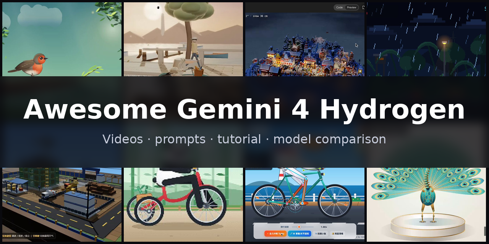](https://www.sandbase.ai/lab/ai-videos/gemini-4-hydrogen?lang=zh-CN&utm_source=github&utm_medium=readme&utm_campaign=awesome-gemini-4-hydrogen&utm_content=banner)

精选 **Gemini 4 Hydrogen 案例**合集：用谷歌的 Gemini 4 Hydrogen（2026 年 11 月 12 日公布）做出的视频、提示词和演示。包括 Three.js 3D 场景、SVG 与 Canvas 动画、动效、产品界面和可在浏览器里玩的游戏，大多是模型根据提示词写成的单文件 HTML 或 SVG，均注明作者并链接原帖。

共 **219 条视频**，来自 **143 位创作者** · **50 条**附作者提示词 · 每天从 [SandBase Lab](https://www.sandbase.ai/lab/ai-videos/gemini-4-hydrogen?lang=zh-CN&utm_source=github&utm_medium=readme&utm_campaign=awesome-gemini-4-hydrogen&utm_content=stats) 同步

## 从这里开始

| 我想… | 去这里 |
|---|---|
| 看视频 | 在下方 [按分类浏览](#contents)，或 [在 SandBase Lab 大屏播放](https://www.sandbase.ai/lab/ai-videos/gemini-4-hydrogen?lang=zh-CN&utm_source=github&utm_medium=readme&utm_campaign=awesome-gemini-4-hydrogen&utm_content=quickstart) |
| 复制提示词 | [提示词索引](docs/zh-CN/prompts.md)：所有附带提示词的视频 |
| 自己写提示词 | [提示词写法](docs/zh-CN/prompt-guide.md)：7 条写法和一个填空模板 |
| 做一个视频 | [教程](docs/zh-CN/tutorial.md)：提示词 → HTML → MP4，含 API 调用和录屏脚本 |
| 选模型 | [Gemini 4 Hydrogen 对照创作者报告与 Lab 实测](docs/zh-CN/model-comparison.md) |
| 马上试试 | [在 Lab 竞技场运行 Gemini 4 Hydrogen](https://www.sandbase.ai/arena/text?models=google%2Fgemini-4-hydrogen&lang=zh-CN&utm_source=github&utm_medium=readme&utm_campaign=awesome-gemini-4-hydrogen&utm_content=quickstart)，和其他模型并排对比 |

<a id="contents"></a>

## 目录

- [精选](#featured) (8)
- [3D 场景](#3d-scene) (67)
- [动效](#motion-graphics) (36)
- [游戏](#game) (19)
- [产品界面](#ui-demo) (8)
- [粒子与形状](#particles) (2)
- [图表图解](#data-viz) (1)
- [讲解](#explainer) (4)
- [测试对比](#comparison) (82)
- [用 Gemini 4 Hydrogen 复刻视频](#recreate)
- [常见问题](#faq)
- [推荐作品](#contribute)

点击预览图播放视频；点击标题前往 SandBase Lab 查看原帖、提示词，并一键 **复刻**；**@作者** 链接到 X 原帖。

<a id="featured"></a>

## 精选

<table>
<tr><td width="33%" valign="top"><a href="https://www.sandbase.ai/lab/media/x/gemini-4-hydrogen/2121745863827697687/video.mp4">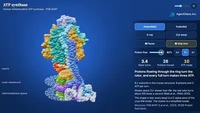</a><br><a href="https://www.sandbase.ai/lab/ai-videos/gemini-4-hydrogen/2121745863827697687?lang=zh-CN&utm_source=github&utm_medium=readme&utm_campaign=awesome-gemini-4-hydrogen&utm_content=card"><b>使用Gemini 4创建的线粒体电机模拟</b></a><br><sub><a href="https://x.com/SidraMiconi/status/2121745863827697687">@SidraMiconi</a> · 0:26 · <a href="https://www.sandbase.ai/lab/ai-videos/gemini-4-hydrogen/2121745863827697687?lang=zh-CN&utm_source=github&utm_medium=readme&utm_campaign=awesome-gemini-4-hydrogen&utm_content=card">提示词</a></sub></td><td width="33%" valign="top"><a href="https://www.sandbase.ai/lab/media/x/gemini-4-hydrogen/2121622062317895753/video.mp4">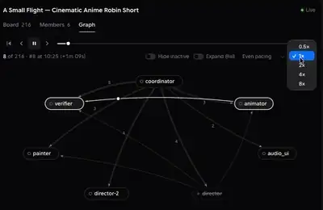</a><br><a href="https://www.sandbase.ai/lab/ai-videos/gemini-4-hydrogen/2121622062317895753?lang=zh-CN&utm_source=github&utm_medium=readme&utm_campaign=awesome-gemini-4-hydrogen&utm_content=card"><b>Antigravity群体图表展示</b></a><br><sub><a href="https://x.com/LuminaBench/status/2121622062317895753">@LuminaBench</a> · 0:20</sub></td><td width="33%" valign="top"><a href="https://www.sandbase.ai/lab/media/x/gemini-4-hydrogen/2121465962863919238/video.mp4">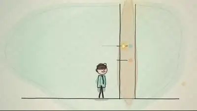</a><br><a href="https://www.sandbase.ai/lab/ai-videos/gemini-4-hydrogen/2121465962863919238?lang=zh-CN&utm_source=github&utm_medium=readme&utm_campaign=awesome-gemini-4-hydrogen&utm_content=card"><b>Gemini 4 Hydrogen 手绘风格动画</b></a><br><sub><a href="https://x.com/hakmgpt/status/2121465962863919238">@hakmgpt</a> · 0:45</sub></td></tr>
<tr><td width="33%" valign="top"><a href="https://www.sandbase.ai/lab/media/x/gemini-4-hydrogen/2124730278992367846/video.mp4">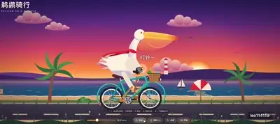</a><br><a href="https://www.sandbase.ai/lab/ai-videos/gemini-4-hydrogen/2124730278992367846?lang=zh-CN&utm_source=github&utm_medium=readme&utm_campaign=awesome-gemini-4-hydrogen&utm_content=card"><b>鹈鹕骑自行车的 SVG 动画演示</b></a><br><sub><a href="https://x.com/leo114119/status/2124730278992367846">@leo114119</a></sub></td><td width="33%" valign="top"><a href="https://www.sandbase.ai/lab/media/x/gemini-4-hydrogen/2121877676042682538/video.mp4">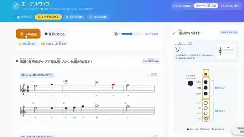</a><br><a href="https://www.sandbase.ai/lab/ai-videos/gemini-4-hydrogen/2121877676042682538?lang=zh-CN&utm_source=github&utm_medium=readme&utm_campaign=awesome-gemini-4-hydrogen&utm_content=card"><b>使用Gemini 4构建的竖笛音乐指南应用</b></a><br><sub><a href="https://x.com/nin222/status/2121877676042682538">@nin222</a> · 0:42</sub></td><td width="33%" valign="top"><a href="https://www.sandbase.ai/lab/media/x/gemini-4-hydrogen/2124421508563149279/video.mp4">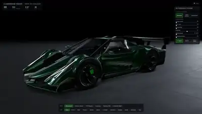</a><br><a href="https://www.sandbase.ai/lab/ai-videos/gemini-4-hydrogen/2124421508563149279?lang=zh-CN&utm_source=github&utm_medium=readme&utm_campaign=awesome-gemini-4-hydrogen&utm_content=card"><b>使用 Three.js 构建的 3D 兰博基尼毒药</b></a><br><sub><a href="https://x.com/Leviwoyun/status/2124421508563149279">@Leviwoyun</a></sub></td></tr>
<tr><td width="33%" valign="top"><a href="https://www.sandbase.ai/lab/media/x/gemini-4-carbon/2121612131615621212/video.mp4">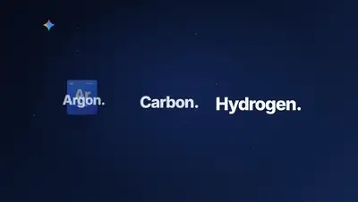</a><br><a href="https://www.sandbase.ai/lab/ai-videos/gemini-4-hydrogen/2121612131615621212?lang=zh-CN&utm_source=github&utm_medium=readme&utm_campaign=awesome-gemini-4-hydrogen&utm_content=card"><b>Gemini 4各版本命名体系科普</b></a><br><sub><a href="https://x.com/HarshithLucky3/status/2121612131615621212">@HarshithLucky3</a> · 0:15</sub></td><td width="33%" valign="top"><a href="https://www.sandbase.ai/lab/media/x/gemini-4-carbon/2122645874249699423/video.mp4"></a><br><a href="https://www.sandbase.ai/lab/ai-videos/gemini-4-hydrogen/2122645874249699423?lang=zh-CN&utm_source=github&utm_medium=readme&utm_campaign=awesome-gemini-4-hydrogen&utm_content=card"><b>通过AI助理调用Gemini 4 Hydrogen</b></a><br><sub><a href="https://x.com/HimazinProducer/status/2122645874249699423">@HimazinProducer</a> · 0:10</sub></td></tr>
</table>

<a id="3d-scene"></a>

## 3D 场景

<table>
<tr><td width="33%" valign="top"><a href="https://www.sandbase.ai/lab/media/x/gemini-4-hydrogen/2120776850431717567/video.mp4">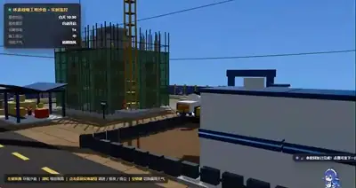</a><br><a href="https://www.sandbase.ai/lab/ai-videos/gemini-4-hydrogen/2120776850431717567?lang=zh-CN&utm_source=github&utm_medium=readme&utm_campaign=awesome-gemini-4-hydrogen&utm_content=card"><b>Python 调用生成的单页面 HTML 3D 场景</b></a><br><sub><a href="https://x.com/huang18825/status/2120776850431717567">@huang18825</a> · 0:26</sub></td><td width="33%" valign="top"><a href="https://www.sandbase.ai/lab/media/x/gemini-4-hydrogen/2120935535422374055/video.mp4">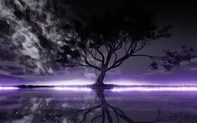</a><br><a href="https://www.sandbase.ai/lab/ai-videos/gemini-4-hydrogen/2120935535422374055?lang=zh-CN&utm_source=github&utm_medium=readme&utm_campaign=awesome-gemini-4-hydrogen&utm_content=card"><b>包含天空与水面反射的程序化三维场景</b></a><br><sub><a href="https://x.com/HarshithLucky3/status/2120935535422374055">@HarshithLucky3</a> · 0:43</sub></td><td width="33%" valign="top"><a href="https://www.sandbase.ai/lab/media/x/gemini-4-hydrogen/2120937159473660224/video.mp4">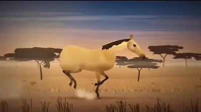</a><br><a href="https://www.sandbase.ai/lab/ai-videos/gemini-4-hydrogen/2120937159473660224?lang=zh-CN&utm_source=github&utm_medium=readme&utm_campaign=awesome-gemini-4-hydrogen&utm_content=card"><b>Three.js 制作的奔跑骏马动画</b></a><br><sub><a href="https://x.com/AI_Screening/status/2120937159473660224">@AI_Screening</a> · 0:21</sub></td></tr>
<tr><td width="33%" valign="top"><a href="https://www.sandbase.ai/lab/media/x/gemini-4-hydrogen/2120938275594756296/video.mp4"></a><br><a href="https://www.sandbase.ai/lab/ai-videos/gemini-4-hydrogen/2120938275594756296?lang=zh-CN&utm_source=github&utm_medium=readme&utm_campaign=awesome-gemini-4-hydrogen&utm_content=card"><b>日出时分的体素风格中国山地寺庙</b></a><br><sub><a href="https://x.com/camperaigg/status/2120938275594756296">@camperaigg</a> · 0:24 · <a href="https://www.sandbase.ai/lab/ai-videos/gemini-4-hydrogen/2120938275594756296?lang=zh-CN&utm_source=github&utm_medium=readme&utm_campaign=awesome-gemini-4-hydrogen&utm_content=card">提示词</a></sub></td><td width="33%" valign="top"><a href="https://www.sandbase.ai/lab/media/x/gemini-4-hydrogen/2120940617169826037/video.mp4">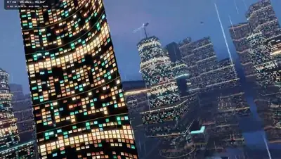</a><br><a href="https://www.sandbase.ai/lab/ai-videos/gemini-4-hydrogen/2120940617169826037?lang=zh-CN&utm_source=github&utm_medium=readme&utm_campaign=awesome-gemini-4-hydrogen&utm_content=card"><b>Three.js 构建的未来城市飞越场景</b></a><br><sub><a href="https://x.com/kimmonismus/status/2120940617169826037">@kimmonismus</a> · 0:20</sub></td><td width="33%" valign="top"><a href="https://www.sandbase.ai/lab/media/x/gemini-4-hydrogen/2120951069874532806/video.mp4">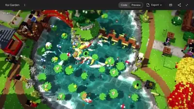</a><br><a href="https://www.sandbase.ai/lab/ai-videos/gemini-4-hydrogen/2120951069874532806?lang=zh-CN&utm_source=github&utm_medium=readme&utm_campaign=awesome-gemini-4-hydrogen&utm_content=card"><b>使用 Gemini 模块化构建的锦鲤花园项目</b></a><br><sub><a href="https://x.com/IamEmily2050/status/2120951069874532806">@IamEmily2050</a> · 1:00</sub></td></tr>
</table>

<details>
<summary><b>展开全部 67 条</b></summary>

<table>
<tr><td width="33%" valign="top"><a href="https://www.sandbase.ai/lab/media/x/gemini-4-hydrogen/2120953932692537722/video.mp4">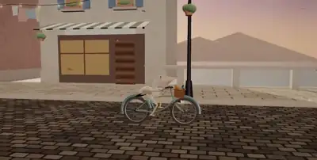</a><br><a href="https://www.sandbase.ai/lab/ai-videos/gemini-4-hydrogen/2120953932692537722?lang=zh-CN&utm_source=github&utm_medium=readme&utm_campaign=awesome-gemini-4-hydrogen&utm_content=card"><b>鹈鹕骑自行车的3D动画场景</b></a><br><sub><a href="https://x.com/nehstrr3/status/2120953932692537722">@nehstrr3</a> · 0:35</sub></td><td width="33%" valign="top"><a href="https://www.sandbase.ai/lab/media/x/gemini-4-hydrogen/2120957446202253803/video.mp4">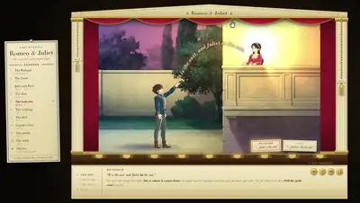</a><br><a href="https://www.sandbase.ai/lab/ai-videos/gemini-4-hydrogen/2120957446202253803?lang=zh-CN&utm_source=github&utm_medium=readme&utm_campaign=awesome-gemini-4-hydrogen&utm_content=card"><b>罗密欧与朱丽叶阳台场景3D纸艺剧场</b></a><br><sub><a href="https://x.com/techartist_/status/2120957446202253803">@techartist_</a> · 0:23</sub></td><td width="33%" valign="top"><a href="https://www.sandbase.ai/lab/media/x/gemini-4-hydrogen/2120970648168042967/video.mp4">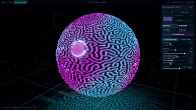</a><br><a href="https://www.sandbase.ai/lab/ai-videos/gemini-4-hydrogen/2120970648168042967?lang=zh-CN&utm_source=github&utm_medium=readme&utm_campaign=awesome-gemini-4-hydrogen&utm_content=card"><b>Three.js中的3D反应扩散有机体</b></a><br><sub><a href="https://x.com/sunset_evm/status/2120970648168042967">@sunset_evm</a> · 0:15</sub></td></tr>
<tr><td width="33%" valign="top"><a href="https://www.sandbase.ai/lab/media/x/gemini-4-hydrogen/2120972707965931603/video.mp4">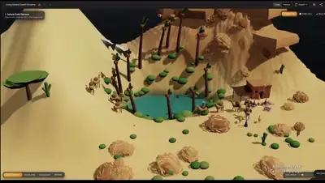</a><br><a href="https://www.sandbase.ai/lab/ai-videos/gemini-4-hydrogen/2120972707965931603?lang=zh-CN&utm_source=github&utm_medium=readme&utm_campaign=awesome-gemini-4-hydrogen&utm_content=card"><b>Three.js等距撒哈拉沙漠场景</b></a><br><sub><a href="https://x.com/ItsmeAjayKV/status/2120972707965931603">@ItsmeAjayKV</a> · 0:57</sub></td><td width="33%" valign="top"><a href="https://www.sandbase.ai/lab/media/x/gemini-4-hydrogen/2120972954146140409/video.mp4">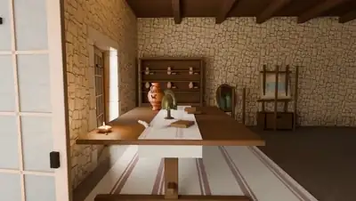</a><br><a href="https://www.sandbase.ai/lab/ai-videos/gemini-4-hydrogen/2120972954146140409?lang=zh-CN&utm_source=github&utm_medium=readme&utm_campaign=awesome-gemini-4-hydrogen&utm_content=card"><b>Gemini 4 Hydrogen 构建的 Three.js 项目</b></a><br><sub><a href="https://x.com/SPAC89/status/2120972954146140409">@SPAC89</a> · 0:28</sub></td><td width="33%" valign="top"><a href="https://www.sandbase.ai/lab/media/x/gemini-4-hydrogen/2120979135975809516/video.mp4"></a><br><a href="https://www.sandbase.ai/lab/ai-videos/gemini-4-hydrogen/2120979135975809516?lang=zh-CN&utm_source=github&utm_medium=readme&utm_campaign=awesome-gemini-4-hydrogen&utm_content=card"><b>Three.js实现的冰晶飘落模拟</b></a><br><sub><a href="https://x.com/camperaigg/status/2120979135975809516">@camperaigg</a> · 0:18 · <a href="https://www.sandbase.ai/lab/ai-videos/gemini-4-hydrogen/2120979135975809516?lang=zh-CN&utm_source=github&utm_medium=readme&utm_campaign=awesome-gemini-4-hydrogen&utm_content=card">提示词</a></sub></td></tr>
<tr><td width="33%" valign="top"><a href="https://www.sandbase.ai/lab/media/x/gemini-4-hydrogen/2120981734040674518/video.mp4">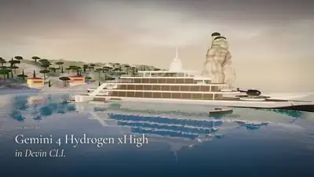</a><br><a href="https://www.sandbase.ai/lab/ai-videos/gemini-4-hydrogen/2120981734040674518?lang=zh-CN&utm_source=github&utm_medium=readme&utm_campaign=awesome-gemini-4-hydrogen&utm_content=card"><b>Three.js实现的卡普里海岸巨型游艇实时动画</b></a><br><sub><a href="https://x.com/Chris_Wozniczek/status/2120981734040674518">@Chris_Wozniczek</a> · 1:10</sub></td><td width="33%" valign="top"><a href="https://www.sandbase.ai/lab/media/x/gemini-4-hydrogen/2120999326038044771/video.mp4">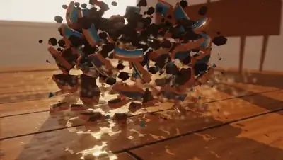</a><br><a href="https://www.sandbase.ai/lab/ai-videos/gemini-4-hydrogen/2120999326038044771?lang=zh-CN&utm_source=github&utm_medium=readme&utm_campaign=awesome-gemini-4-hydrogen&utm_content=card"><b>Three.js 陶罐碎裂物理模拟</b></a><br><sub><a href="https://x.com/camperaigg/status/2120999326038044771">@camperaigg</a> · 0:16</sub></td><td width="33%" valign="top"><a href="https://www.sandbase.ai/lab/media/x/gemini-4-hydrogen/2121006210082324528/video.mp4">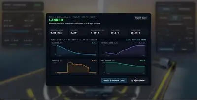</a><br><a href="https://www.sandbase.ai/lab/ai-videos/gemini-4-hydrogen/2121006210082324528?lang=zh-CN&utm_source=github&utm_medium=readme&utm_campaign=awesome-gemini-4-hydrogen&utm_content=card"><b>Three.js实现的猎鹰9号火箭着陆模拟</b></a><br><sub><a href="https://x.com/tinkerlog/status/2121006210082324528">@tinkerlog</a> · 1:51</sub></td></tr>
<tr><td width="33%" valign="top"><a href="https://www.sandbase.ai/lab/media/x/gemini-4-hydrogen/2121079696557535597/video.mp4">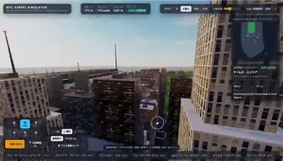</a><br><a href="https://www.sandbase.ai/lab/ai-videos/gemini-4-hydrogen/2121079696557535597?lang=zh-CN&utm_source=github&utm_medium=readme&utm_campaign=awesome-gemini-4-hydrogen&utm_content=card"><b>Three.js纽约市飞行模拟场景</b></a><br><sub><a href="https://x.com/yharuto0917/status/2121079696557535597">@yharuto0917</a> · 1:11</sub></td><td width="33%" valign="top"><a href="https://www.sandbase.ai/lab/media/x/gemini-4-hydrogen/2121089280583901375/video.mp4">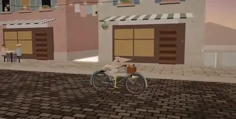</a><br><a href="https://www.sandbase.ai/lab/ai-videos/gemini-4-hydrogen/2121089280583901375?lang=zh-CN&utm_source=github&utm_medium=readme&utm_campaign=awesome-gemini-4-hydrogen&utm_content=card"><b>鹈鹕骑自行车的3D动画场景</b></a><br><sub><a href="https://x.com/Shohank9n1/status/2121089280583901375">@Shohank9n1</a> · 0:29 · <a href="https://www.sandbase.ai/lab/ai-videos/gemini-4-hydrogen/2121089280583901375?lang=zh-CN&utm_source=github&utm_medium=readme&utm_campaign=awesome-gemini-4-hydrogen&utm_content=card">提示词</a></sub></td><td width="33%" valign="top"><a href="https://www.sandbase.ai/lab/media/x/gemini-4-hydrogen/2121108557735289029/video.mp4">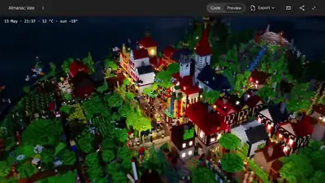</a><br><a href="https://www.sandbase.ai/lab/ai-videos/gemini-4-hydrogen/2121108557735289029?lang=zh-CN&utm_source=github&utm_medium=readme&utm_campaign=awesome-gemini-4-hydrogen&utm_content=card"><b>多模块提示词生成的 Almance Vale</b></a><br><sub><a href="https://x.com/IamEmily2050/status/2121108557735289029">@IamEmily2050</a> · 1:00</sub></td></tr>
<tr><td width="33%" valign="top"><a href="https://www.sandbase.ai/lab/media/x/gemini-4-hydrogen/2121115630459920809/video.mp4">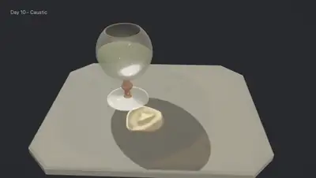</a><br><a href="https://www.sandbase.ai/lab/ai-videos/gemini-4-hydrogen/2121115630459920809?lang=zh-CN&utm_source=github&utm_medium=readme&utm_campaign=awesome-gemini-4-hydrogen&utm_content=card"><b>WebGPU中的水下焦散反射与环绕主光效果</b></a><br><sub><a href="https://x.com/AI_Andrew/status/2121115630459920809">@AI_Andrew</a> · 0:40</sub></td><td width="33%" valign="top"><a href="https://www.sandbase.ai/lab/media/x/gemini-4-hydrogen/2121128385690693821/video.mp4">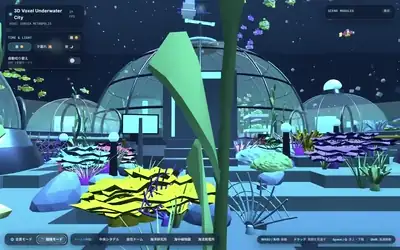</a><br><a href="https://www.sandbase.ai/lab/ai-videos/gemini-4-hydrogen/2121128385690693821?lang=zh-CN&utm_source=github&utm_medium=readme&utm_campaign=awesome-gemini-4-hydrogen&utm_content=card"><b>可自由探索的 3D 海底城市</b></a><br><sub><a href="https://x.com/ayyh_18/status/2121128385690693821">@ayyh_18</a> · 0:50</sub></td><td width="33%" valign="top"><a href="https://www.sandbase.ai/lab/media/x/gemini-4-hydrogen/2121163760081440784/video.mp4">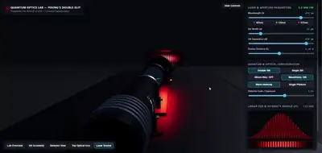</a><br><a href="https://www.sandbase.ai/lab/ai-videos/gemini-4-hydrogen/2121163760081440784?lang=zh-CN&utm_source=github&utm_medium=readme&utm_campaign=awesome-gemini-4-hydrogen&utm_content=card"><b>三维双缝干涉量子物理实验模拟</b></a><br><sub><a href="https://x.com/analogalok/status/2121163760081440784">@analogalok</a> · 0:30 · <a href="https://www.sandbase.ai/lab/ai-videos/gemini-4-hydrogen/2121163760081440784?lang=zh-CN&utm_source=github&utm_medium=readme&utm_campaign=awesome-gemini-4-hydrogen&utm_content=card">提示词</a></sub></td></tr>
<tr><td width="33%" valign="top"><a href="https://www.sandbase.ai/lab/media/x/gemini-4-hydrogen/2121165467821936651/video.mp4">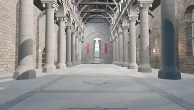</a><br><a href="https://www.sandbase.ai/lab/ai-videos/gemini-4-hydrogen/2121165467821936651?lang=zh-CN&utm_source=github&utm_medium=readme&utm_campaign=awesome-gemini-4-hydrogen&utm_content=card"><b>Blender MCP 复刻铁王座大厅</b></a><br><sub><a href="https://x.com/ashen_one/status/2121165467821936651">@ashen_one</a> · 0:15</sub></td><td width="33%" valign="top"><a href="https://www.sandbase.ai/lab/media/x/gemini-4-hydrogen/2121169304649638116/video.mp4"></a><br><a href="https://www.sandbase.ai/lab/ai-videos/gemini-4-hydrogen/2121169304649638116?lang=zh-CN&utm_source=github&utm_medium=readme&utm_campaign=awesome-gemini-4-hydrogen&utm_content=card"><b>使用 Three.js 与 Antigravity 构建的场景</b></a><br><sub><a href="https://x.com/AI_Screening/status/2121169304649638116">@AI_Screening</a> · 0:14</sub></td><td width="33%" valign="top"><a href="https://www.sandbase.ai/lab/media/x/gemini-4-hydrogen/2121172856889618528/video.mp4"></a><br><a href="https://www.sandbase.ai/lab/ai-videos/gemini-4-hydrogen/2121172856889618528?lang=zh-CN&utm_source=github&utm_medium=readme&utm_campaign=awesome-gemini-4-hydrogen&utm_content=card"><b>Three.js 灰度风格海盗船模型</b></a><br><sub><a href="https://x.com/parves075/status/2121172856889618528">@parves075</a> · 0:37</sub></td></tr>
<tr><td width="33%" valign="top"><a href="https://www.sandbase.ai/lab/media/x/gemini-4-hydrogen/2121200010574598655/video.mp4">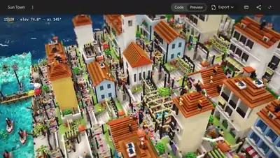</a><br><a href="https://www.sandbase.ai/lab/ai-videos/gemini-4-hydrogen/2121200010574598655?lang=zh-CN&utm_source=github&utm_medium=readme&utm_campaign=awesome-gemini-4-hydrogen&utm_content=card"><b>Sun Twon 多模块场景生成测试</b></a><br><sub><a href="https://x.com/IamEmily2050/status/2121200010574598655">@IamEmily2050</a> · 1:00</sub></td><td width="33%" valign="top"><a href="https://www.sandbase.ai/lab/media/x/gemini-4-hydrogen/2121209712465297565/video.mp4">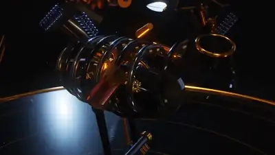</a><br><a href="https://www.sandbase.ai/lab/ai-videos/gemini-4-hydrogen/2121209712465297565?lang=zh-CN&utm_source=github&utm_medium=readme&utm_campaign=awesome-gemini-4-hydrogen&utm_content=card"><b>Three.js程序化生成的机械鸟</b></a><br><sub><a href="https://x.com/camperaigg/status/2121209712465297565">@camperaigg</a> · 0:18</sub></td><td width="33%" valign="top"><a href="https://www.sandbase.ai/lab/media/x/gemini-4-hydrogen/2121254256288137484/video.mp4">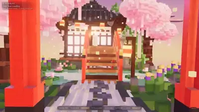</a><br><a href="https://www.sandbase.ai/lab/ai-videos/gemini-4-hydrogen/2121254256288137484?lang=zh-CN&utm_source=github&utm_medium=readme&utm_campaign=awesome-gemini-4-hydrogen&utm_content=card"><b>单HTML文件纯Three.js场景</b></a><br><sub><a href="https://x.com/SahilPanhotra/status/2121254256288137484">@SahilPanhotra</a> · 0:28</sub></td></tr>
<tr><td width="33%" valign="top"><a href="https://www.sandbase.ai/lab/media/x/gemini-4-hydrogen/2121259604076036239/video.mp4">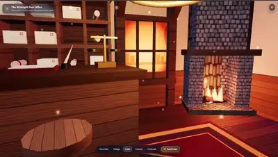</a><br><a href="https://www.sandbase.ai/lab/ai-videos/gemini-4-hydrogen/2121259604076036239?lang=zh-CN&utm_source=github&utm_medium=readme&utm_campaign=awesome-gemini-4-hydrogen&utm_content=card"><b>浮空岛邮局交互式微缩3D场景</b></a><br><sub><a href="https://x.com/jony_palino/status/2121259604076036239">@jony_palino</a> · 0:37</sub></td><td width="33%" valign="top"><a href="https://www.sandbase.ai/lab/media/x/gemini-4-hydrogen/2121279837512106168/video.mp4">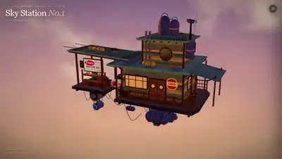</a><br><a href="https://www.sandbase.ai/lab/ai-videos/gemini-4-hydrogen/2121279837512106168?lang=zh-CN&utm_source=github&utm_medium=readme&utm_campaign=awesome-gemini-4-hydrogen&utm_content=card"><b>空中加油站与复古飞行汽车</b></a><br><sub><a href="https://x.com/doe_naps/status/2121279837512106168">@doe_naps</a> · 0:35</sub></td><td width="33%" valign="top"><a href="https://www.sandbase.ai/lab/media/x/gemini-4-hydrogen/2121298325412745396/video.mp4">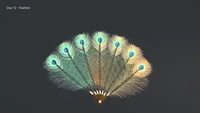</a><br><a href="https://www.sandbase.ai/lab/ai-videos/gemini-4-hydrogen/2121298325412745396?lang=zh-CN&utm_source=github&utm_medium=readme&utm_campaign=awesome-gemini-4-hydrogen&utm_content=card"><b>WebGPU呈现的闪亮孔雀羽毛</b></a><br><sub><a href="https://x.com/AI_Andrew/status/2121298325412745396">@AI_Andrew</a> · 0:20</sub></td></tr>
<tr><td width="33%" valign="top"><a href="https://www.sandbase.ai/lab/media/x/gemini-4-hydrogen/2121330663106474327/video.mp4">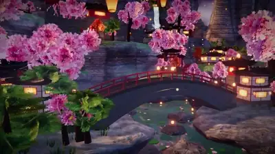</a><br><a href="https://www.sandbase.ai/lab/ai-videos/gemini-4-hydrogen/2121330663106474327?lang=zh-CN&utm_source=github&utm_medium=readme&utm_campaign=awesome-gemini-4-hydrogen&utm_content=card"><b>使用群集模式的Three.js动画测试</b></a><br><sub><a href="https://x.com/DanjiTosaka/status/2121330663106474327">@DanjiTosaka</a> · 0:31 · <a href="https://www.sandbase.ai/lab/ai-videos/gemini-4-hydrogen/2121330663106474327?lang=zh-CN&utm_source=github&utm_medium=readme&utm_campaign=awesome-gemini-4-hydrogen&utm_content=card">提示词</a></sub></td><td width="33%" valign="top"><a href="https://www.sandbase.ai/lab/media/x/gemini-4-hydrogen/2121354542344466565/video.mp4">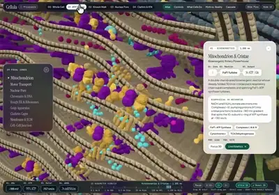</a><br><a href="https://www.sandbase.ai/lab/ai-videos/gemini-4-hydrogen/2121354542344466565?lang=zh-CN&utm_source=github&utm_medium=readme&utm_campaign=awesome-gemini-4-hydrogen&utm_content=card"><b>人类细胞交互式3D百科全书</b></a><br><sub><a href="https://x.com/soumyadesign/status/2121354542344466565">@soumyadesign</a> · 0:47</sub></td><td width="33%" valign="top"><a href="https://www.sandbase.ai/lab/media/x/gemini-4-hydrogen/2121393266318823550/video.mp4">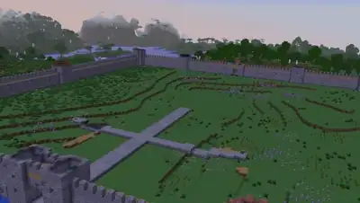</a><br><a href="https://www.sandbase.ai/lab/ai-videos/gemini-4-hydrogen/2121393266318823550?lang=zh-CN&utm_source=github&utm_medium=readme&utm_campaign=awesome-gemini-4-hydrogen&utm_content=card"><b>AI建造并拍摄的我的世界中世纪村庄</b></a><br><sub><a href="https://x.com/jan_volad/status/2121393266318823550">@jan_volad</a> · 0:52</sub></td></tr>
<tr><td width="33%" valign="top"><a href="https://www.sandbase.ai/lab/media/x/gemini-4-hydrogen/2121554731034362171/video.mp4">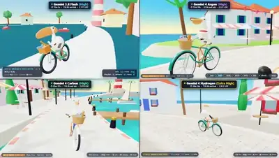</a><br><a href="https://www.sandbase.ai/lab/ai-videos/gemini-4-hydrogen/2121554731034362171?lang=zh-CN&utm_source=github&utm_medium=readme&utm_campaign=awesome-gemini-4-hydrogen&utm_content=card"><b>Three.js中的鹈鹕骑自行车3D场景</b></a><br><sub><a href="https://x.com/StatsWire/status/2121554731034362171">@StatsWire</a> · 0:45</sub></td><td width="33%" valign="top"><a href="https://www.sandbase.ai/lab/media/x/gemini-4-hydrogen/2121590376544997507/video.mp4">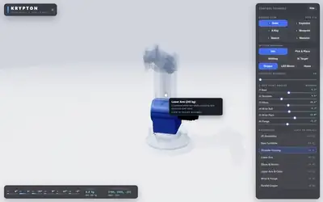</a><br><a href="https://www.sandbase.ai/lab/ai-videos/gemini-4-hydrogen/2121590376544997507?lang=zh-CN&utm_source=github&utm_medium=readme&utm_campaign=awesome-gemini-4-hydrogen&utm_content=card"><b>Three.js交互式3D工业机械臂</b></a><br><sub><a href="https://x.com/HarshithLucky3/status/2121590376544997507">@HarshithLucky3</a> · 0:55 · <a href="https://www.sandbase.ai/lab/ai-videos/gemini-4-hydrogen/2121590376544997507?lang=zh-CN&utm_source=github&utm_medium=readme&utm_campaign=awesome-gemini-4-hydrogen&utm_content=card">提示词</a></sub></td><td width="33%" valign="top"><a href="https://www.sandbase.ai/lab/media/x/gemini-4-hydrogen/2121745863827697687/video.mp4"></a><br><a href="https://www.sandbase.ai/lab/ai-videos/gemini-4-hydrogen/2121745863827697687?lang=zh-CN&utm_source=github&utm_medium=readme&utm_campaign=awesome-gemini-4-hydrogen&utm_content=card"><b>使用Gemini 4创建的线粒体电机模拟</b></a><br><sub><a href="https://x.com/SidraMiconi/status/2121745863827697687">@SidraMiconi</a> · 0:26 · <a href="https://www.sandbase.ai/lab/ai-videos/gemini-4-hydrogen/2121745863827697687?lang=zh-CN&utm_source=github&utm_medium=readme&utm_campaign=awesome-gemini-4-hydrogen&utm_content=card">提示词</a></sub></td></tr>
<tr><td width="33%" valign="top"><a href="https://www.sandbase.ai/lab/media/x/gemini-4-hydrogen/2121778642665816215/video.mp4">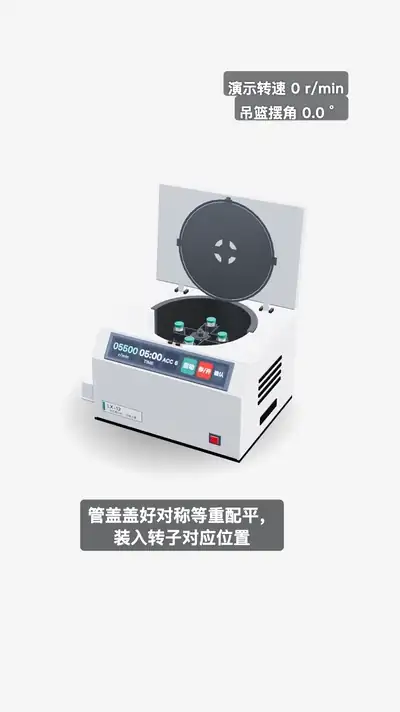</a><br><a href="https://www.sandbase.ai/lab/ai-videos/gemini-4-hydrogen/2121778642665816215?lang=zh-CN&utm_source=github&utm_medium=readme&utm_campaign=awesome-gemini-4-hydrogen&utm_content=card"><b>Gemini生成的3D交互式离心机网页</b></a><br><sub><a href="https://x.com/CopperForgeAI/status/2121778642665816215">@CopperForgeAI</a> · 0:21</sub></td><td width="33%" valign="top"><a href="https://www.sandbase.ai/lab/media/x/gemini-4-hydrogen/2121896295220785467/video.mp4">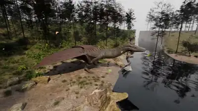</a><br><a href="https://www.sandbase.ai/lab/ai-videos/gemini-4-hydrogen/2121896295220785467?lang=zh-CN&utm_source=github&utm_medium=readme&utm_campaign=awesome-gemini-4-hydrogen&utm_content=card"><b>Blender中的飞龙飞行与咆哮动画</b></a><br><sub><a href="https://x.com/kesarisandeep4u/status/2121896295220785467">@kesarisandeep4u</a> · 0:35</sub></td><td width="33%" valign="top"><a href="https://www.sandbase.ai/lab/media/x/gemini-4-hydrogen/2121902216261013532/video.mp4">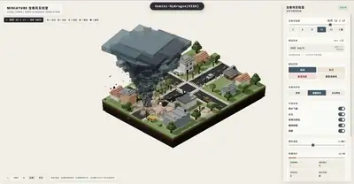</a><br><a href="https://www.sandbase.ai/lab/ai-videos/gemini-4-hydrogen/2121902216261013532?lang=zh-CN&utm_source=github&utm_medium=readme&utm_campaign=awesome-gemini-4-hydrogen&utm_content=card"><b>Three.js可爱的可爱小镇龙卷风模拟器</b></a><br><sub><a href="https://x.com/cfenghub/status/2121902216261013532">@cfenghub</a> · 0:25</sub></td></tr>
<tr><td width="33%" valign="top"><a href="https://www.sandbase.ai/lab/media/x/gemini-4-hydrogen/2121960943361896596/video.mp4">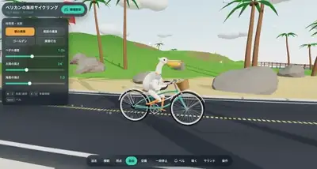</a><br><a href="https://www.sandbase.ai/lab/ai-videos/gemini-4-hydrogen/2121960943361896596?lang=zh-CN&utm_source=github&utm_medium=readme&utm_campaign=awesome-gemini-4-hydrogen&utm_content=card"><b>Three.js中沿海骑自行车的鹈鹕3D场景</b></a><br><sub><a href="https://x.com/Aki_LIG/status/2121960943361896596">@Aki_LIG</a> · 2:48 · <a href="https://www.sandbase.ai/lab/ai-videos/gemini-4-hydrogen/2121960943361896596?lang=zh-CN&utm_source=github&utm_medium=readme&utm_campaign=awesome-gemini-4-hydrogen&utm_content=card">提示词</a></sub></td><td width="33%" valign="top"><a href="https://www.sandbase.ai/lab/media/x/gemini-4-hydrogen/2121991166136590744/video.mp4">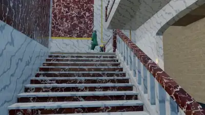</a><br><a href="https://www.sandbase.ai/lab/ai-videos/gemini-4-hydrogen/2121991166136590744?lang=zh-CN&utm_source=github&utm_medium=readme&utm_campaign=awesome-gemini-4-hydrogen&utm_content=card"><b>基于真实图纸构建的1780年代凡尔赛宫3D场景</b></a><br><sub><a href="https://x.com/c_nemri/status/2121991166136590744">@c_nemri</a> · 1:13</sub></td><td width="33%" valign="top"><a href="https://www.sandbase.ai/lab/media/x/gemini-4-hydrogen/2121994622511845677/video.mp4">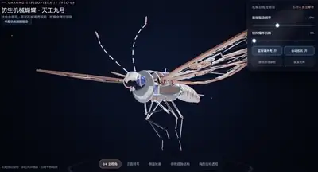</a><br><a href="https://www.sandbase.ai/lab/ai-videos/gemini-4-hydrogen/2121994622511845677?lang=zh-CN&utm_source=github&utm_medium=readme&utm_campaign=awesome-gemini-4-hydrogen&utm_content=card"><b>使用Three.js创建的机械蝴蝶</b></a><br><sub><a href="https://x.com/dragono64v/status/2121994622511845677">@dragono64v</a> · 0:37</sub></td></tr>
<tr><td width="33%" valign="top"><a href="https://www.sandbase.ai/lab/media/x/gemini-4-hydrogen/2122000359602196495/video.mp4">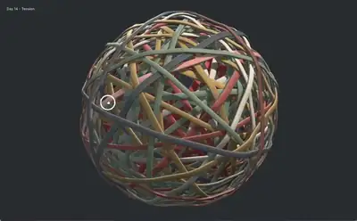</a><br><a href="https://www.sandbase.ai/lab/ai-videos/gemini-4-hydrogen/2122000359602196495?lang=zh-CN&utm_source=github&utm_medium=readme&utm_campaign=awesome-gemini-4-hydrogen&utm_content=card"><b>WebGPU交互式橡皮筋球</b></a><br><sub><a href="https://x.com/AI_Andrew/status/2122000359602196495">@AI_Andrew</a> · 0:05</sub></td><td width="33%" valign="top"><a href="https://www.sandbase.ai/lab/media/x/gemini-4-hydrogen/2122019069411172393/video.mp4">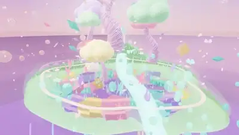</a><br><a href="https://www.sandbase.ai/lab/ai-videos/gemini-4-hydrogen/2122019069411172393?lang=zh-CN&utm_source=github&utm_medium=readme&utm_campaign=awesome-gemini-4-hydrogen&utm_content=card"><b>Three.js生成的奇幻糖果星球孤岛3D微缩世界</b></a><br><sub><a href="https://x.com/dragono64v/status/2122019069411172393">@dragono64v</a> · 0:20</sub></td><td width="33%" valign="top"><a href="https://www.sandbase.ai/lab/media/x/gemini-4-hydrogen/2122177107216503211/video.mp4">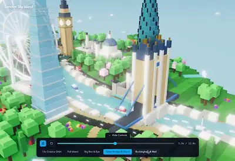</a><br><a href="https://www.sandbase.ai/lab/ai-videos/gemini-4-hydrogen/2122177107216503211?lang=zh-CN&utm_source=github&utm_medium=readme&utm_campaign=awesome-gemini-4-hydrogen&utm_content=card"><b>Gemini 4 Hydrogen生成的Three.js小岛</b></a><br><sub><a href="https://x.com/Dav338876/status/2122177107216503211">@Dav338876</a> · 0:27</sub></td></tr>
<tr><td width="33%" valign="top"><a href="https://www.sandbase.ai/lab/media/x/gemini-4-argon/2122253350808744004/video.mp4"></a><br><a href="https://www.sandbase.ai/lab/ai-videos/gemini-4-hydrogen/2122253350808744004?lang=zh-CN&utm_source=github&utm_medium=readme&utm_campaign=awesome-gemini-4-hydrogen&utm_content=card"><b>使用视频Minimax模型制作的可爱角色动画</b></a><br><sub><a href="https://x.com/nyapan_mohy/status/2122253350808744004">@nyapan_mohy</a> · 0:15 · <a href="https://www.sandbase.ai/lab/ai-videos/gemini-4-hydrogen/2122253350808744004?lang=zh-CN&utm_source=github&utm_medium=readme&utm_campaign=awesome-gemini-4-hydrogen&utm_content=card">提示词</a></sub></td><td width="33%" valign="top"><a href="https://www.sandbase.ai/lab/media/x/gemini-4-hydrogen/2122255731411849691/video.mp4">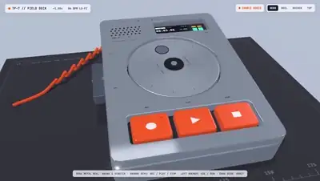</a><br><a href="https://www.sandbase.ai/lab/ai-videos/gemini-4-hydrogen/2122255731411849691?lang=zh-CN&utm_source=github&utm_medium=readme&utm_campaign=awesome-gemini-4-hydrogen&utm_content=card"><b>纯代码生成的TP-7交互录音机</b></a><br><sub><a href="https://x.com/FiniYang/status/2122255731411849691">@FiniYang</a> · 0:14 · <a href="https://www.sandbase.ai/lab/ai-videos/gemini-4-hydrogen/2122255731411849691?lang=zh-CN&utm_source=github&utm_medium=readme&utm_campaign=awesome-gemini-4-hydrogen&utm_content=card">提示词</a></sub></td><td width="33%" valign="top"><a href="https://www.sandbase.ai/lab/media/x/gemini-4-hydrogen/2122303514907214287/video.mp4">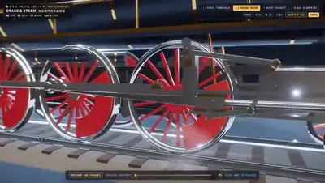</a><br><a href="https://www.sandbase.ai/lab/ai-videos/gemini-4-hydrogen/2122303514907214287?lang=zh-CN&utm_source=github&utm_medium=readme&utm_campaign=awesome-gemini-4-hydrogen&utm_content=card"><b>基于Three.js的程序化蒸汽机车装配</b></a><br><sub><a href="https://x.com/FiniYang/status/2122303514907214287">@FiniYang</a> · 0:16</sub></td></tr>
<tr><td width="33%" valign="top"><a href="https://www.sandbase.ai/lab/media/x/gemini-4-hydrogen/2122355544811794832/video.mp4"></a><br><a href="https://www.sandbase.ai/lab/ai-videos/gemini-4-hydrogen/2122355544811794832?lang=zh-CN&utm_source=github&utm_medium=readme&utm_campaign=awesome-gemini-4-hydrogen&utm_content=card"><b>带有渲染器效果的卡通风格3D世界</b></a><br><sub><a href="https://x.com/parazar/status/2122355544811794832">@parazar</a> · 1:14</sub></td><td width="33%" valign="top"><a href="https://www.sandbase.ai/lab/media/x/gemini-4-hydrogen/2122367785749934533/video.mp4"></a><br><a href="https://www.sandbase.ai/lab/ai-videos/gemini-4-hydrogen/2122367785749934533?lang=zh-CN&utm_source=github&utm_medium=readme&utm_campaign=awesome-gemini-4-hydrogen&utm_content=card"><b>使用Gemini-4-hydrogen复刻泰坦尼克号场景</b></a><br><sub><a href="https://x.com/Dav338876/status/2122367785749934533">@Dav338876</a> · 1:13</sub></td><td width="33%" valign="top"><a href="https://www.sandbase.ai/lab/media/x/gemini-4-hydrogen/2122424240641376674/video.mp4"></a><br><a href="https://www.sandbase.ai/lab/ai-videos/gemini-4-hydrogen/2122424240641376674?lang=zh-CN&utm_source=github&utm_medium=readme&utm_campaign=awesome-gemini-4-hydrogen&utm_content=card"><b>使用Gemini-4-hydrogen制作的Blender场景</b></a><br><sub><a href="https://x.com/SPAC89/status/2122424240641376674">@SPAC89</a> · 0:50</sub></td></tr>
<tr><td width="33%" valign="top"><a href="https://www.sandbase.ai/lab/media/x/gemini-4-hydrogen/2122471069659656310/video.mp4"></a><br><a href="https://www.sandbase.ai/lab/ai-videos/gemini-4-hydrogen/2122471069659656310?lang=zh-CN&utm_source=github&utm_medium=readme&utm_campaign=awesome-gemini-4-hydrogen&utm_content=card"><b>StageFlow通过Three.js生成的场景编排演示</b></a><br><sub><a href="https://x.com/tarumainfo/status/2122471069659656310">@tarumainfo</a></sub></td><td width="33%" valign="top"><a href="https://www.sandbase.ai/lab/media/x/gemini-4-hydrogen/2122608311912780243/video.mp4"></a><br><a href="https://www.sandbase.ai/lab/ai-videos/gemini-4-hydrogen/2122608311912780243?lang=zh-CN&utm_source=github&utm_medium=readme&utm_campaign=awesome-gemini-4-hydrogen&utm_content=card"><b>Three.js交互式3D直流电机</b></a><br><sub><a href="https://x.com/analogalok/status/2122608311912780243">@analogalok</a> · <a href="https://www.sandbase.ai/lab/ai-videos/gemini-4-hydrogen/2122608311912780243?lang=zh-CN&utm_source=github&utm_medium=readme&utm_campaign=awesome-gemini-4-hydrogen&utm_content=card">提示词</a></sub></td><td width="33%" valign="top"><a href="https://www.sandbase.ai/lab/media/x/gemini-4-hydrogen/2122609183837049037/video.mp4"></a><br><a href="https://www.sandbase.ai/lab/ai-videos/gemini-4-hydrogen/2122609183837049037?lang=zh-CN&utm_source=github&utm_medium=readme&utm_campaign=awesome-gemini-4-hydrogen&utm_content=card"><b>Three.js科幻机甲组装发射动画</b></a><br><sub><a href="https://x.com/alohaproxy/status/2122609183837049037">@alohaproxy</a> · <a href="https://www.sandbase.ai/lab/ai-videos/gemini-4-hydrogen/2122609183837049037?lang=zh-CN&utm_source=github&utm_medium=readme&utm_campaign=awesome-gemini-4-hydrogen&utm_content=card">提示词</a></sub></td></tr>
<tr><td width="33%" valign="top"><a href="https://www.sandbase.ai/lab/media/x/gemini-4-hydrogen/2122614055747678695/video.mp4"></a><br><a href="https://www.sandbase.ai/lab/ai-videos/gemini-4-hydrogen/2122614055747678695?lang=zh-CN&utm_source=github&utm_medium=readme&utm_campaign=awesome-gemini-4-hydrogen&utm_content=card"><b>Gemini 4 Hydrogen游戏与3D能力展示</b></a><br><sub><a href="https://x.com/Skybornfx/status/2122614055747678695">@Skybornfx</a></sub></td><td width="33%" valign="top"><a href="https://www.sandbase.ai/lab/media/x/gemini-4-hydrogen/2122725218561200410/video.mp4"></a><br><a href="https://www.sandbase.ai/lab/ai-videos/gemini-4-hydrogen/2122725218561200410?lang=zh-CN&utm_source=github&utm_medium=readme&utm_campaign=awesome-gemini-4-hydrogen&utm_content=card"><b>Blender千与千寻风格海上火车场景</b></a><br><sub><a href="https://x.com/paojiaofty/status/2122725218561200410">@paojiaofty</a> · 0:15</sub></td><td width="33%" valign="top"><a href="https://www.sandbase.ai/lab/media/x/gemini-4-hydrogen/2122743416916521437/video.mp4"></a><br><a href="https://www.sandbase.ai/lab/ai-videos/gemini-4-hydrogen/2122743416916521437?lang=zh-CN&utm_source=github&utm_medium=readme&utm_campaign=awesome-gemini-4-hydrogen&utm_content=card"><b>Three.js东亚宝塔桥门场景</b></a><br><sub><a href="https://x.com/srikanthvaluri/status/2122743416916521437">@srikanthvaluri</a></sub></td></tr>
<tr><td width="33%" valign="top"><a href="https://www.sandbase.ai/lab/media/x/gemini-4-hydrogen/2122823093299380475/video.mp4"></a><br><a href="https://www.sandbase.ai/lab/ai-videos/gemini-4-hydrogen/2122823093299380475?lang=zh-CN&utm_source=github&utm_medium=readme&utm_campaign=awesome-gemini-4-hydrogen&utm_content=card"><b>时间循环3D场景构建测试</b></a><br><sub><a href="https://x.com/ItsmeAjayKV/status/2122823093299380475">@ItsmeAjayKV</a> · 1:06</sub></td><td width="33%" valign="top"><a href="https://www.sandbase.ai/lab/media/x/gemini-4-hydrogen/2123034440763146262/video.mp4"></a><br><a href="https://www.sandbase.ai/lab/ai-videos/gemini-4-hydrogen/2123034440763146262?lang=zh-CN&utm_source=github&utm_medium=readme&utm_campaign=awesome-gemini-4-hydrogen&utm_content=card"><b>基于 Three.js 和 WebGPU 的实时路径追踪</b></a><br><sub><a href="https://x.com/meby_central/status/2123034440763146262">@meby_central</a></sub></td><td width="33%" valign="top"><a href="https://www.sandbase.ai/lab/media/x/gemini-4-hydrogen/2123710061633782184/video.mp4"></a><br><a href="https://www.sandbase.ai/lab/ai-videos/gemini-4-hydrogen/2123710061633782184?lang=zh-CN&utm_source=github&utm_medium=readme&utm_campaign=awesome-gemini-4-hydrogen&utm_content=card"><b>小米 SU7 Ultra 的 3D 建模尝试</b></a><br><sub><a href="https://x.com/YxzRainy/status/2123710061633782184">@YxzRainy</a></sub></td></tr>
<tr><td width="33%" valign="top"><a href="https://www.sandbase.ai/lab/media/x/gemini-4-argon/2123843882937155607/video.mp4"></a><br><a href="https://www.sandbase.ai/lab/ai-videos/gemini-4-hydrogen/2123843882937155607?lang=zh-CN&utm_source=github&utm_medium=readme&utm_campaign=awesome-gemini-4-hydrogen&utm_content=card"><b>使用 Three.js 构建的 3D V12 发动机</b></a><br><sub><a href="https://x.com/thtbee_/status/2123843882937155607">@thtbee_</a></sub></td><td width="33%" valign="top"><a href="https://www.sandbase.ai/lab/media/x/gemini-4-hydrogen/2124034158423089211/video.mp4"></a><br><a href="https://www.sandbase.ai/lab/ai-videos/gemini-4-hydrogen/2124034158423089211?lang=zh-CN&utm_source=github&utm_medium=readme&utm_campaign=awesome-gemini-4-hydrogen&utm_content=card"><b>Three.js呈现手持热杯的可爱幽灵</b></a><br><sub><a href="https://x.com/srikanthvaluri/status/2124034158423089211">@srikanthvaluri</a></sub></td><td width="33%" valign="top"><a href="https://www.sandbase.ai/lab/media/x/gemini-4-hydrogen/2124421508563149279/video.mp4"></a><br><a href="https://www.sandbase.ai/lab/ai-videos/gemini-4-hydrogen/2124421508563149279?lang=zh-CN&utm_source=github&utm_medium=readme&utm_campaign=awesome-gemini-4-hydrogen&utm_content=card"><b>使用 Three.js 构建的 3D 兰博基尼毒药</b></a><br><sub><a href="https://x.com/Leviwoyun/status/2124421508563149279">@Leviwoyun</a></sub></td></tr>
<tr><td width="33%" valign="top"><a href="https://www.sandbase.ai/lab/media/x/gemini-4-hydrogen/2124761669192798306/video.mp4"></a><br><a href="https://www.sandbase.ai/lab/ai-videos/gemini-4-hydrogen/2124761669192798306?lang=zh-CN&utm_source=github&utm_medium=readme&utm_campaign=awesome-gemini-4-hydrogen&utm_content=card"><b>原生WebGL2渲染雨夜便利店街角</b></a><br><sub><a href="https://x.com/xiax0603/status/2124761669192798306">@xiax0603</a></sub></td><td width="33%" valign="top"><a href="https://www.sandbase.ai/lab/media/x/gemini-4-hydrogen/2125594945830469779/video.mp4"></a><br><a href="https://www.sandbase.ai/lab/ai-videos/gemini-4-hydrogen/2125594945830469779?lang=zh-CN&utm_source=github&utm_medium=readme&utm_campaign=awesome-gemini-4-hydrogen&utm_content=card"><b>使用智能体测试Three.js 3D纪录片生成</b></a><br><sub><a href="https://x.com/guiitib/status/2125594945830469779">@guiitib</a></sub></td><td width="33%" valign="top"><a href="https://www.sandbase.ai/lab/media/x/gemini-4-hydrogen/2125742982548554053/video.mp4"></a><br><a href="https://www.sandbase.ai/lab/ai-videos/gemini-4-hydrogen/2125742982548554053?lang=zh-CN&utm_source=github&utm_medium=readme&utm_campaign=awesome-gemini-4-hydrogen&utm_content=card"><b>使用Three.js制作的社交媒体内容</b></a><br><sub><a href="https://x.com/GuiKrypto/status/2125742982548554053">@GuiKrypto</a></sub></td></tr>
<tr><td width="33%" valign="top"><a href="https://www.sandbase.ai/lab/media/x/gemini-4-carbon/2126291966312984815/video.mp4"></a><br><a href="https://www.sandbase.ai/lab/ai-videos/gemini-4-hydrogen/2126291966312984815?lang=zh-CN&utm_source=github&utm_medium=readme&utm_campaign=awesome-gemini-4-hydrogen&utm_content=card"><b>Three.js 交互式汽车结构拆解展厅</b></a><br><sub><a href="https://x.com/adityawaslost/status/2126291966312984815">@adityawaslost</a></sub></td></tr>
</table>

</details>

<a id="motion-graphics"></a>

## 动效

<table>
<tr><td width="33%" valign="top"><a href="https://www.sandbase.ai/lab/media/x/gemini-4-hydrogen/2120793403176988866/video.mp4"></a><br><a href="https://www.sandbase.ai/lab/ai-videos/gemini-4-hydrogen/2120793403176988866?lang=zh-CN&utm_source=github&utm_medium=readme&utm_campaign=awesome-gemini-4-hydrogen&utm_content=card"><b>交互式鹈鹕骑自行车 HTML 动画</b></a><br><sub><a href="https://x.com/Delroy715/status/2120793403176988866">@Delroy715</a> · 0:33</sub></td><td width="33%" valign="top"><a href="https://www.sandbase.ai/lab/media/x/gemini-4-hydrogen/2120879536607023386/video.mp4"></a><br><a href="https://www.sandbase.ai/lab/ai-videos/gemini-4-hydrogen/2120879536607023386?lang=zh-CN&utm_source=github&utm_medium=readme&utm_campaign=awesome-gemini-4-hydrogen&utm_content=card"><b>灰度二维动画场景测试</b></a><br><sub><a href="https://x.com/nehstrr3/status/2120879536607023386">@nehstrr3</a> · 0:48</sub></td><td width="33%" valign="top"><a href="https://www.sandbase.ai/lab/media/x/gemini-4-hydrogen/2120921538421735676/video.mp4"></a><br><a href="https://www.sandbase.ai/lab/ai-videos/gemini-4-hydrogen/2120921538421735676?lang=zh-CN&utm_source=github&utm_medium=readme&utm_campaign=awesome-gemini-4-hydrogen&utm_content=card"><b>琉璃机械孔雀开屏SVG动画</b></a><br><sub><a href="https://x.com/leo114119/status/2120921538421735676">@leo114119</a> · 0:22</sub></td></tr>
<tr><td width="33%" valign="top"><a href="https://www.sandbase.ai/lab/media/x/gemini-4-hydrogen/2120937028015833193/video.mp4"></a><br><a href="https://www.sandbase.ai/lab/ai-videos/gemini-4-hydrogen/2120937028015833193?lang=zh-CN&utm_source=github&utm_medium=readme&utm_campaign=awesome-gemini-4-hydrogen&utm_content=card"><b>鹈鹕骑自行车的SVG动画</b></a><br><sub><a href="https://x.com/DrstaOne/status/2120937028015833193">@DrstaOne</a> · 0:31 · <a href="https://www.sandbase.ai/lab/ai-videos/gemini-4-hydrogen/2120937028015833193?lang=zh-CN&utm_source=github&utm_medium=readme&utm_campaign=awesome-gemini-4-hydrogen&utm_content=card">提示词</a></sub></td><td width="33%" valign="top"><a href="https://www.sandbase.ai/lab/media/x/gemini-4-hydrogen/2120940274847453609/video.mp4"></a><br><a href="https://www.sandbase.ai/lab/ai-videos/gemini-4-hydrogen/2120940274847453609?lang=zh-CN&utm_source=github&utm_medium=readme&utm_campaign=awesome-gemini-4-hydrogen&utm_content=card"><b>Gemini 4 Hydrogen 单提示词测试</b></a><br><sub><a href="https://x.com/Avenoxai/status/2120940274847453609">@Avenoxai</a> · 0:31</sub></td><td width="33%" valign="top"><a href="https://www.sandbase.ai/lab/media/x/gemini-4-hydrogen/2120970144885456948/video.mp4"></a><br><a href="https://www.sandbase.ai/lab/ai-videos/gemini-4-hydrogen/2120970144885456948?lang=zh-CN&utm_source=github&utm_medium=readme&utm_campaign=awesome-gemini-4-hydrogen&utm_content=card"><b>从太空连续缩放至自由女神像的动画</b></a><br><sub><a href="https://x.com/analogalok/status/2120970144885456948">@analogalok</a> · 0:29 · <a href="https://www.sandbase.ai/lab/ai-videos/gemini-4-hydrogen/2120970144885456948?lang=zh-CN&utm_source=github&utm_medium=readme&utm_campaign=awesome-gemini-4-hydrogen&utm_content=card">提示词</a></sub></td></tr>
</table>

<details>
<summary><b>展开全部 36 条</b></summary>

<table>
<tr><td width="33%" valign="top"><a href="https://www.sandbase.ai/lab/media/x/gemini-4-hydrogen/2120980010936717728/video.mp4"></a><br><a href="https://www.sandbase.ai/lab/ai-videos/gemini-4-hydrogen/2120980010936717728?lang=zh-CN&utm_source=github&utm_medium=readme&utm_campaign=awesome-gemini-4-hydrogen&utm_content=card"><b>纯代码生成的蜘蛛动画</b></a><br><sub><a href="https://x.com/hakmgpt/status/2120980010936717728">@hakmgpt</a> · 1:00</sub></td><td width="33%" valign="top"><a href="https://www.sandbase.ai/lab/media/x/gemini-4-hydrogen/2121030290369827023/video.mp4"></a><br><a href="https://www.sandbase.ai/lab/ai-videos/gemini-4-hydrogen/2121030290369827023?lang=zh-CN&utm_source=github&utm_medium=readme&utm_campaign=awesome-gemini-4-hydrogen&utm_content=card"><b>边牧制作手冲咖啡的SVG动画</b></a><br><sub><a href="https://x.com/Sin_Yiyao/status/2121030290369827023">@Sin_Yiyao</a> · 0:24 · <a href="https://www.sandbase.ai/lab/ai-videos/gemini-4-hydrogen/2121030290369827023?lang=zh-CN&utm_source=github&utm_medium=readme&utm_campaign=awesome-gemini-4-hydrogen&utm_content=card">提示词</a></sub></td><td width="33%" valign="top"><a href="https://www.sandbase.ai/lab/media/x/gemini-4-hydrogen/2121046922974962086/video.mp4"></a><br><a href="https://www.sandbase.ai/lab/ai-videos/gemini-4-hydrogen/2121046922974962086?lang=zh-CN&utm_source=github&utm_medium=readme&utm_campaign=awesome-gemini-4-hydrogen&utm_content=card"><b>用Gemini 4 Hydrogen制作的演示</b></a><br><sub><a href="https://x.com/JamesC_Alpha/status/2121046922974962086">@JamesC_Alpha</a> · 0:16</sub></td></tr>
<tr><td width="33%" valign="top"><a href="https://www.sandbase.ai/lab/media/x/gemini-4-hydrogen/2121057739204169981/video.mp4"></a><br><a href="https://www.sandbase.ai/lab/ai-videos/gemini-4-hydrogen/2121057739204169981?lang=zh-CN&utm_source=github&utm_medium=readme&utm_campaign=awesome-gemini-4-hydrogen&utm_content=card"><b>熔岩灯视频生成效果测试</b></a><br><sub><a href="https://x.com/loading_X__/status/2121057739204169981">@loading_X__</a> · 0:17</sub></td><td width="33%" valign="top"><a href="https://www.sandbase.ai/lab/media/x/gemini-4-hydrogen/2121068143502397863/video.mp4"></a><br><a href="https://www.sandbase.ai/lab/ai-videos/gemini-4-hydrogen/2121068143502397863?lang=zh-CN&utm_source=github&utm_medium=readme&utm_campaign=awesome-gemini-4-hydrogen&utm_content=card"><b>鹈鹕骑自行车的SVG动画测试</b></a><br><sub><a href="https://x.com/qingzhoucloud/status/2121068143502397863">@qingzhoucloud</a> · 0:14 · <a href="https://www.sandbase.ai/lab/ai-videos/gemini-4-hydrogen/2121068143502397863?lang=zh-CN&utm_source=github&utm_medium=readme&utm_campaign=awesome-gemini-4-hydrogen&utm_content=card">提示词</a></sub></td><td width="33%" valign="top"><a href="https://www.sandbase.ai/lab/media/x/gemini-4-hydrogen/2121171341026193639/video.mp4"></a><br><a href="https://www.sandbase.ai/lab/ai-videos/gemini-4-hydrogen/2121171341026193639?lang=zh-CN&utm_source=github&utm_medium=readme&utm_campaign=awesome-gemini-4-hydrogen&utm_content=card"><b>使用Gemini 4 Hydrogen制作的2D动画场景</b></a><br><sub><a href="https://x.com/nehstrr3/status/2121171341026193639">@nehstrr3</a> · 1:00</sub></td></tr>
<tr><td width="33%" valign="top"><a href="https://www.sandbase.ai/lab/media/x/gemini-4-hydrogen/2121400396002492781/video.mp4"></a><br><a href="https://www.sandbase.ai/lab/ai-videos/gemini-4-hydrogen/2121400396002492781?lang=zh-CN&utm_source=github&utm_medium=readme&utm_campaign=awesome-gemini-4-hydrogen&utm_content=card"><b>Gemini 4 Hydrogen 模块化项目生成测试</b></a><br><sub><a href="https://x.com/IamEmily2050/status/2121400396002492781">@IamEmily2050</a> · 1:00</sub></td><td width="33%" valign="top"><a href="https://www.sandbase.ai/lab/media/x/gemini-4-hydrogen/2121465962863919238/video.mp4"></a><br><a href="https://www.sandbase.ai/lab/ai-videos/gemini-4-hydrogen/2121465962863919238?lang=zh-CN&utm_source=github&utm_medium=readme&utm_campaign=awesome-gemini-4-hydrogen&utm_content=card"><b>Gemini 4 Hydrogen 手绘风格动画</b></a><br><sub><a href="https://x.com/hakmgpt/status/2121465962863919238">@hakmgpt</a> · 0:45</sub></td><td width="33%" valign="top"><a href="https://www.sandbase.ai/lab/media/x/gemini-4-hydrogen/2121468074931224684/video.mp4"></a><br><a href="https://www.sandbase.ai/lab/ai-videos/gemini-4-hydrogen/2121468074931224684?lang=zh-CN&utm_source=github&utm_medium=readme&utm_campaign=awesome-gemini-4-hydrogen&utm_content=card"><b>使用Gemini-4-hydrogen生成的动画</b></a><br><sub><a href="https://x.com/hakmgpt/status/2121468074931224684">@hakmgpt</a> · 0:30</sub></td></tr>
<tr><td width="33%" valign="top"><a href="https://www.sandbase.ai/lab/media/x/gemini-4-hydrogen/2121620820791562291/video.mp4"></a><br><a href="https://www.sandbase.ai/lab/ai-videos/gemini-4-hydrogen/2121620820791562291?lang=zh-CN&utm_source=github&utm_medium=readme&utm_campaign=awesome-gemini-4-hydrogen&utm_content=card"><b>代码生成的知更鸟飞行定格动画</b></a><br><sub><a href="https://x.com/LuminaBench/status/2121620820791562291">@LuminaBench</a> · 0:20</sub></td><td width="33%" valign="top"><a href="https://www.sandbase.ai/lab/media/x/gemini-4-hydrogen/2121668035643875526/video.mp4"></a><br><a href="https://www.sandbase.ai/lab/ai-videos/gemini-4-hydrogen/2121668035643875526?lang=zh-CN&utm_source=github&utm_medium=readme&utm_campaign=awesome-gemini-4-hydrogen&utm_content=card"><b>由代码生成的AI音乐和动态图形</b></a><br><sub><a href="https://x.com/TimJayas/status/2121668035643875526">@TimJayas</a> · 0:30</sub></td><td width="33%" valign="top"><a href="https://www.sandbase.ai/lab/media/x/gemini-4-hydrogen/2121920801222119634/video.mp4"></a><br><a href="https://www.sandbase.ai/lab/ai-videos/gemini-4-hydrogen/2121920801222119634?lang=zh-CN&utm_source=github&utm_medium=readme&utm_campaign=awesome-gemini-4-hydrogen&utm_content=card"><b>Gemini 4 Hydrogen 快速原型制作测试</b></a><br><sub><a href="https://x.com/ItsmeAjayKV/status/2121920801222119634">@ItsmeAjayKV</a> · 0:56</sub></td></tr>
<tr><td width="33%" valign="top"><a href="https://www.sandbase.ai/lab/media/x/gemini-4-hydrogen/2121952483132289270/video.mp4"></a><br><a href="https://www.sandbase.ai/lab/ai-videos/gemini-4-hydrogen/2121952483132289270?lang=zh-CN&utm_source=github&utm_medium=readme&utm_campaign=awesome-gemini-4-hydrogen&utm_content=card"><b>Gemini Hydrogen单提示词生成演示</b></a><br><sub><a href="https://x.com/CodeByPoonam/status/2121952483132289270">@CodeByPoonam</a> · 0:47</sub></td><td width="33%" valign="top"><a href="https://www.sandbase.ai/lab/media/x/gemini-4-hydrogen/2121972204665770012/video.mp4"></a><br><a href="https://www.sandbase.ai/lab/ai-videos/gemini-4-hydrogen/2121972204665770012?lang=zh-CN&utm_source=github&utm_medium=readme&utm_campaign=awesome-gemini-4-hydrogen&utm_content=card"><b>AI音乐视频Bloom in Color</b></a><br><sub><a href="https://x.com/DavidLi36143625/status/2121972204665770012">@DavidLi36143625</a> · 0:57 · <a href="https://www.sandbase.ai/lab/ai-videos/gemini-4-hydrogen/2121972204665770012?lang=zh-CN&utm_source=github&utm_medium=readme&utm_campaign=awesome-gemini-4-hydrogen&utm_content=card">提示词</a></sub></td><td width="33%" valign="top"><a href="https://www.sandbase.ai/lab/media/x/gemini-4-hydrogen/2121995389255778491/video.mp4"></a><br><a href="https://www.sandbase.ai/lab/ai-videos/gemini-4-hydrogen/2121995389255778491?lang=zh-CN&utm_source=github&utm_medium=readme&utm_campaign=awesome-gemini-4-hydrogen&utm_content=card"><b>海鹦偷走帽子的程序化HTML动画</b></a><br><sub><a href="https://x.com/learnwithcheer/status/2121995389255778491">@learnwithcheer</a> · 0:05</sub></td></tr>
<tr><td width="33%" valign="top"><a href="https://www.sandbase.ai/lab/media/x/gemini-4-hydrogen/2122117109736263722/video.mp4"></a><br><a href="https://www.sandbase.ai/lab/ai-videos/gemini-4-hydrogen/2122117109736263722?lang=zh-CN&utm_source=github&utm_medium=readme&utm_campaign=awesome-gemini-4-hydrogen&utm_content=card"><b>Gemini 4 Hydrogen的SVG测试</b></a><br><sub><a href="https://x.com/gin1910410/status/2122117109736263722">@gin1910410</a> · 0:09</sub></td><td width="33%" valign="top"><a href="https://www.sandbase.ai/lab/media/x/gemini-4-hydrogen/2122510161369841742/video.mp4"></a><br><a href="https://www.sandbase.ai/lab/ai-videos/gemini-4-hydrogen/2122510161369841742?lang=zh-CN&utm_source=github&utm_medium=readme&utm_campaign=awesome-gemini-4-hydrogen&utm_content=card"><b>Gemini 4 Hydrogen插件生成的简短动画</b></a><br><sub><a href="https://x.com/Ali_F_Dev/status/2122510161369841742">@Ali_F_Dev</a></sub></td><td width="33%" valign="top"><a href="https://www.sandbase.ai/lab/media/x/gemini-4-argon/2122547991894737058/video.mp4"></a><br><a href="https://www.sandbase.ai/lab/ai-videos/gemini-4-hydrogen/2122547991894737058?lang=zh-CN&utm_source=github&utm_medium=readme&utm_campaign=awesome-gemini-4-hydrogen&utm_content=card"><b>MiniMax本地运行生成的4K武侠短片</b></a><br><sub><a href="https://x.com/hiwise_aigc/status/2122547991894737058">@hiwise_aigc</a> · 0:20</sub></td></tr>
<tr><td width="33%" valign="top"><a href="https://www.sandbase.ai/lab/media/x/gemini-4-hydrogen/2122623429644054768/video.mp4"></a><br><a href="https://www.sandbase.ai/lab/ai-videos/gemini-4-hydrogen/2122623429644054768?lang=zh-CN&utm_source=github&utm_medium=readme&utm_campaign=awesome-gemini-4-hydrogen&utm_content=card"><b>埃菲尔铁塔建造过程动画演示</b></a><br><sub><a href="https://x.com/qingzhoucloud/status/2122623429644054768">@qingzhoucloud</a></sub></td><td width="33%" valign="top"><a href="https://www.sandbase.ai/lab/media/x/gemini-4-hydrogen/2123065479384203366/video.mp4"></a><br><a href="https://www.sandbase.ai/lab/ai-videos/gemini-4-hydrogen/2123065479384203366?lang=zh-CN&utm_source=github&utm_medium=readme&utm_campaign=awesome-gemini-4-hydrogen&utm_content=card"><b>基于六张人像照片生成的动态视频</b></a><br><sub><a href="https://x.com/joseph_mugen/status/2123065479384203366">@joseph_mugen</a> · 0:10</sub></td><td width="33%" valign="top"><a href="https://www.sandbase.ai/lab/media/x/gemini-4-hydrogen/2124730278992367846/video.mp4"></a><br><a href="https://www.sandbase.ai/lab/ai-videos/gemini-4-hydrogen/2124730278992367846?lang=zh-CN&utm_source=github&utm_medium=readme&utm_campaign=awesome-gemini-4-hydrogen&utm_content=card"><b>鹈鹕骑自行车的 SVG 动画演示</b></a><br><sub><a href="https://x.com/leo114119/status/2124730278992367846">@leo114119</a></sub></td></tr>
<tr><td width="33%" valign="top"><a href="https://www.sandbase.ai/lab/media/x/gemini-4-hydrogen/2124745667696619877/video.mp4"></a><br><a href="https://www.sandbase.ai/lab/ai-videos/gemini-4-hydrogen/2124745667696619877?lang=zh-CN&utm_source=github&utm_medium=readme&utm_campaign=awesome-gemini-4-hydrogen&utm_content=card"><b>琉璃机械孔雀的 SVG 动画展示</b></a><br><sub><a href="https://x.com/leo114119/status/2124745667696619877">@leo114119</a></sub></td><td width="33%" valign="top"><a href="https://www.sandbase.ai/lab/media/x/gemini-4-hydrogen/2124755200758157353/video.mp4"></a><br><a href="https://www.sandbase.ai/lab/ai-videos/gemini-4-hydrogen/2124755200758157353?lang=zh-CN&utm_source=github&utm_medium=readme&utm_campaign=awesome-gemini-4-hydrogen&utm_content=card"><b>琉璃机械风格孔雀开屏SVG动效</b></a><br><sub><a href="https://x.com/xiax0603/status/2124755200758157353">@xiax0603</a></sub></td><td width="33%" valign="top"><a href="https://www.sandbase.ai/lab/media/x/gemini-4-hydrogen/2125261778997133526/video.mp4"></a><br><a href="https://www.sandbase.ai/lab/ai-videos/gemini-4-hydrogen/2125261778997133526?lang=zh-CN&utm_source=github&utm_medium=readme&utm_campaign=awesome-gemini-4-hydrogen&utm_content=card"><b>基于Alpha Mom提示词改编的测试视频</b></a><br><sub><a href="https://x.com/GuiKrypto/status/2125261778997133526">@GuiKrypto</a></sub></td></tr>
<tr><td width="33%" valign="top"><a href="https://www.sandbase.ai/lab/media/x/gemini-4-hydrogen/2125618568511557979/video.mp4"></a><br><a href="https://www.sandbase.ai/lab/ai-videos/gemini-4-hydrogen/2125618568511557979?lang=zh-CN&utm_source=github&utm_medium=readme&utm_campaign=awesome-gemini-4-hydrogen&utm_content=card"><b>使用Gemini Hydrogen制作的纸艺动画</b></a><br><sub><a href="https://x.com/prayag_sonar/status/2125618568511557979">@prayag_sonar</a></sub></td><td width="33%" valign="top"><a href="https://www.sandbase.ai/lab/media/x/gemini-4-hydrogen/2125691480731750654/video.mp4"></a><br><a href="https://www.sandbase.ai/lab/ai-videos/gemini-4-hydrogen/2125691480731750654?lang=zh-CN&utm_source=github&utm_medium=readme&utm_campaign=awesome-gemini-4-hydrogen&utm_content=card"><b>使用Gemini Hydrogen生成的视频短片</b></a><br><sub><a href="https://x.com/garciarsdiego/status/2125691480731750654">@garciarsdiego</a></sub></td><td width="33%" valign="top"><a href="https://www.sandbase.ai/lab/media/x/gemini-4-hydrogen/2125918679196107086/video.mp4"></a><br><a href="https://www.sandbase.ai/lab/ai-videos/gemini-4-hydrogen/2125918679196107086?lang=zh-CN&utm_source=github&utm_medium=readme&utm_campaign=awesome-gemini-4-hydrogen&utm_content=card"><b>Little Ember Wings AI音乐视频</b></a><br><sub><a href="https://x.com/DavidLi36143625/status/2125918679196107086">@DavidLi36143625</a> · <a href="https://www.sandbase.ai/lab/ai-videos/gemini-4-hydrogen/2125918679196107086?lang=zh-CN&utm_source=github&utm_medium=readme&utm_campaign=awesome-gemini-4-hydrogen&utm_content=card">提示词</a></sub></td></tr>
<tr><td width="33%" valign="top"><a href="https://www.sandbase.ai/lab/media/x/gemini-4-hydrogen/2125988647014912029/video.mp4"></a><br><a href="https://www.sandbase.ai/lab/ai-videos/gemini-4-hydrogen/2125988647014912029?lang=zh-CN&utm_source=github&utm_medium=readme&utm_campaign=awesome-gemini-4-hydrogen&utm_content=card"><b>基于表格公式的动态像素画画布</b></a><br><sub><a href="https://x.com/sarahmarti82917/status/2125988647014912029">@sarahmarti82917</a></sub></td><td width="33%" valign="top"><a href="https://www.sandbase.ai/lab/media/x/gemini-4-hydrogen/2126269810082206037/video.mp4"></a><br><a href="https://www.sandbase.ai/lab/ai-videos/gemini-4-hydrogen/2126269810082206037?lang=zh-CN&utm_source=github&utm_medium=readme&utm_campaign=awesome-gemini-4-hydrogen&utm_content=card"><b>机械臂自主校准与运动探索</b></a><br><sub><a href="https://x.com/seeedstudio/status/2126269810082206037">@seeedstudio</a></sub></td><td width="33%" valign="top"><a href="https://www.sandbase.ai/lab/media/x/gemini-4-hydrogen/2126391358642606302/video.mp4"></a><br><a href="https://www.sandbase.ai/lab/ai-videos/gemini-4-hydrogen/2126391358642606302?lang=zh-CN&utm_source=github&utm_medium=readme&utm_campaign=awesome-gemini-4-hydrogen&utm_content=card"><b>基于参考视频生成的动态视觉短片</b></a><br><sub><a href="https://x.com/JuzerSaifyMando/status/2126391358642606302">@JuzerSaifyMando</a></sub></td></tr>
</table>

</details>

<a id="game"></a>

## 游戏

<table>
<tr><td width="33%" valign="top"><a href="https://www.sandbase.ai/lab/media/x/gemini-4-hydrogen/2120948703095820743/video.mp4"></a><br><a href="https://www.sandbase.ai/lab/ai-videos/gemini-4-hydrogen/2120948703095820743?lang=zh-CN&utm_source=github&utm_medium=readme&utm_campaign=awesome-gemini-4-hydrogen&utm_content=card"><b>恒星内部氢聚变交互模拟游戏</b></a><br><sub><a href="https://x.com/SidraMiconi/status/2120948703095820743">@SidraMiconi</a> · 0:24</sub></td><td width="33%" valign="top"><a href="https://www.sandbase.ai/lab/media/x/gemini-4-hydrogen/2120957526724276710/video.mp4"></a><br><a href="https://www.sandbase.ai/lab/ai-videos/gemini-4-hydrogen/2120957526724276710?lang=zh-CN&utm_source=github&utm_medium=readme&utm_campaign=awesome-gemini-4-hydrogen&utm_content=card"><b>类GTA VI的网页小游戏</b></a><br><sub><a href="https://x.com/0xNaneless/status/2120957526724276710">@0xNaneless</a> · 0:17</sub></td><td width="33%" valign="top"><a href="https://www.sandbase.ai/lab/media/x/gemini-4-hydrogen/2120988437188669844/video.mp4"></a><br><a href="https://www.sandbase.ai/lab/ai-videos/gemini-4-hydrogen/2120988437188669844?lang=zh-CN&utm_source=github&utm_medium=readme&utm_campaign=awesome-gemini-4-hydrogen&utm_content=card"><b>Gemini Hydrogen 生成的我的世界克隆版</b></a><br><sub><a href="https://x.com/RezAIT00/status/2120988437188669844">@RezAIT00</a> · 0:23</sub></td></tr>
<tr><td width="33%" valign="top"><a href="https://www.sandbase.ai/lab/media/x/gemini-4-hydrogen/2121146464466604147/video.mp4"></a><br><a href="https://www.sandbase.ai/lab/ai-videos/gemini-4-hydrogen/2121146464466604147?lang=zh-CN&utm_source=github&utm_medium=readme&utm_campaign=awesome-gemini-4-hydrogen&utm_content=card"><b>Gemini 4 Hydrogen 制作的城市天际线游戏</b></a><br><sub><a href="https://x.com/yohakujpn/status/2121146464466604147">@yohakujpn</a> · 3:33</sub></td><td width="33%" valign="top"><a href="https://www.sandbase.ai/lab/media/x/gemini-4-hydrogen/2121218443336876183/video.mp4"></a><br><a href="https://www.sandbase.ai/lab/ai-videos/gemini-4-hydrogen/2121218443336876183?lang=zh-CN&utm_source=github&utm_medium=readme&utm_campaign=awesome-gemini-4-hydrogen&utm_content=card"><b>基于Three.js制作的鹈鹕小游戏</b></a><br><sub><a href="https://x.com/aiislove666/status/2121218443336876183">@aiislove666</a> · 0:42</sub></td><td width="33%" valign="top"><a href="https://www.sandbase.ai/lab/media/x/gemini-4-hydrogen/2121288800764858638/video.mp4"></a><br><a href="https://www.sandbase.ai/lab/ai-videos/gemini-4-hydrogen/2121288800764858638?lang=zh-CN&utm_source=github&utm_medium=readme&utm_campaign=awesome-gemini-4-hydrogen&utm_content=card"><b>Three.js实现的Rust风格游戏场景</b></a><br><sub><a href="https://x.com/RezAIT00/status/2121288800764858638">@RezAIT00</a> · 0:18</sub></td></tr>
</table>

<details>
<summary><b>展开全部 19 条</b></summary>

<table>
<tr><td width="33%" valign="top"><a href="https://www.sandbase.ai/lab/media/x/gemini-4-hydrogen/2121291623346962495/video.mp4"></a><br><a href="https://www.sandbase.ai/lab/ai-videos/gemini-4-hydrogen/2121291623346962495?lang=zh-CN&utm_source=github&utm_medium=readme&utm_campaign=awesome-gemini-4-hydrogen&utm_content=card"><b>基于浏览器的多人MOBA游戏</b></a><br><sub><a href="https://x.com/shreyanzjain/status/2121291623346962495">@shreyanzjain</a> · 0:39</sub></td><td width="33%" valign="top"><a href="https://www.sandbase.ai/lab/media/x/gemini-4-hydrogen/2121293853139620111/video.mp4"></a><br><a href="https://www.sandbase.ai/lab/ai-videos/gemini-4-hydrogen/2121293853139620111?lang=zh-CN&utm_source=github&utm_medium=readme&utm_campaign=awesome-gemini-4-hydrogen&utm_content=card"><b>纯代码SVG鹈鹕骑车网页游戏</b></a><br><sub><a href="https://x.com/laopai1990/status/2121293853139620111">@laopai1990</a> · 0:21</sub></td><td width="33%" valign="top"><a href="https://www.sandbase.ai/lab/media/x/gemini-4-hydrogen/2121325715341897769/video.mp4"></a><br><a href="https://www.sandbase.ai/lab/ai-videos/gemini-4-hydrogen/2121325715341897769?lang=zh-CN&utm_source=github&utm_medium=readme&utm_campaign=awesome-gemini-4-hydrogen&utm_content=card"><b>使用Defold制作的三维贪吃蛇游戏</b></a><br><sub><a href="https://x.com/FatalExit/status/2121325715341897769">@FatalExit</a> · 0:20</sub></td></tr>
<tr><td width="33%" valign="top"><a href="https://www.sandbase.ai/lab/media/x/gemini-4-hydrogen/2121561371951399133/video.mp4"></a><br><a href="https://www.sandbase.ai/lab/ai-videos/gemini-4-hydrogen/2121561371951399133?lang=zh-CN&utm_source=github&utm_medium=readme&utm_campaign=awesome-gemini-4-hydrogen&utm_content=card"><b>单HTML文件生成的射击游戏演示</b></a><br><sub><a href="https://x.com/SahilPanhotra/status/2121561371951399133">@SahilPanhotra</a> · 0:10</sub></td><td width="33%" valign="top"><a href="https://www.sandbase.ai/lab/media/x/gemini-4-hydrogen/2121605706205769828/video.mp4"></a><br><a href="https://www.sandbase.ai/lab/ai-videos/gemini-4-hydrogen/2121605706205769828?lang=zh-CN&utm_source=github&utm_medium=readme&utm_campaign=awesome-gemini-4-hydrogen&utm_content=card"><b>利用AI代码构建的3D赛车游戏</b></a><br><sub><a href="https://x.com/a_kucherenko/status/2121605706205769828">@a_kucherenko</a> · 0:24</sub></td><td width="33%" valign="top"><a href="https://www.sandbase.ai/lab/media/x/gemini-4-hydrogen/2121648872036409544/video.mp4"></a><br><a href="https://www.sandbase.ai/lab/ai-videos/gemini-4-hydrogen/2121648872036409544?lang=zh-CN&utm_source=github&utm_medium=readme&utm_campaign=awesome-gemini-4-hydrogen&utm_content=card"><b>单提示词生成的霓虹太空射击游戏</b></a><br><sub><a href="https://x.com/joseph_mugen/status/2121648872036409544">@joseph_mugen</a> · 0:12</sub></td></tr>
<tr><td width="33%" valign="top"><a href="https://www.sandbase.ai/lab/media/x/gemini-4-hydrogen/2121909681514074328/video.mp4"></a><br><a href="https://www.sandbase.ai/lab/ai-videos/gemini-4-hydrogen/2121909681514074328?lang=zh-CN&utm_source=github&utm_medium=readme&utm_campaign=awesome-gemini-4-hydrogen&utm_content=card"><b>使用Gemini 4构建的GTA风格开放世界游戏</b></a><br><sub><a href="https://x.com/SahilPanhotra/status/2121909681514074328">@SahilPanhotra</a> · 0:53</sub></td><td width="33%" valign="top"><a href="https://www.sandbase.ai/lab/media/x/gemini-4-hydrogen/2122071075156856926/video.mp4"></a><br><a href="https://www.sandbase.ai/lab/ai-videos/gemini-4-hydrogen/2122071075156856926?lang=zh-CN&utm_source=github&utm_medium=readme&utm_campaign=awesome-gemini-4-hydrogen&utm_content=card"><b>从两张图片中生成可玩的电子游戏</b></a><br><sub><a href="https://x.com/0xLakshyaGaming/status/2122071075156856926">@0xLakshyaGaming</a> · 1:04</sub></td><td width="33%" valign="top"><a href="https://www.sandbase.ai/lab/media/x/gemini-4-hydrogen/2122087748337299571/video.mp4"></a><br><a href="https://www.sandbase.ai/lab/ai-videos/gemini-4-hydrogen/2122087748337299571?lang=zh-CN&utm_source=github&utm_medium=readme&utm_campaign=awesome-gemini-4-hydrogen&utm_content=card"><b>在Minecraft中建造中世纪城市</b></a><br><sub><a href="https://x.com/jan_volad/status/2122087748337299571">@jan_volad</a> · 1:53</sub></td></tr>
<tr><td width="33%" valign="top"><a href="https://www.sandbase.ai/lab/media/x/gemini-4-hydrogen/2122438252317843561/video.mp4"></a><br><a href="https://www.sandbase.ai/lab/ai-videos/gemini-4-hydrogen/2122438252317843561?lang=zh-CN&utm_source=github&utm_medium=readme&utm_campaign=awesome-gemini-4-hydrogen&utm_content=card"><b>纯WebGL实现的3D科幻飞行射击游戏</b></a><br><sub><a href="https://x.com/kanta13jp1/status/2122438252317843561">@kanta13jp1</a> · 0:24</sub></td><td width="33%" valign="top"><a href="https://www.sandbase.ai/lab/media/x/gemini-4-hydrogen/2122794998265782445/video.mp4"></a><br><a href="https://www.sandbase.ai/lab/ai-videos/gemini-4-hydrogen/2122794998265782445?lang=zh-CN&utm_source=github&utm_medium=readme&utm_campaign=awesome-gemini-4-hydrogen&utm_content=card"><b>使用Godot制作的霓虹气垫球游戏</b></a><br><sub><a href="https://x.com/IliaGrigorevDev/status/2122794998265782445">@IliaGrigorevDev</a> · 0:29</sub></td><td width="33%" valign="top"><a href="https://www.sandbase.ai/lab/media/x/gemini-4-hydrogen/2122966212804051383/video.mp4"></a><br><a href="https://www.sandbase.ai/lab/ai-videos/gemini-4-hydrogen/2122966212804051383?lang=zh-CN&utm_source=github&utm_medium=readme&utm_campaign=awesome-gemini-4-hydrogen&utm_content=card"><b>还原虚假手游广告玩法的网页游戏</b></a><br><sub><a href="https://x.com/c_nemri/status/2122966212804051383">@c_nemri</a></sub></td></tr>
<tr><td width="33%" valign="top"><a href="https://www.sandbase.ai/lab/media/x/gemini-4-hydrogen/2123053572372009253/video.mp4"></a><br><a href="https://www.sandbase.ai/lab/ai-videos/gemini-4-hydrogen/2123053572372009253?lang=zh-CN&utm_source=github&utm_medium=readme&utm_campaign=awesome-gemini-4-hydrogen&utm_content=card"><b>使用AI制作的印度脆球小游戏</b></a><br><sub><a href="https://x.com/Goura_vk/status/2123053572372009253">@Goura_vk</a></sub></td></tr>
</table>

</details>

<a id="ui-demo"></a>

## 产品界面

<table>
<tr><td width="33%" valign="top"><a href="https://www.sandbase.ai/lab/media/x/gemini-4-hydrogen/2120944141559550409/video.mp4"></a><br><a href="https://www.sandbase.ai/lab/ai-videos/gemini-4-hydrogen/2120944141559550409?lang=zh-CN&utm_source=github&utm_medium=readme&utm_campaign=awesome-gemini-4-hydrogen&utm_content=card"><b>Swarm 多智能体 Canvas 小应用生成演示</b></a><br><sub><a href="https://x.com/shengzheyao/status/2120944141559550409">@shengzheyao</a> · 0:26</sub></td><td width="33%" valign="top"><a href="https://www.sandbase.ai/lab/media/x/gemini-4-hydrogen/2121297504780345463/video.mp4"></a><br><a href="https://www.sandbase.ai/lab/ai-videos/gemini-4-hydrogen/2121297504780345463?lang=zh-CN&utm_source=github&utm_medium=readme&utm_campaign=awesome-gemini-4-hydrogen&utm_content=card"><b>Game Boy芯片音乐电子乐演示</b></a><br><sub><a href="https://x.com/bartaro/status/2121297504780345463">@bartaro</a> · 1:46</sub></td><td width="33%" valign="top"><a href="https://www.sandbase.ai/lab/media/x/gemini-4-hydrogen/2121877676042682538/video.mp4"></a><br><a href="https://www.sandbase.ai/lab/ai-videos/gemini-4-hydrogen/2121877676042682538?lang=zh-CN&utm_source=github&utm_medium=readme&utm_campaign=awesome-gemini-4-hydrogen&utm_content=card"><b>使用Gemini 4构建的竖笛音乐指南应用</b></a><br><sub><a href="https://x.com/nin222/status/2121877676042682538">@nin222</a> · 0:42</sub></td></tr>
<tr><td width="33%" valign="top"><a href="https://www.sandbase.ai/lab/media/x/gemini-4-hydrogen/2122019549117911473/video.mp4"></a><br><a href="https://www.sandbase.ai/lab/ai-videos/gemini-4-hydrogen/2122019549117911473?lang=zh-CN&utm_source=github&utm_medium=readme&utm_campaign=awesome-gemini-4-hydrogen&utm_content=card"><b>基于参考图像重建网页交互演示</b></a><br><sub><a href="https://x.com/thebuggeddev/status/2122019549117911473">@thebuggeddev</a> · 0:12</sub></td><td width="33%" valign="top"><a href="https://www.sandbase.ai/lab/media/x/gemini-4-hydrogen/2122629568125157709/video.mp4"></a><br><a href="https://www.sandbase.ai/lab/ai-videos/gemini-4-hydrogen/2122629568125157709?lang=zh-CN&utm_source=github&utm_medium=readme&utm_campaign=awesome-gemini-4-hydrogen&utm_content=card"><b>从手绘草图生成交互式字体设计工具</b></a><br><sub><a href="https://x.com/mspd4100/status/2122629568125157709">@mspd4100</a></sub></td><td width="33%" valign="top"><a href="https://www.sandbase.ai/lab/media/x/gemini-4-carbon/2122645874249699423/video.mp4"></a><br><a href="https://www.sandbase.ai/lab/ai-videos/gemini-4-hydrogen/2122645874249699423?lang=zh-CN&utm_source=github&utm_medium=readme&utm_campaign=awesome-gemini-4-hydrogen&utm_content=card"><b>通过AI助理调用Gemini 4 Hydrogen</b></a><br><sub><a href="https://x.com/HimazinProducer/status/2122645874249699423">@HimazinProducer</a> · 0:10</sub></td></tr>
</table>

<details>
<summary><b>展开全部 8 条</b></summary>

<table>
<tr><td width="33%" valign="top"><a href="https://www.sandbase.ai/lab/media/x/gemini-4-hydrogen/2122761655964910070/video.mp4"></a><br><a href="https://www.sandbase.ai/lab/ai-videos/gemini-4-hydrogen/2122761655964910070?lang=zh-CN&utm_source=github&utm_medium=readme&utm_campaign=awesome-gemini-4-hydrogen&utm_content=card"><b>机械臂入门配置与任务校准演示</b></a><br><sub><a href="https://x.com/carolina_parada/status/2122761655964910070">@carolina_parada</a> · 0:31</sub></td><td width="33%" valign="top"><a href="https://www.sandbase.ai/lab/media/x/gemini-4-hydrogen/2125547117490102599/video.mp4"></a><br><a href="https://www.sandbase.ai/lab/ai-videos/gemini-4-hydrogen/2125547117490102599?lang=zh-CN&utm_source=github&utm_medium=readme&utm_campaign=awesome-gemini-4-hydrogen&utm_content=card"><b>使用React生成的健身应用落地页</b></a><br><sub><a href="https://x.com/J70427237/status/2125547117490102599">@J70427237</a> · <a href="https://www.sandbase.ai/lab/ai-videos/gemini-4-hydrogen/2125547117490102599?lang=zh-CN&utm_source=github&utm_medium=readme&utm_campaign=awesome-gemini-4-hydrogen&utm_content=card">提示词</a></sub></td></tr>
</table>

</details>

<a id="particles"></a>

## 粒子与形状

<table>
<tr><td width="33%" valign="top"><a href="https://www.sandbase.ai/lab/media/x/gemini-4-hydrogen/2120998990594310650/video.mp4"></a><br><a href="https://www.sandbase.ai/lab/ai-videos/gemini-4-hydrogen/2120998990594310650?lang=zh-CN&utm_source=github&utm_medium=readme&utm_campaign=awesome-gemini-4-hydrogen&utm_content=card"><b>量子轨道融合为氢分子的可视化动画</b></a><br><sub><a href="https://x.com/Moleh1ll/status/2120998990594310650">@Moleh1ll</a> · 0:22</sub></td><td width="33%" valign="top"><a href="https://www.sandbase.ai/lab/media/x/gemini-4-hydrogen/2125593639770562684/video.mp4"></a><br><a href="https://www.sandbase.ai/lab/ai-videos/gemini-4-hydrogen/2125593639770562684?lang=zh-CN&utm_source=github&utm_medium=readme&utm_campaign=awesome-gemini-4-hydrogen&utm_content=card"><b>调整色相的生成式艺术作品</b></a><br><sub><a href="https://x.com/surajdobar/status/2125593639770562684">@surajdobar</a></sub></td></tr>
</table>

<a id="data-viz"></a>

## 图表图解

<table>
<tr><td width="33%" valign="top"><a href="https://www.sandbase.ai/lab/media/x/gemini-4-hydrogen/2121622062317895753/video.mp4"></a><br><a href="https://www.sandbase.ai/lab/ai-videos/gemini-4-hydrogen/2121622062317895753?lang=zh-CN&utm_source=github&utm_medium=readme&utm_campaign=awesome-gemini-4-hydrogen&utm_content=card"><b>Antigravity群体图表展示</b></a><br><sub><a href="https://x.com/LuminaBench/status/2121622062317895753">@LuminaBench</a> · 0:20</sub></td></tr>
</table>

<a id="explainer"></a>

## 讲解

<table>
<tr><td width="33%" valign="top"><a href="https://www.sandbase.ai/lab/media/x/gemini-4-carbon/2121612131615621212/video.mp4"></a><br><a href="https://www.sandbase.ai/lab/ai-videos/gemini-4-hydrogen/2121612131615621212?lang=zh-CN&utm_source=github&utm_medium=readme&utm_campaign=awesome-gemini-4-hydrogen&utm_content=card"><b>Gemini 4各版本命名体系科普</b></a><br><sub><a href="https://x.com/HarshithLucky3/status/2121612131615621212">@HarshithLucky3</a> · 0:15</sub></td><td width="33%" valign="top"><a href="https://www.sandbase.ai/lab/media/x/gemini-4-hydrogen/2121844887033458954/video.mp4"></a><br><a href="https://www.sandbase.ai/lab/ai-videos/gemini-4-hydrogen/2121844887033458954?lang=zh-CN&utm_source=github&utm_medium=readme&utm_campaign=awesome-gemini-4-hydrogen&utm_content=card"><b>将枯燥课本转为生动教学视频</b></a><br><sub><a href="https://x.com/smalkalbani/status/2121844887033458954">@smalkalbani</a> · 0:20 · <a href="https://www.sandbase.ai/lab/ai-videos/gemini-4-hydrogen/2121844887033458954?lang=zh-CN&utm_source=github&utm_medium=readme&utm_campaign=awesome-gemini-4-hydrogen&utm_content=card">提示词</a></sub></td><td width="33%" valign="top"><a href="https://www.sandbase.ai/lab/media/x/gemini-4-hydrogen/2125798153748426836/video.mp4"></a><br><a href="https://www.sandbase.ai/lab/ai-videos/gemini-4-hydrogen/2125798153748426836?lang=zh-CN&utm_source=github&utm_medium=readme&utm_campaign=awesome-gemini-4-hydrogen&utm_content=card"><b>关于OpenAI领导层危机的纪录短片</b></a><br><sub><a href="https://x.com/XiaoKooeye/status/2125798153748426836">@XiaoKooeye</a></sub></td></tr>
<tr><td width="33%" valign="top"><a href="https://www.sandbase.ai/lab/media/x/gemini-4-hydrogen/2126348879616700859/video.mp4"></a><br><a href="https://www.sandbase.ai/lab/ai-videos/gemini-4-hydrogen/2126348879616700859?lang=zh-CN&utm_source=github&utm_medium=readme&utm_campaign=awesome-gemini-4-hydrogen&utm_content=card"><b>十二个物理学概念动画解析</b></a><br><sub><a href="https://x.com/prayag_sonar/status/2126348879616700859">@prayag_sonar</a></sub></td></tr>
</table>

<a id="comparison"></a>

## 测试对比

<table>
<tr><td width="33%" valign="top"><a href="https://www.sandbase.ai/lab/media/x/gemini-4-hydrogen/2120897880487596186/video.mp4"></a><br><a href="https://www.sandbase.ai/lab/ai-videos/gemini-4-hydrogen/2120897880487596186?lang=zh-CN&utm_source=github&utm_medium=readme&utm_campaign=awesome-gemini-4-hydrogen&utm_content=card"><b>Fable 5.2 与 Gemini 4 Carbon 生成效果对比</b></a><br><sub><a href="https://x.com/vikktorrrre/status/2120897880487596186">@vikktorrrre</a> · 1:00</sub></td><td width="33%" valign="top"><a href="https://www.sandbase.ai/lab/media/x/gemini-4-hydrogen/2120947103559999742/video.mp4"></a><br><a href="https://www.sandbase.ai/lab/ai-videos/gemini-4-hydrogen/2120947103559999742?lang=zh-CN&utm_source=github&utm_medium=readme&utm_campaign=awesome-gemini-4-hydrogen&utm_content=card"><b>纽约城市 3D 场景渲染效果对比</b></a><br><sub><a href="https://x.com/aipulseda1ly/status/2120947103559999742">@aipulseda1ly</a> · 0:08</sub></td><td width="33%" valign="top"><a href="https://www.sandbase.ai/lab/media/x/gemini-4-hydrogen/2120956699951628637/video.mp4"></a><br><a href="https://www.sandbase.ai/lab/ai-videos/gemini-4-hydrogen/2120956699951628637?lang=zh-CN&utm_source=github&utm_medium=readme&utm_campaign=awesome-gemini-4-hydrogen&utm_content=card"><b>吉卜力风格双人骑行 SVG 生成对比</b></a><br><sub><a href="https://x.com/marcthecreatorr/status/2120956699951628637">@marcthecreatorr</a> · 0:28 · <a href="https://www.sandbase.ai/lab/ai-videos/gemini-4-hydrogen/2120956699951628637?lang=zh-CN&utm_source=github&utm_medium=readme&utm_campaign=awesome-gemini-4-hydrogen&utm_content=card">提示词</a></sub></td></tr>
<tr><td width="33%" valign="top"><a href="https://www.sandbase.ai/lab/media/x/gemini-4-hydrogen/2120959112934834412/video.mp4"></a><br><a href="https://www.sandbase.ai/lab/ai-videos/gemini-4-hydrogen/2120959112934834412?lang=zh-CN&utm_source=github&utm_medium=readme&utm_campaign=awesome-gemini-4-hydrogen&utm_content=card"><b>Gemini 4 Hydrogen与Flash生成速度对比</b></a><br><sub><a href="https://x.com/Bhavani_00007/status/2120959112934834412">@Bhavani_00007</a> · 0:20</sub></td><td width="33%" valign="top"><a href="https://www.sandbase.ai/lab/media/x/gemini-4-hydrogen/2120960537639182703/video.mp4"></a><br><a href="https://www.sandbase.ai/lab/ai-videos/gemini-4-hydrogen/2120960537639182703?lang=zh-CN&utm_source=github&utm_medium=readme&utm_campaign=awesome-gemini-4-hydrogen&utm_content=card"><b>单页面精美创意网页生成对比</b></a><br><sub><a href="https://x.com/SaiNemani1/status/2120960537639182703">@SaiNemani1</a> · 1:04 · <a href="https://www.sandbase.ai/lab/ai-videos/gemini-4-hydrogen/2120960537639182703?lang=zh-CN&utm_source=github&utm_medium=readme&utm_campaign=awesome-gemini-4-hydrogen&utm_content=card">提示词</a></sub></td><td width="33%" valign="top"><a href="https://www.sandbase.ai/lab/media/x/gemini-4-hydrogen/2120978349967458704/video.mp4"></a><br><a href="https://www.sandbase.ai/lab/ai-videos/gemini-4-hydrogen/2120978349967458704?lang=zh-CN&utm_source=github&utm_medium=readme&utm_campaign=awesome-gemini-4-hydrogen&utm_content=card"><b>狮子骑车抛球杂耍交互式SVG对比</b></a><br><sub><a href="https://x.com/SahilPanhotra/status/2120978349967458704">@SahilPanhotra</a> · 0:48 · <a href="https://www.sandbase.ai/lab/ai-videos/gemini-4-hydrogen/2120978349967458704?lang=zh-CN&utm_source=github&utm_medium=readme&utm_campaign=awesome-gemini-4-hydrogen&utm_content=card">提示词</a></sub></td></tr>
</table>

<details>
<summary><b>展开全部 82 条</b></summary>

<table>
<tr><td width="33%" valign="top"><a href="https://www.sandbase.ai/lab/media/x/gemini-4-hydrogen/2120985358317875222/video.mp4"></a><br><a href="https://www.sandbase.ai/lab/ai-videos/gemini-4-hydrogen/2120985358317875222?lang=zh-CN&utm_source=github&utm_medium=readme&utm_campaign=awesome-gemini-4-hydrogen&utm_content=card"><b>Gemini 4各模型同提示词效果对比</b></a><br><sub><a href="https://x.com/kickingkeys/status/2120985358317875222">@kickingkeys</a> · 0:20</sub></td><td width="33%" valign="top"><a href="https://www.sandbase.ai/lab/media/x/gemini-4-hydrogen/2121030005899825504/video.mp4"></a><br><a href="https://www.sandbase.ai/lab/ai-videos/gemini-4-hydrogen/2121030005899825504?lang=zh-CN&utm_source=github&utm_medium=readme&utm_campaign=awesome-gemini-4-hydrogen&utm_content=card"><b>三款大模型相同提示词生成成本对比</b></a><br><sub><a href="https://x.com/luckeyfaraday/status/2121030005899825504">@luckeyfaraday</a> · 0:21</sub></td><td width="33%" valign="top"><a href="https://www.sandbase.ai/lab/media/x/gemini-4-hydrogen/2121030532247261251/video.mp4"></a><br><a href="https://www.sandbase.ai/lab/ai-videos/gemini-4-hydrogen/2121030532247261251?lang=zh-CN&utm_source=github&utm_medium=readme&utm_campaign=awesome-gemini-4-hydrogen&utm_content=card"><b>Qwen 4 Max Preview 对比 Gemini 4 Hydrogen</b></a><br><sub><a href="https://x.com/Chris_Wozniczek/status/2121030532247261251">@Chris_Wozniczek</a> · 1:10</sub></td></tr>
<tr><td width="33%" valign="top"><a href="https://www.sandbase.ai/lab/media/x/gemini-4-hydrogen/2121095287632441723/video.mp4"></a><br><a href="https://www.sandbase.ai/lab/ai-videos/gemini-4-hydrogen/2121095287632441723?lang=zh-CN&utm_source=github&utm_medium=readme&utm_campaign=awesome-gemini-4-hydrogen&utm_content=card"><b>HTML油画动画生成效果与成本对比</b></a><br><sub><a href="https://x.com/ALwith_ai/status/2121095287632441723">@ALwith_ai</a> · 0:16</sub></td><td width="33%" valign="top"><a href="https://www.sandbase.ai/lab/media/x/gemini-4-hydrogen/2121108468484460948/video.mp4"></a><br><a href="https://www.sandbase.ai/lab/ai-videos/gemini-4-hydrogen/2121108468484460948?lang=zh-CN&utm_source=github&utm_medium=readme&utm_campaign=awesome-gemini-4-hydrogen&utm_content=card"><b>多模型生成可摇晃交互式雪花球对比</b></a><br><sub><a href="https://x.com/PokeBenchTV/status/2121108468484460948">@PokeBenchTV</a> · 0:58 · <a href="https://www.sandbase.ai/lab/ai-videos/gemini-4-hydrogen/2121108468484460948?lang=zh-CN&utm_source=github&utm_medium=readme&utm_campaign=awesome-gemini-4-hydrogen&utm_content=card">提示词</a></sub></td><td width="33%" valign="top"><a href="https://www.sandbase.ai/lab/media/x/gemini-4-hydrogen/2121118111613305174/video.mp4"></a><br><a href="https://www.sandbase.ai/lab/ai-videos/gemini-4-hydrogen/2121118111613305174?lang=zh-CN&utm_source=github&utm_medium=readme&utm_campaign=awesome-gemini-4-hydrogen&utm_content=card"><b>多款AI模型生成鲸鱼破水效果对比</b></a><br><sub><a href="https://x.com/Offloop/status/2121118111613305174">@Offloop</a> · 0:12</sub></td></tr>
<tr><td width="33%" valign="top"><a href="https://www.sandbase.ai/lab/media/x/gemini-4-hydrogen/2121121271538991281/video.mp4"></a><br><a href="https://www.sandbase.ai/lab/ai-videos/gemini-4-hydrogen/2121121271538991281?lang=zh-CN&utm_source=github&utm_medium=readme&utm_campaign=awesome-gemini-4-hydrogen&utm_content=card"><b>Three.js纯代码3D桌面场景对比</b></a><br><sub><a href="https://x.com/sugarcanebkk/status/2121121271538991281">@sugarcanebkk</a> · 0:18</sub></td><td width="33%" valign="top"><a href="https://www.sandbase.ai/lab/media/x/gemini-4-hydrogen/2121128996779982870/video.mp4"></a><br><a href="https://www.sandbase.ai/lab/ai-videos/gemini-4-hydrogen/2121128996779982870?lang=zh-CN&utm_source=github&utm_medium=readme&utm_campaign=awesome-gemini-4-hydrogen&utm_content=card"><b>Gemini与Sonnet生成标枪追踪游戏对比</b></a><br><sub><a href="https://x.com/VulKan42069/status/2121128996779982870">@VulKan42069</a> · 1:05</sub></td><td width="33%" valign="top"><a href="https://www.sandbase.ai/lab/media/x/gemini-4-hydrogen/2121163593114919253/video.mp4"></a><br><a href="https://www.sandbase.ai/lab/ai-videos/gemini-4-hydrogen/2121163593114919253?lang=zh-CN&utm_source=github&utm_medium=readme&utm_campaign=awesome-gemini-4-hydrogen&utm_content=card"><b>Gemini 4 Hydrogen 对比 Claude Sonnet 5.5</b></a><br><sub><a href="https://x.com/theGOATmeeh/status/2121163593114919253">@theGOATmeeh</a> · 0:09</sub></td></tr>
<tr><td width="33%" valign="top"><a href="https://www.sandbase.ai/lab/media/x/gemini-4-hydrogen/2121172215182065807/video.mp4"></a><br><a href="https://www.sandbase.ai/lab/ai-videos/gemini-4-hydrogen/2121172215182065807?lang=zh-CN&utm_source=github&utm_medium=readme&utm_campaign=awesome-gemini-4-hydrogen&utm_content=card"><b>多模型生成的3D蜘蛛侠蛛丝荡摆网页游戏对比</b></a><br><sub><a href="https://x.com/StatsWire/status/2121172215182065807">@StatsWire</a> · 0:45</sub></td><td width="33%" valign="top"><a href="https://www.sandbase.ai/lab/media/x/gemini-4-hydrogen/2121212636507595077/video.mp4"></a><br><a href="https://www.sandbase.ai/lab/ai-videos/gemini-4-hydrogen/2121212636507595077?lang=zh-CN&utm_source=github&utm_medium=readme&utm_campaign=awesome-gemini-4-hydrogen&utm_content=card"><b>Gemini两代模型单HTML文件生成效果对比</b></a><br><sub><a href="https://x.com/StatsWire/status/2121212636507595077">@StatsWire</a> · 0:45</sub></td><td width="33%" valign="top"><a href="https://www.sandbase.ai/lab/media/x/gemini-4-hydrogen/2121218239451574582/video.mp4"></a><br><a href="https://www.sandbase.ai/lab/ai-videos/gemini-4-hydrogen/2121218239451574582?lang=zh-CN&utm_source=github&utm_medium=readme&utm_campaign=awesome-gemini-4-hydrogen&utm_content=card"><b>Gemini 与 Sonnet 运行智能体速度对比</b></a><br><sub><a href="https://x.com/lostinazeroy/status/2121218239451574582">@lostinazeroy</a> · 0:12</sub></td></tr>
<tr><td width="33%" valign="top"><a href="https://www.sandbase.ai/lab/media/x/gemini-4-hydrogen/2121219775170761044/video.mp4"></a><br><a href="https://www.sandbase.ai/lab/ai-videos/gemini-4-hydrogen/2121219775170761044?lang=zh-CN&utm_source=github&utm_medium=readme&utm_campaign=awesome-gemini-4-hydrogen&utm_content=card"><b>多款模型生成 Chrome 恐龙游戏测试对比</b></a><br><sub><a href="https://x.com/noclipepe/status/2121219775170761044">@noclipepe</a> · 0:28</sub></td><td width="33%" valign="top"><a href="https://www.sandbase.ai/lab/media/x/gemini-4-hydrogen/2121221667619852660/video.mp4"></a><br><a href="https://www.sandbase.ai/lab/ai-videos/gemini-4-hydrogen/2121221667619852660?lang=zh-CN&utm_source=github&utm_medium=readme&utm_campaign=awesome-gemini-4-hydrogen&utm_content=card"><b>Sonnet 与 Gemini 生成的 3D 飞船对比</b></a><br><sub><a href="https://x.com/marcthecreatorr/status/2121221667619852660">@marcthecreatorr</a> · 0:54</sub></td><td width="33%" valign="top"><a href="https://www.sandbase.ai/lab/media/x/gemini-4-hydrogen/2121226579141386285/video.mp4"></a><br><a href="https://www.sandbase.ai/lab/ai-videos/gemini-4-hydrogen/2121226579141386285?lang=zh-CN&utm_source=github&utm_medium=readme&utm_campaign=awesome-gemini-4-hydrogen&utm_content=card"><b>四款 Gemini 模型制作 3D 攻城游戏对比</b></a><br><sub><a href="https://x.com/StatsWire/status/2121226579141386285">@StatsWire</a> · 0:45 · <a href="https://www.sandbase.ai/lab/ai-videos/gemini-4-hydrogen/2121226579141386285?lang=zh-CN&utm_source=github&utm_medium=readme&utm_campaign=awesome-gemini-4-hydrogen&utm_content=card">提示词</a></sub></td></tr>
<tr><td width="33%" valign="top"><a href="https://www.sandbase.ai/lab/media/x/gemini-4-argon/2121228272495419480/video.mp4"></a><br><a href="https://www.sandbase.ai/lab/ai-videos/gemini-4-hydrogen/2121228272495419480?lang=zh-CN&utm_source=github&utm_medium=readme&utm_campaign=awesome-gemini-4-hydrogen&utm_content=card"><b>多风格定格小猫奔跑跨模型对比</b></a><br><sub><a href="https://x.com/TypingMindApp/status/2121228272495419480">@TypingMindApp</a> · 0:15 · <a href="https://www.sandbase.ai/lab/ai-videos/gemini-4-hydrogen/2121228272495419480?lang=zh-CN&utm_source=github&utm_medium=readme&utm_campaign=awesome-gemini-4-hydrogen&utm_content=card">提示词</a></sub></td><td width="33%" valign="top"><a href="https://www.sandbase.ai/lab/media/x/gemini-4-carbon/2121240209358561686/video.mp4"></a><br><a href="https://www.sandbase.ai/lab/ai-videos/gemini-4-hydrogen/2121240209358561686?lang=zh-CN&utm_source=github&utm_medium=readme&utm_campaign=awesome-gemini-4-hydrogen&utm_content=card"><b>生成街机游戏的成本与时间对比</b></a><br><sub><a href="https://x.com/0xTeddet/status/2121240209358561686">@0xTeddet</a> · 0:21</sub></td><td width="33%" valign="top"><a href="https://www.sandbase.ai/lab/media/x/gemini-4-hydrogen/2121289822677483740/video.mp4"></a><br><a href="https://www.sandbase.ai/lab/ai-videos/gemini-4-hydrogen/2121289822677483740?lang=zh-CN&utm_source=github&utm_medium=readme&utm_campaign=awesome-gemini-4-hydrogen&utm_content=card"><b>火柴人对战光标模型生成效果对比</b></a><br><sub><a href="https://x.com/DanielZambrini/status/2121289822677483740">@DanielZambrini</a> · 0:15 · <a href="https://www.sandbase.ai/lab/ai-videos/gemini-4-hydrogen/2121289822677483740?lang=zh-CN&utm_source=github&utm_medium=readme&utm_campaign=awesome-gemini-4-hydrogen&utm_content=card">提示词</a></sub></td></tr>
<tr><td width="33%" valign="top"><a href="https://www.sandbase.ai/lab/media/x/gemini-4-hydrogen/2121305690585383385/video.mp4"></a><br><a href="https://www.sandbase.ai/lab/ai-videos/gemini-4-hydrogen/2121305690585383385?lang=zh-CN&utm_source=github&utm_medium=readme&utm_campaign=awesome-gemini-4-hydrogen&utm_content=card"><b>多模型生成速度对比</b></a><br><sub><a href="https://x.com/AnikaCodes/status/2121305690585383385">@AnikaCodes</a> · 0:20</sub></td><td width="33%" valign="top"><a href="https://www.sandbase.ai/lab/media/x/gemini-4-hydrogen/2121307569335730331/video.mp4"></a><br><a href="https://www.sandbase.ai/lab/ai-videos/gemini-4-hydrogen/2121307569335730331?lang=zh-CN&utm_source=github&utm_medium=readme&utm_campaign=awesome-gemini-4-hydrogen&utm_content=card"><b>抑郁主题叙事动画生成对比测试</b></a><br><sub><a href="https://x.com/VulKan42069/status/2121307569335730331">@VulKan42069</a> · 0:45</sub></td><td width="33%" valign="top"><a href="https://www.sandbase.ai/lab/media/x/fable-5-2/2121326233044537688/video.mp4"></a><br><a href="https://www.sandbase.ai/lab/ai-videos/gemini-4-hydrogen/2121326233044537688?lang=zh-CN&utm_source=github&utm_medium=readme&utm_campaign=awesome-gemini-4-hydrogen&utm_content=card"><b>飞屋测试中的多模型对比</b></a><br><sub><a href="https://x.com/noclipepe/status/2121326233044537688">@noclipepe</a> · 0:36</sub></td></tr>
<tr><td width="33%" valign="top"><a href="https://www.sandbase.ai/lab/media/x/gemini-4-hydrogen/2121378834687610966/video.mp4"></a><br><a href="https://www.sandbase.ai/lab/ai-videos/gemini-4-hydrogen/2121378834687610966?lang=zh-CN&utm_source=github&utm_medium=readme&utm_campaign=awesome-gemini-4-hydrogen&utm_content=card"><b>东京夜景生成模型的性能对比</b></a><br><sub><a href="https://x.com/sprinntt/status/2121378834687610966">@sprinntt</a> · 0:19 · <a href="https://www.sandbase.ai/lab/ai-videos/gemini-4-hydrogen/2121378834687610966?lang=zh-CN&utm_source=github&utm_medium=readme&utm_campaign=awesome-gemini-4-hydrogen&utm_content=card">提示词</a></sub></td><td width="33%" valign="top"><a href="https://www.sandbase.ai/lab/media/x/gpt-6-2-sol/2121502334866096160/video.mp4"></a><br><a href="https://www.sandbase.ai/lab/ai-videos/gemini-4-hydrogen/2121502334866096160?lang=zh-CN&utm_source=github&utm_medium=readme&utm_campaign=awesome-gemini-4-hydrogen&utm_content=card"><b>Three.js 3D海岛场景多模型对比</b></a><br><sub><a href="https://x.com/laopai1990/status/2121502334866096160">@laopai1990</a> · 1:06</sub></td><td width="33%" valign="top"><a href="https://www.sandbase.ai/lab/media/x/gpt-6-2-sol/2121532503022514662/video.mp4"></a><br><a href="https://www.sandbase.ai/lab/ai-videos/gemini-4-hydrogen/2121532503022514662?lang=zh-CN&utm_source=github&utm_medium=readme&utm_campaign=awesome-gemini-4-hydrogen&utm_content=card"><b>三个AI模型执行相同任务的对比</b></a><br><sub><a href="https://x.com/jayakavuru/status/2121532503022514662">@jayakavuru</a> · 0:43</sub></td></tr>
<tr><td width="33%" valign="top"><a href="https://www.sandbase.ai/lab/media/x/gpt-6-2-sol/2121555574869360796/video.mp4"></a><br><a href="https://www.sandbase.ai/lab/ai-videos/gemini-4-hydrogen/2121555574869360796?lang=zh-CN&utm_source=github&utm_medium=readme&utm_campaign=awesome-gemini-4-hydrogen&utm_content=card"><b>使用相同提示词对比三个AI模型</b></a><br><sub><a href="https://x.com/realdrovex/status/2121555574869360796">@realdrovex</a> · 0:43</sub></td><td width="33%" valign="top"><a href="https://www.sandbase.ai/lab/media/x/gemini-4-argon/2121596515474964556/video.mp4"></a><br><a href="https://www.sandbase.ai/lab/ai-videos/gemini-4-hydrogen/2121596515474964556?lang=zh-CN&utm_source=github&utm_medium=readme&utm_campaign=awesome-gemini-4-hydrogen&utm_content=card"><b>两款模型神庙逃亡游戏对比</b></a><br><sub><a href="https://x.com/runable_hq/status/2121596515474964556">@runable_hq</a> · 0:13</sub></td><td width="33%" valign="top"><a href="https://www.sandbase.ai/lab/media/x/gemini-4-carbon/2121604816380010719/video.mp4"></a><br><a href="https://www.sandbase.ai/lab/ai-videos/gemini-4-hydrogen/2121604816380010719?lang=zh-CN&utm_source=github&utm_medium=readme&utm_campaign=awesome-gemini-4-hydrogen&utm_content=card"><b>采石场越野车漂移效果对比</b></a><br><sub><a href="https://x.com/teddyaisi/status/2121604816380010719">@teddyaisi</a> · 0:20</sub></td></tr>
<tr><td width="33%" valign="top"><a href="https://www.sandbase.ai/lab/media/x/gemini-4-carbon/2121664345818235177/video.mp4"></a><br><a href="https://www.sandbase.ai/lab/ai-videos/gemini-4-hydrogen/2121664345818235177?lang=zh-CN&utm_source=github&utm_medium=readme&utm_campaign=awesome-gemini-4-hydrogen&utm_content=card"><b>四款模型沙漠奔马动画生成对比</b></a><br><sub><a href="https://x.com/Marlenuii/status/2121664345818235177">@Marlenuii</a> · 0:19</sub></td><td width="33%" valign="top"><a href="https://www.sandbase.ai/lab/media/x/gemini-4-hydrogen/2121683480199196852/video.mp4"></a><br><a href="https://www.sandbase.ai/lab/ai-videos/gemini-4-hydrogen/2121683480199196852?lang=zh-CN&utm_source=github&utm_medium=readme&utm_campaign=awesome-gemini-4-hydrogen&utm_content=card"><b>Claude 与 Gemini 相同提示词生成对比</b></a><br><sub><a href="https://x.com/AIMind_Ai/status/2121683480199196852">@AIMind_Ai</a> · 0:32</sub></td><td width="33%" valign="top"><a href="https://www.sandbase.ai/lab/media/x/gemini-4-hydrogen/2121701704139956250/video.mp4"></a><br><a href="https://www.sandbase.ai/lab/ai-videos/gemini-4-hydrogen/2121701704139956250?lang=zh-CN&utm_source=github&utm_medium=readme&utm_campaign=awesome-gemini-4-hydrogen&utm_content=card"><b>四款AI模型云端视频生成对比</b></a><br><sub><a href="https://x.com/EnvolDev/status/2121701704139956250">@EnvolDev</a> · 0:25 · <a href="https://www.sandbase.ai/lab/ai-videos/gemini-4-hydrogen/2121701704139956250?lang=zh-CN&utm_source=github&utm_medium=readme&utm_campaign=awesome-gemini-4-hydrogen&utm_content=card">提示词</a></sub></td></tr>
<tr><td width="33%" valign="top"><a href="https://www.sandbase.ai/lab/media/x/gemini-4-hydrogen/2121723072541782394/video.mp4"></a><br><a href="https://www.sandbase.ai/lab/ai-videos/gemini-4-hydrogen/2121723072541782394?lang=zh-CN&utm_source=github&utm_medium=readme&utm_campaign=awesome-gemini-4-hydrogen&utm_content=card"><b>Gemini与Claude渲染立方体对比</b></a><br><sub><a href="https://x.com/DavGrew/status/2121723072541782394">@DavGrew</a> · 0:14</sub></td><td width="33%" valign="top"><a href="https://www.sandbase.ai/lab/media/x/gemini-4-carbon/2121800606406885880/video.mp4"></a><br><a href="https://www.sandbase.ai/lab/ai-videos/gemini-4-hydrogen/2121800606406885880?lang=zh-CN&utm_source=github&utm_medium=readme&utm_campaign=awesome-gemini-4-hydrogen&utm_content=card"><b>三款模型在Three.js中生成章鱼对比</b></a><br><sub><a href="https://x.com/teddyaisi/status/2121800606406885880">@teddyaisi</a> · 0:20</sub></td><td width="33%" valign="top"><a href="https://www.sandbase.ai/lab/media/x/gemini-4-hydrogen/2121913603624419568/video.mp4"></a><br><a href="https://www.sandbase.ai/lab/ai-videos/gemini-4-hydrogen/2121913603624419568?lang=zh-CN&utm_source=github&utm_medium=readme&utm_campaign=awesome-gemini-4-hydrogen&utm_content=card"><b>同提示词下三款AI模型对比</b></a><br><sub><a href="https://x.com/VamsiBuilds/status/2121913603624419568">@VamsiBuilds</a> · 0:43</sub></td></tr>
<tr><td width="33%" valign="top"><a href="https://www.sandbase.ai/lab/media/x/gemini-4-carbon/2121977175612219870/video.mp4"></a><br><a href="https://www.sandbase.ai/lab/ai-videos/gemini-4-hydrogen/2121977175612219870?lang=zh-CN&utm_source=github&utm_medium=readme&utm_campaign=awesome-gemini-4-hydrogen&utm_content=card"><b>多款 Gemini 模型的 Three.js 熔岩效果对比</b></a><br><sub><a href="https://x.com/teddyaisi/status/2121977175612219870">@teddyaisi</a> · 0:20 · <a href="https://www.sandbase.ai/lab/ai-videos/gemini-4-hydrogen/2121977175612219870?lang=zh-CN&utm_source=github&utm_medium=readme&utm_campaign=awesome-gemini-4-hydrogen&utm_content=card">提示词</a></sub></td><td width="33%" valign="top"><a href="https://www.sandbase.ai/lab/media/x/gemini-4-hydrogen/2122035198728814753/video.mp4"></a><br><a href="https://www.sandbase.ai/lab/ai-videos/gemini-4-hydrogen/2122035198728814753?lang=zh-CN&utm_source=github&utm_medium=readme&utm_campaign=awesome-gemini-4-hydrogen&utm_content=card"><b>两款模型动画动态效果对比</b></a><br><sub><a href="https://x.com/rubenssoto_ai/status/2122035198728814753">@rubenssoto_ai</a> · 0:30</sub></td><td width="33%" valign="top"><a href="https://www.sandbase.ai/lab/media/x/gemini-4-argon/2122075114883690862/video.mp4"></a><br><a href="https://www.sandbase.ai/lab/ai-videos/gemini-4-hydrogen/2122075114883690862?lang=zh-CN&utm_source=github&utm_medium=readme&utm_campaign=awesome-gemini-4-hydrogen&utm_content=card"><b>三种AI模型在地球可视化上的表现对比</b></a><br><sub><a href="https://x.com/Dain0x/status/2122075114883690862">@Dain0x</a> · 0:43 · <a href="https://www.sandbase.ai/lab/ai-videos/gemini-4-hydrogen/2122075114883690862?lang=zh-CN&utm_source=github&utm_medium=readme&utm_campaign=awesome-gemini-4-hydrogen&utm_content=card">提示词</a></sub></td></tr>
<tr><td width="33%" valign="top"><a href="https://www.sandbase.ai/lab/media/x/gemini-4-hydrogen/2122094888007139351/video.mp4"></a><br><a href="https://www.sandbase.ai/lab/ai-videos/gemini-4-hydrogen/2122094888007139351?lang=zh-CN&utm_source=github&utm_medium=readme&utm_campaign=awesome-gemini-4-hydrogen&utm_content=card"><b>四种AI工作流生成里约夜景对比</b></a><br><sub><a href="https://x.com/SamgreyAi/status/2122094888007139351">@SamgreyAi</a> · 0:12</sub></td><td width="33%" valign="top"><a href="https://www.sandbase.ai/lab/media/x/gemini-4-carbon/2122105333887934810/video.mp4"></a><br><a href="https://www.sandbase.ai/lab/ai-videos/gemini-4-hydrogen/2122105333887934810?lang=zh-CN&utm_source=github&utm_medium=readme&utm_campaign=awesome-gemini-4-hydrogen&utm_content=card"><b>四种AI模型在大教堂提示词下的表现对比</b></a><br><sub><a href="https://x.com/EnvolDev/status/2122105333887934810">@EnvolDev</a> · 0:25 · <a href="https://www.sandbase.ai/lab/ai-videos/gemini-4-hydrogen/2122105333887934810?lang=zh-CN&utm_source=github&utm_medium=readme&utm_campaign=awesome-gemini-4-hydrogen&utm_content=card">提示词</a></sub></td><td width="33%" valign="top"><a href="https://www.sandbase.ai/lab/media/x/qwen4-max/2122221106304352257/video.mp4"></a><br><a href="https://www.sandbase.ai/lab/ai-videos/gemini-4-hydrogen/2122221106304352257?lang=zh-CN&utm_source=github&utm_medium=readme&utm_campaign=awesome-gemini-4-hydrogen&utm_content=card"><b>用于电机模拟的AI模型对比</b></a><br><sub><a href="https://x.com/analogalok/status/2122221106304352257">@analogalok</a> · 0:13 · <a href="https://www.sandbase.ai/lab/ai-videos/gemini-4-hydrogen/2122221106304352257?lang=zh-CN&utm_source=github&utm_medium=readme&utm_campaign=awesome-gemini-4-hydrogen&utm_content=card">提示词</a></sub></td></tr>
<tr><td width="33%" valign="top"><a href="https://www.sandbase.ai/lab/media/x/gemini-4-hydrogen/2122345434567905500/video.mp4"></a><br><a href="https://www.sandbase.ai/lab/ai-videos/gemini-4-hydrogen/2122345434567905500?lang=zh-CN&utm_source=github&utm_medium=readme&utm_campaign=awesome-gemini-4-hydrogen&utm_content=card"><b>各模型构建Minecraft网页版的性能对比</b></a><br><sub><a href="https://x.com/x_Kuro_/status/2122345434567905500">@x_Kuro_</a> · 0:16 · <a href="https://www.sandbase.ai/lab/ai-videos/gemini-4-hydrogen/2122345434567905500?lang=zh-CN&utm_source=github&utm_medium=readme&utm_campaign=awesome-gemini-4-hydrogen&utm_content=card">提示词</a></sub></td><td width="33%" valign="top"><a href="https://www.sandbase.ai/lab/media/x/gemini-4-hydrogen/2122349082723176738/video.mp4"></a><br><a href="https://www.sandbase.ai/lab/ai-videos/gemini-4-hydrogen/2122349082723176738?lang=zh-CN&utm_source=github&utm_medium=readme&utm_campaign=awesome-gemini-4-hydrogen&utm_content=card"><b>测试三种AI模型在行走模拟中的表现</b></a><br><sub><a href="https://x.com/noclipepe/status/2122349082723176738">@noclipepe</a> · 0:58 · <a href="https://www.sandbase.ai/lab/ai-videos/gemini-4-hydrogen/2122349082723176738?lang=zh-CN&utm_source=github&utm_medium=readme&utm_campaign=awesome-gemini-4-hydrogen&utm_content=card">提示词</a></sub></td><td width="33%" valign="top"><a href="https://www.sandbase.ai/lab/media/x/gemini-4-hydrogen/2122353119749361808/video.mp4"></a><br><a href="https://www.sandbase.ai/lab/ai-videos/gemini-4-hydrogen/2122353119749361808?lang=zh-CN&utm_source=github&utm_medium=readme&utm_campaign=awesome-gemini-4-hydrogen&utm_content=card"><b>对比四种AI模型制作动画SVG的表现</b></a><br><sub><a href="https://x.com/RezAIT00/status/2122353119749361808">@RezAIT00</a> · 0:18 · <a href="https://www.sandbase.ai/lab/ai-videos/gemini-4-hydrogen/2122353119749361808?lang=zh-CN&utm_source=github&utm_medium=readme&utm_campaign=awesome-gemini-4-hydrogen&utm_content=card">提示词</a></sub></td></tr>
<tr><td width="33%" valign="top"><a href="https://www.sandbase.ai/lab/media/x/gemini-4-hydrogen/2122374143878304055/video.mp4"></a><br><a href="https://www.sandbase.ai/lab/ai-videos/gemini-4-hydrogen/2122374143878304055?lang=zh-CN&utm_source=github&utm_medium=readme&utm_campaign=awesome-gemini-4-hydrogen&utm_content=card"><b>猜猜是哪个AI模型生成的兔子</b></a><br><sub><a href="https://x.com/jony_palino/status/2122374143878304055">@jony_palino</a> · 0:20</sub></td><td width="33%" valign="top"><a href="https://www.sandbase.ai/lab/media/x/gemini-4-carbon/2122424452885717358/video.mp4"></a><br><a href="https://www.sandbase.ai/lab/ai-videos/gemini-4-hydrogen/2122424452885717358?lang=zh-CN&utm_source=github&utm_medium=readme&utm_campaign=awesome-gemini-4-hydrogen&utm_content=card"><b>冰之大教堂生成模型的性能对比</b></a><br><sub><a href="https://x.com/realdrovex/status/2122424452885717358">@realdrovex</a> · 0:25 · <a href="https://www.sandbase.ai/lab/ai-videos/gemini-4-hydrogen/2122424452885717358?lang=zh-CN&utm_source=github&utm_medium=readme&utm_campaign=awesome-gemini-4-hydrogen&utm_content=card">提示词</a></sub></td><td width="33%" valign="top"><a href="https://www.sandbase.ai/lab/media/x/gemini-4-carbon/2122440859891409372/video.mp4"></a><br><a href="https://www.sandbase.ai/lab/ai-videos/gemini-4-hydrogen/2122440859891409372?lang=zh-CN&utm_source=github&utm_medium=readme&utm_campaign=awesome-gemini-4-hydrogen&utm_content=card"><b>四款AI模型生成奔马踏水效果对比</b></a><br><sub><a href="https://x.com/SamgreyAi/status/2122440859891409372">@SamgreyAi</a> · 0:12 · <a href="https://www.sandbase.ai/lab/ai-videos/gemini-4-hydrogen/2122440859891409372?lang=zh-CN&utm_source=github&utm_medium=readme&utm_campaign=awesome-gemini-4-hydrogen&utm_content=card">提示词</a></sub></td></tr>
<tr><td width="33%" valign="top"><a href="https://www.sandbase.ai/lab/media/x/gemini-4-carbon/2122544449968373997/video.mp4"></a><br><a href="https://www.sandbase.ai/lab/ai-videos/gemini-4-hydrogen/2122544449968373997?lang=zh-CN&utm_source=github&utm_medium=readme&utm_campaign=awesome-gemini-4-hydrogen&utm_content=card"><b>四款模型生成Three.js座头鲸跃出海面</b></a><br><sub><a href="https://x.com/teddyaisi/status/2122544449968373997">@teddyaisi</a> · <a href="https://www.sandbase.ai/lab/ai-videos/gemini-4-hydrogen/2122544449968373997?lang=zh-CN&utm_source=github&utm_medium=readme&utm_campaign=awesome-gemini-4-hydrogen&utm_content=card">提示词</a></sub></td><td width="33%" valign="top"><a href="https://www.sandbase.ai/lab/media/x/gemini-4-hydrogen/2122545954251555294/video.mp4"></a><br><a href="https://www.sandbase.ai/lab/ai-videos/gemini-4-hydrogen/2122545954251555294?lang=zh-CN&utm_source=github&utm_medium=readme&utm_campaign=awesome-gemini-4-hydrogen&utm_content=card"><b>三款AI模型同提示词生成视频对比</b></a><br><sub><a href="https://x.com/GeroXBT/status/2122545954251555294">@GeroXBT</a> · 0:10</sub></td><td width="33%" valign="top"><a href="https://www.sandbase.ai/lab/media/x/gemini-4-hydrogen/2122649824411455933/video.mp4"></a><br><a href="https://www.sandbase.ai/lab/ai-videos/gemini-4-hydrogen/2122649824411455933?lang=zh-CN&utm_source=github&utm_medium=readme&utm_campaign=awesome-gemini-4-hydrogen&utm_content=card"><b>太阳与地球生成的跨模型对比</b></a><br><sub><a href="https://x.com/GeroXBT/status/2122649824411455933">@GeroXBT</a> · 0:10</sub></td></tr>
<tr><td width="33%" valign="top"><a href="https://www.sandbase.ai/lab/media/x/gemini-4-hydrogen/2122651038029086720/video.mp4"></a><br><a href="https://www.sandbase.ai/lab/ai-videos/gemini-4-hydrogen/2122651038029086720?lang=zh-CN&utm_source=github&utm_medium=readme&utm_campaign=awesome-gemini-4-hydrogen&utm_content=card"><b>四款模型生成单缸发动机剖面运转对比</b></a><br><sub><a href="https://x.com/kinderlayer/status/2122651038029086720">@kinderlayer</a> · 0:12 · <a href="https://www.sandbase.ai/lab/ai-videos/gemini-4-hydrogen/2122651038029086720?lang=zh-CN&utm_source=github&utm_medium=readme&utm_campaign=awesome-gemini-4-hydrogen&utm_content=card">提示词</a></sub></td><td width="33%" valign="top"><a href="https://www.sandbase.ai/lab/media/x/gemini-4-hydrogen/2122694324332765681/video.mp4"></a><br><a href="https://www.sandbase.ai/lab/ai-videos/gemini-4-hydrogen/2122694324332765681?lang=zh-CN&utm_source=github&utm_medium=readme&utm_campaign=awesome-gemini-4-hydrogen&utm_content=card"><b>独轮车霸王龙动画SVG对比</b></a><br><sub><a href="https://x.com/RezAIT00/status/2122694324332765681">@RezAIT00</a> · 0:18</sub></td><td width="33%" valign="top"><a href="https://www.sandbase.ai/lab/media/x/gemini-4-hydrogen/2122769950842437651/video.mp4"></a><br><a href="https://www.sandbase.ai/lab/ai-videos/gemini-4-hydrogen/2122769950842437651?lang=zh-CN&utm_source=github&utm_medium=readme&utm_campaign=awesome-gemini-4-hydrogen&utm_content=card"><b>Gemini Hydrogen与Sol生成的灯塔场景对比</b></a><br><sub><a href="https://x.com/maxt3chno/status/2122769950842437651">@maxt3chno</a> · 0:23</sub></td></tr>
<tr><td width="33%" valign="top"><a href="https://www.sandbase.ai/lab/media/x/gpt-6-2-sol/2122793921239724521/video.mp4"></a><br><a href="https://www.sandbase.ai/lab/ai-videos/gemini-4-hydrogen/2122793921239724521?lang=zh-CN&utm_source=github&utm_medium=readme&utm_campaign=awesome-gemini-4-hydrogen&utm_content=card"><b>GPT-6.2与Fable 5.2的Three.js生成对比</b></a><br><sub><a href="https://x.com/TimJayas/status/2122793921239724521">@TimJayas</a></sub></td><td width="33%" valign="top"><a href="https://www.sandbase.ai/lab/media/x/gemini-4-hydrogen/2122941884192407650/video.mp4"></a><br><a href="https://www.sandbase.ai/lab/ai-videos/gemini-4-hydrogen/2122941884192407650?lang=zh-CN&utm_source=github&utm_medium=readme&utm_campaign=awesome-gemini-4-hydrogen&utm_content=card"><b>大鹏展翅Three.js三维动画生成对比</b></a><br><sub><a href="https://x.com/vincent_ddup/status/2122941884192407650">@vincent_ddup</a> · <a href="https://www.sandbase.ai/lab/ai-videos/gemini-4-hydrogen/2122941884192407650?lang=zh-CN&utm_source=github&utm_medium=readme&utm_campaign=awesome-gemini-4-hydrogen&utm_content=card">提示词</a></sub></td><td width="33%" valign="top"><a href="https://www.sandbase.ai/lab/media/x/gemini-4-argon/2122989930699792818/video.mp4"></a><br><a href="https://www.sandbase.ai/lab/ai-videos/gemini-4-hydrogen/2122989930699792818?lang=zh-CN&utm_source=github&utm_medium=readme&utm_campaign=awesome-gemini-4-hydrogen&utm_content=card"><b>多款模型生成的3D恐龙游戏对比</b></a><br><sub><a href="https://x.com/noclipepe/status/2122989930699792818">@noclipepe</a> · 0:32</sub></td></tr>
<tr><td width="33%" valign="top"><a href="https://www.sandbase.ai/lab/media/x/gemini-4-hydrogen/2123028120483901925/video.mp4"></a><br><a href="https://www.sandbase.ai/lab/ai-videos/gemini-4-hydrogen/2123028120483901925?lang=zh-CN&utm_source=github&utm_medium=readme&utm_campaign=awesome-gemini-4-hydrogen&utm_content=card"><b>四款模型生成的孔雀舞动画对比</b></a><br><sub><a href="https://x.com/CodeByPoonam/status/2123028120483901925">@CodeByPoonam</a> · 0:15 · <a href="https://www.sandbase.ai/lab/ai-videos/gemini-4-hydrogen/2123028120483901925?lang=zh-CN&utm_source=github&utm_medium=readme&utm_campaign=awesome-gemini-4-hydrogen&utm_content=card">提示词</a></sub></td><td width="33%" valign="top"><a href="https://www.sandbase.ai/lab/media/x/gemini-4-argon/2123060685647261951/video.mp4"></a><br><a href="https://www.sandbase.ai/lab/ai-videos/gemini-4-hydrogen/2123060685647261951?lang=zh-CN&utm_source=github&utm_medium=readme&utm_campaign=awesome-gemini-4-hydrogen&utm_content=card"><b>不同模型生成的3D恐龙游戏对比</b></a><br><sub><a href="https://x.com/jonson_coder/status/2123060685647261951">@jonson_coder</a></sub></td><td width="33%" valign="top"><a href="https://www.sandbase.ai/lab/media/x/gemini-4-hydrogen/2123114989099552784/video.mp4"></a><br><a href="https://www.sandbase.ai/lab/ai-videos/gemini-4-hydrogen/2123114989099552784?lang=zh-CN&utm_source=github&utm_medium=readme&utm_campaign=awesome-gemini-4-hydrogen&utm_content=card"><b>非洲大草原狮子动画多模型生成对比</b></a><br><sub><a href="https://x.com/Marlenuii/status/2123114989099552784">@Marlenuii</a></sub></td></tr>
<tr><td width="33%" valign="top"><a href="https://www.sandbase.ai/lab/media/x/gemini-4-hydrogen/2123166994426220812/video.mp4"></a><br><a href="https://www.sandbase.ai/lab/ai-videos/gemini-4-hydrogen/2123166994426220812?lang=zh-CN&utm_source=github&utm_medium=readme&utm_campaign=awesome-gemini-4-hydrogen&utm_content=card"><b>三款模型生成电动机原理动画对比</b></a><br><sub><a href="https://x.com/isagi1000x/status/2123166994426220812">@isagi1000x</a> · <a href="https://www.sandbase.ai/lab/ai-videos/gemini-4-hydrogen/2123166994426220812?lang=zh-CN&utm_source=github&utm_medium=readme&utm_campaign=awesome-gemini-4-hydrogen&utm_content=card">提示词</a></sub></td><td width="33%" valign="top"><a href="https://www.sandbase.ai/lab/media/x/gemini-4-hydrogen/2123297239280054452/video.mp4"></a><br><a href="https://www.sandbase.ai/lab/ai-videos/gemini-4-hydrogen/2123297239280054452?lang=zh-CN&utm_source=github&utm_medium=readme&utm_campaign=awesome-gemini-4-hydrogen&utm_content=card"><b>昼夜交替前端场景生成对比测试</b></a><br><sub><a href="https://x.com/ItsmeAjayKV/status/2123297239280054452">@ItsmeAjayKV</a></sub></td><td width="33%" valign="top"><a href="https://www.sandbase.ai/lab/media/x/gemini-4-hydrogen/2123601475708559658/video.mp4"></a><br><a href="https://www.sandbase.ai/lab/ai-videos/gemini-4-hydrogen/2123601475708559658?lang=zh-CN&utm_source=github&utm_medium=readme&utm_campaign=awesome-gemini-4-hydrogen&utm_content=card"><b>Three.js 机械右脚可拆解装配体对比</b></a><br><sub><a href="https://x.com/yeemio/status/2123601475708559658">@yeemio</a></sub></td></tr>
<tr><td width="33%" valign="top"><a href="https://www.sandbase.ai/lab/media/x/gemini-4-hydrogen/2123641201748496621/video.mp4"></a><br><a href="https://www.sandbase.ai/lab/ai-videos/gemini-4-hydrogen/2123641201748496621?lang=zh-CN&utm_source=github&utm_medium=readme&utm_campaign=awesome-gemini-4-hydrogen&utm_content=card"><b>宾利侧视图 Three.js 模型对比</b></a><br><sub><a href="https://x.com/AI_Screening/status/2123641201748496621">@AI_Screening</a></sub></td><td width="33%" valign="top"><a href="https://www.sandbase.ai/lab/media/x/gemini-4-hydrogen/2124623671562273248/video.mp4"></a><br><a href="https://www.sandbase.ai/lab/ai-videos/gemini-4-hydrogen/2124623671562273248?lang=zh-CN&utm_source=github&utm_medium=readme&utm_campaign=awesome-gemini-4-hydrogen&utm_content=card"><b>雨夜城市街道网页生成效果对比</b></a><br><sub><a href="https://x.com/aapakari/status/2124623671562273248">@aapakari</a> · <a href="https://www.sandbase.ai/lab/ai-videos/gemini-4-hydrogen/2124623671562273248?lang=zh-CN&utm_source=github&utm_medium=readme&utm_campaign=awesome-gemini-4-hydrogen&utm_content=card">提示词</a></sub></td><td width="33%" valign="top"><a href="https://www.sandbase.ai/lab/media/x/gemini-4-hydrogen/2124746198141849605/video.mp4"></a><br><a href="https://www.sandbase.ai/lab/ai-videos/gemini-4-hydrogen/2124746198141849605?lang=zh-CN&utm_source=github&utm_medium=readme&utm_campaign=awesome-gemini-4-hydrogen&utm_content=card"><b>琉璃机械孔雀 SVG 动画对比测试</b></a><br><sub><a href="https://x.com/leo114119/status/2124746198141849605">@leo114119</a></sub></td></tr>
<tr><td width="33%" valign="top"><a href="https://www.sandbase.ai/lab/media/x/gemini-4-hydrogen/2124760357109682176/video.mp4"></a><br><a href="https://www.sandbase.ai/lab/ai-videos/gemini-4-hydrogen/2124760357109682176?lang=zh-CN&utm_source=github&utm_medium=readme&utm_campaign=awesome-gemini-4-hydrogen&utm_content=card"><b>琉璃机械孔雀SVG动效模型对比</b></a><br><sub><a href="https://x.com/xiax0603/status/2124760357109682176">@xiax0603</a></sub></td><td width="33%" valign="top"><a href="https://www.sandbase.ai/lab/media/x/gemini-4-hydrogen/2124763730370347434/video.mp4"></a><br><a href="https://www.sandbase.ai/lab/ai-videos/gemini-4-hydrogen/2124763730370347434?lang=zh-CN&utm_source=github&utm_medium=readme&utm_campaign=awesome-gemini-4-hydrogen&utm_content=card"><b>鹈鹕海滩场景 SVG 动画对比</b></a><br><sub><a href="https://x.com/AnikaCodes/status/2124763730370347434">@AnikaCodes</a></sub></td><td width="33%" valign="top"><a href="https://www.sandbase.ai/lab/media/x/gemini-4-hydrogen/2124766547021533514/video.mp4"></a><br><a href="https://www.sandbase.ai/lab/ai-videos/gemini-4-hydrogen/2124766547021533514?lang=zh-CN&utm_source=github&utm_medium=readme&utm_campaign=awesome-gemini-4-hydrogen&utm_content=card"><b>雨夜便利店街角3D建模渲染对比</b></a><br><sub><a href="https://x.com/xiax0603/status/2124766547021533514">@xiax0603</a></sub></td></tr>
<tr><td width="33%" valign="top"><a href="https://www.sandbase.ai/lab/media/x/gemini-4-hydrogen/2124808330233454950/video.mp4"></a><br><a href="https://www.sandbase.ai/lab/ai-videos/gemini-4-hydrogen/2124808330233454950?lang=zh-CN&utm_source=github&utm_medium=readme&utm_campaign=awesome-gemini-4-hydrogen&utm_content=card"><b>Gemini 4 与 Claude 编程基准测试对比</b></a><br><sub><a href="https://x.com/tropical_ai/status/2124808330233454950">@tropical_ai</a></sub></td><td width="33%" valign="top"><a href="https://www.sandbase.ai/lab/media/x/gemini-4-hydrogen/2125196960399303126/video.mp4"></a><br><a href="https://www.sandbase.ai/lab/ai-videos/gemini-4-hydrogen/2125196960399303126?lang=zh-CN&utm_source=github&utm_medium=readme&utm_campaign=awesome-gemini-4-hydrogen&utm_content=card"><b>港口摩天轮动画性能表现对比</b></a><br><sub><a href="https://x.com/aapakari/status/2125196960399303126">@aapakari</a> · <a href="https://www.sandbase.ai/lab/ai-videos/gemini-4-hydrogen/2125196960399303126?lang=zh-CN&utm_source=github&utm_medium=readme&utm_campaign=awesome-gemini-4-hydrogen&utm_content=card">提示词</a></sub></td><td width="33%" valign="top"><a href="https://www.sandbase.ai/lab/media/x/gemini-4-hydrogen/2125560102988186051/video.mp4"></a><br><a href="https://www.sandbase.ai/lab/ai-videos/gemini-4-hydrogen/2125560102988186051?lang=zh-CN&utm_source=github&utm_medium=readme&utm_campaign=awesome-gemini-4-hydrogen&utm_content=card"><b>鱼群穿梭的珊瑚礁网页生成对比</b></a><br><sub><a href="https://x.com/aapakari/status/2125560102988186051">@aapakari</a> · <a href="https://www.sandbase.ai/lab/ai-videos/gemini-4-hydrogen/2125560102988186051?lang=zh-CN&utm_source=github&utm_medium=readme&utm_campaign=awesome-gemini-4-hydrogen&utm_content=card">提示词</a></sub></td></tr>
<tr><td width="33%" valign="top"><a href="https://www.sandbase.ai/lab/media/x/gemini-4-carbon/2125567189256466919/video.mp4"></a><br><a href="https://www.sandbase.ai/lab/ai-videos/gemini-4-hydrogen/2125567189256466919?lang=zh-CN&utm_source=github&utm_medium=readme&utm_campaign=awesome-gemini-4-hydrogen&utm_content=card"><b>三款模型生成3D纪念碑效果对比</b></a><br><sub><a href="https://x.com/srikanthvaluri/status/2125567189256466919">@srikanthvaluri</a></sub></td><td width="33%" valign="top"><a href="https://www.sandbase.ai/lab/media/x/gemini-4-hydrogen/2125606026011365475/video.mp4"></a><br><a href="https://www.sandbase.ai/lab/ai-videos/gemini-4-hydrogen/2125606026011365475?lang=zh-CN&utm_source=github&utm_medium=readme&utm_campaign=awesome-gemini-4-hydrogen&utm_content=card"><b>暴风雨中旋转灯塔的SVG动画对比</b></a><br><sub><a href="https://x.com/sergeo_n/status/2125606026011365475">@sergeo_n</a> · <a href="https://www.sandbase.ai/lab/ai-videos/gemini-4-hydrogen/2125606026011365475?lang=zh-CN&utm_source=github&utm_medium=readme&utm_campaign=awesome-gemini-4-hydrogen&utm_content=card">提示词</a></sub></td><td width="33%" valign="top"><a href="https://www.sandbase.ai/lab/media/x/minimax-m3-1-flash/2125914972915900424/video.mp4"></a><br><a href="https://www.sandbase.ai/lab/ai-videos/gemini-4-hydrogen/2125914972915900424?lang=zh-CN&utm_source=github&utm_medium=readme&utm_campaign=awesome-gemini-4-hydrogen&utm_content=card"><b>松树林营火网页双模型对比</b></a><br><sub><a href="https://x.com/aapakari/status/2125914972915900424">@aapakari</a> · <a href="https://www.sandbase.ai/lab/ai-videos/gemini-4-hydrogen/2125914972915900424?lang=zh-CN&utm_source=github&utm_medium=readme&utm_campaign=awesome-gemini-4-hydrogen&utm_content=card">提示词</a></sub></td></tr>
<tr><td width="33%" valign="top"><a href="https://www.sandbase.ai/lab/media/x/gemini-4-hydrogen/2125963571548828025/video.mp4"></a><br><a href="https://www.sandbase.ai/lab/ai-videos/gemini-4-hydrogen/2125963571548828025?lang=zh-CN&utm_source=github&utm_medium=readme&utm_campaign=awesome-gemini-4-hydrogen&utm_content=card"><b>Three.js海洋悬索桥模型对比</b></a><br><sub><a href="https://x.com/sergeo_n/status/2125963571548828025">@sergeo_n</a> · <a href="https://www.sandbase.ai/lab/ai-videos/gemini-4-hydrogen/2125963571548828025?lang=zh-CN&utm_source=github&utm_medium=readme&utm_campaign=awesome-gemini-4-hydrogen&utm_content=card">提示词</a></sub></td><td width="33%" valign="top"><a href="https://www.sandbase.ai/lab/media/x/gemini-4-hydrogen/2126063337452831153/video.mp4"></a><br><a href="https://www.sandbase.ai/lab/ai-videos/gemini-4-hydrogen/2126063337452831153?lang=zh-CN&utm_source=github&utm_medium=readme&utm_campaign=awesome-gemini-4-hydrogen&utm_content=card"><b>慢动作3D体素骷髅粉碎效果对比</b></a><br><sub><a href="https://x.com/SerikaOnoe61787/status/2126063337452831153">@SerikaOnoe61787</a></sub></td><td width="33%" valign="top"><a href="https://www.sandbase.ai/lab/media/x/gemini-4-carbon/2126182622577774853/video.mp4"></a><br><a href="https://www.sandbase.ai/lab/ai-videos/gemini-4-hydrogen/2126182622577774853?lang=zh-CN&utm_source=github&utm_medium=readme&utm_campaign=awesome-gemini-4-hydrogen&utm_content=card"><b>镜头穿透雪花玻璃球的模型效果对比</b></a><br><sub><a href="https://x.com/SKYEVAL_AI/status/2126182622577774853">@SKYEVAL_AI</a> · <a href="https://www.sandbase.ai/lab/ai-videos/gemini-4-hydrogen/2126182622577774853?lang=zh-CN&utm_source=github&utm_medium=readme&utm_campaign=awesome-gemini-4-hydrogen&utm_content=card">提示词</a></sub></td></tr>
<tr><td width="33%" valign="top"><a href="https://www.sandbase.ai/lab/media/x/gemini-4-hydrogen/2126294695173349498/video.mp4"></a><br><a href="https://www.sandbase.ai/lab/ai-videos/gemini-4-hydrogen/2126294695173349498?lang=zh-CN&utm_source=github&utm_medium=readme&utm_campaign=awesome-gemini-4-hydrogen&utm_content=card"><b>多款模型生成的3D机械蚂蚁对比</b></a><br><sub><a href="https://x.com/srikanthvaluri/status/2126294695173349498">@srikanthvaluri</a></sub></td></tr>
</table>

</details>

**[在 SandBase Lab 查看全部 219 条 →](https://www.sandbase.ai/lab/ai-videos/gemini-4-hydrogen?lang=zh-CN&utm_source=github&utm_medium=readme&utm_campaign=awesome-gemini-4-hydrogen&utm_content=section)**

<a id="recreate"></a>

## 用 Gemini 4 Hydrogen 复刻视频

[SandBase Lab](https://www.sandbase.ai/lab/ai-videos/gemini-4-hydrogen?lang=zh-CN&utm_source=github&utm_medium=readme&utm_campaign=awesome-gemini-4-hydrogen&utm_content=recreate) 的每个视频页都有 **复刻** 按钮：在 Lab 文本竞技场把帖子内容发给 Gemini 4 Hydrogen，返回可在浏览器直接播放的代码。

用 API 的话，Gemini 4 Hydrogen 在 SandBase 上的模型 ID 是 `google/gemini-4-hydrogen`（兼容 OpenAI）。把提示词写进 `prompt.txt`，在 [控制台](https://www.sandbase.ai/console/keys?utm_source=github&utm_medium=readme&utm_campaign=awesome-gemini-4-hydrogen) 创建 Key，然后运行：

```bash
jq -n --rawfile prompt prompt.txt \
  '{model: "google/gemini-4-hydrogen", max_tokens: 128000, messages: [{role: "user", content: $prompt}]}' |
curl -sS --max-time 900 https://api.sandbase.ai/v1/chat/completions \
  -H "Authorization: Bearer $SANDBASE_API_KEY" \
  -H "Content-Type: application/json" \
  -d @- | jq -r '.choices[0].message.content' | sed '/^```/d' > gemini-4-hydrogen.html
```

用浏览器打开 `gemini-4-hydrogen.html`，或在 [SandBase Sandbox](https://www.sandbase.ai/landing/sandbox?utm_source=github&utm_medium=readme&utm_campaign=awesome-gemini-4-hydrogen) 中运行，让生成的代码保持隔离。上面的示例把 `max_tokens` 设为 128000，因为隐藏的推理 token 也占用这份额度。完整步骤见 [教程](docs/zh-CN/tutorial.md)，价格见 [模型页](https://www.sandbase.ai/model/google/gemini-4-hydrogen?utm_source=github&utm_medium=readme&utm_campaign=awesome-gemini-4-hydrogen)。

<a id="faq"></a>

## 常见问题

### Gemini 4 Hydrogen 是什么？

Gemini 4 Hydrogen 是谷歌的模型，2026 年 11 月 12 日公布，在 SandBase 上可用。上下文窗口 1,048,576 token，标价为每百万输入 token $1.50、每百万输出 token $7.50，缓存的输入读取按输入价的 5% 计费。在 SandBase 上它是 `google/gemini-4-hydrogen`。来源：`sandbase inspect google/gemini-4-hydrogen`。

### 这些 Gemini 4 Hydrogen 视频是怎么做出来的？

模型并不直接渲染视频。它写出网页或 SVG（Three.js、Canvas、CSS 或 SVG 动画），作者再把页面播放过程录下来。作者在自己的帖子里既描述过一次调用完成的情况，也描述过多步完成的情况。见 [教程](docs/zh-CN/tutorial.md)。

### 在哪里找到视频的提示词？

标有 **提示词** 的视频，其 Lab 页面上有作者的提示词。[提示词索引](docs/zh-CN/prompts.md) 列出了全部。

### 怎么写好 Gemini 4 Hydrogen 提示词？

指定输出一个独立文件和你要的渲染方式，写清楚期望的动作和物理效果，并说明怎样检查结果。详细写法和模板见 [提示词写法](docs/zh-CN/prompt-guide.md)。

### 怎么调用 Gemini 4 Hydrogen API？

在 SandBase 上模型 ID 是 `google/gemini-4-hydrogen`，使用兼容 OpenAI 的 `/v1/chat/completions` 接口，一个 Key 调用所有模型。见 [复刻](#recreate) 和 [模型页](https://www.sandbase.ai/model/google/gemini-4-hydrogen?utm_source=github&utm_medium=readme&utm_campaign=awesome-gemini-4-hydrogen)。

### Gemini 4 Hydrogen 比 Gemini 4 Carbon、Claude Opus 5.5 或 Fable 5.2 更强吗？

创作者的看法不一，而实测一侧目前是空的。同一提示词下，创作者的运行结果显示它比 Opus 5.5 和 Fable 5.2 便宜（一部影片 $6.21 对 $60.89 和 $76.04），在一个大教堂场景里也比 Gemini 4 Carbon 便宜（$4.27 对 $8.83）。效果上则是分裂的：一位在 3D 写实度上把它排在 Qwen 模型之前，另一位认为 Carbon 的物理和细节更好，还有一位说 Fable 更好，但在意成本时 Hydrogen 够用。Lab [Evals 榜单](https://www.sandbase.ai/leaderboards?lang=zh-CN&utm_source=github&utm_medium=readme&utm_campaign=awesome-gemini-4-hydrogen) 和 [Pelican Test](https://www.sandbase.ai/arena/pelican-test?lang=zh-CN&utm_source=github&utm_medium=readme&utm_campaign=awesome-gemini-4-hydrogen) 所依据的数据里还没有 Gemini 4 Hydrogen 的行。详见 [模型对比](docs/zh-CN/model-comparison.md)。

### 做一个视频要花多少钱？

创作者报告的花费：Cursor 里一个 SVG 场景约 $0.9，一次提示词做出的应用 $0.36，大教堂场景 $4.27，一部影片 $6.21。标价见 [模型页](https://www.sandbase.ai/model/google/gemini-4-hydrogen?utm_source=github&utm_medium=readme&utm_campaign=awesome-gemini-4-hydrogen)，推理 token 按输出计费。

### 可以转用这些视频吗？

默认不可以，视频归作者所有。见 [MEDIA-RIGHTS](MEDIA-RIGHTS.md)。

<a id="contribute"></a>

## 推荐作品

发现了应该收录的 Gemini 4 Hydrogen 作品？附上 X 原帖 [提交给我们](https://github.com/sandbase-lab/awesome-gemini-4-hydrogen/issues/new?template=submit-video.yml)。通过后会先加入 SandBase Lab，下一次每日同步时出现在这里。觉得有用的话，点个 ⭐ 能让更多人看到。

## 致谢与权利

所有视频、提示词和帖子归作者所有。每张卡片都注明作者并链接原帖。MIT 许可证只覆盖本仓库的脚本。更正署名或下架视频请见 [MEDIA-RIGHTS](MEDIA-RIGHTS.md)。

与 Google 无隶属或背书关系。

---

由 [SandBase Lab](https://www.sandbase.ai/lab/?lang=zh-CN&utm_source=github&utm_medium=readme&utm_campaign=awesome-gemini-4-hydrogen) 维护 · [全部 AI 视频合集](https://www.sandbase.ai/lab/ai-videos?lang=zh-CN&utm_source=github&utm_medium=readme&utm_campaign=awesome-gemini-4-hydrogen)
